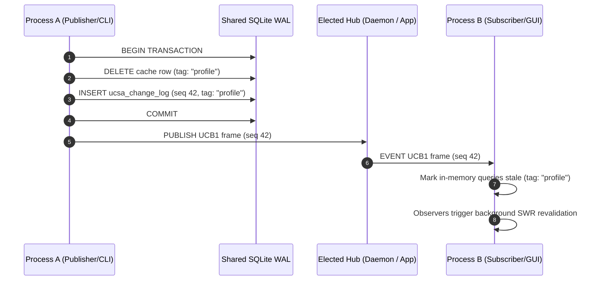
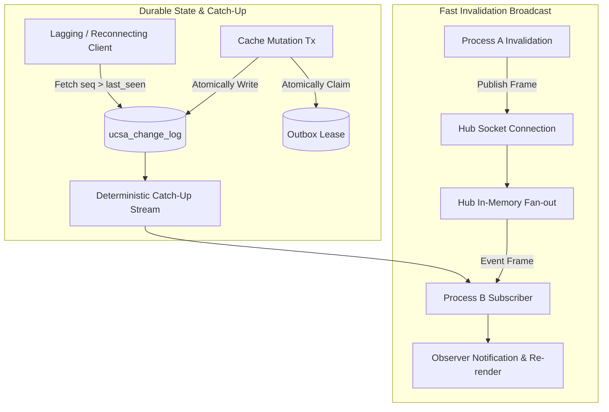

# Inter-Process Event Bus & Live Daemon (E-006)

## Outcome

Multiple independent processes sharing a UCSA SQLite database (e.g. background CLI commands, Node servers, desktop GUI apps) achieve instant cross-process state reactivity without polling:
1. **Durable Change Log & Catch-up (`ucsa_change_log`):** Invalidation and mutation lifecycle events are atomically written to SQLite in the same transaction as the state change. Reconnecting or lagging processes reliably catch up by monotonic sequence number (`seq`).
2. **Deterministic Wire Protocol (`UCB1`):** A fixed 12-byte header + UTF-8 JSON wire protocol supporting `HELLO`, `WELCOME`, `SUBSCRIBE`, `UNSUBSCRIBE`, `PUBLISH`, `EVENT`, `PING`, `PONG`, `RESYNC`, `BYE`, and `ERROR` with split-frame assembly and typed error boundaries.
3. **Elected Hub & Dedicated Daemon (`ucsa daemon`):** An elected in-process hub coordinating over Unix domain sockets (or Windows named pipes) with zero lock-file churn, atomic epoch takeover via `ucsa_bus_hub`, token authentication, and a standalone `ucsa daemon` CLI command.
4. **Outbox Lease Ownership & Safe WAL Checkpointing:** Distributed lease columns (`lease_owner`, `lease_until`) preventing duplicate mutation replay across concurrent processes, coupled with designated non-blocking WAL truncate checkpointing.





## Slices

1. `durable-change-log-catchup`: SQLite schema migration v3 (`ucsa_change_log`, `ucsa_bus_hub`, outbox lease columns), atomic log inserts on invalidations, sequence tracking, and catch-up reader.
2. `ucb1-ipc-frame-codec`: Fixed 12-byte header `UCB1` frame codec, split-boundary streaming decoder, typed protocol errors, and language-neutral conformance vectors.
3. `elected-hub-daemon`: Hub election state machine with database epoch lock, Unix domain socket / Windows named pipe listener, client token validation, slow consumer protection (`RESYNC`), and standalone `ucsa daemon` CLI command.
4. `cross-process-engine-leases`: Bus client wired into `QueryEngine` & `MutationOutbox`, outbox distributed lease claims (`lease_owner`, `lease_until`), designated non-blocking WAL checkpointer, and cross-process end-to-end integration tests.

## Architecture & Data Contracts

### 1. Schema Migration v3
```sql
CREATE TABLE IF NOT EXISTS ucsa_change_log (
  seq          INTEGER PRIMARY KEY AUTOINCREMENT,
  origin       TEXT    NOT NULL,
  kind         TEXT    NOT NULL CHECK (kind IN ('invalidate','mutation','stream','reset')),
  tags         TEXT,
  query_hashes TEXT,
  detail       TEXT,
  created_at   INTEGER NOT NULL
);
CREATE INDEX IF NOT EXISTS idx_ucsa_change_log_created ON ucsa_change_log(created_at);

CREATE TABLE IF NOT EXISTS ucsa_bus_hub (
  id           INTEGER PRIMARY KEY CHECK (id = 1),
  epoch        INTEGER NOT NULL,
  pid          INTEGER NOT NULL,
  endpoint     TEXT    NOT NULL,
  token        TEXT    NOT NULL,
  claimed_at   INTEGER NOT NULL
);

ALTER TABLE ucsa_mutation_outbox ADD COLUMN lease_owner TEXT;
ALTER TABLE ucsa_mutation_outbox ADD COLUMN lease_until INTEGER;
```

### 2. UCB1 Wire Protocol Specification
- Fixed 12-byte header:
  - 0..3: ASCII `"UCB1"`
  - 4: `type` (1 byte, e.g. 0x01 HELLO, 0x02 WELCOME, 0x03 SUBSCRIBE, 0x05 PUBLISH, 0x06 EVENT, 0x08 PING, 0x09 PONG, 0x0A RESYNC, 0x0B BYE, 0x0F ERROR)
  - 5: `flags` (1 byte, must be 0)
  - 6..7: `reserved` (2 bytes, must be 0)
  - 8..11: `payload_length` (4 bytes big-endian unsigned int, max 1,048,576 bytes)
- Followed by `payload_length` bytes of UTF-8 JSON.
