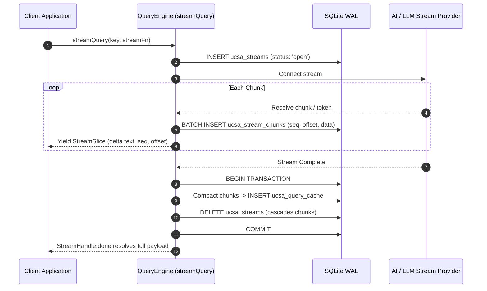

# Generative AI & LLM Token Streaming Engine (E-007)

## Outcome

Clients interacting with LLMs and generative AI APIs receive streaming responses with full persistent caching, crash-resilient chunk buffering, resume capabilities, and seamless cross-process visibility:
1. **Append-Only Chunk Store (`ucsa_streams`, `ucsa_stream_chunks`, `ucsa_stream_tags`):** Partial chunks are buffered into SQLite append-only tables without O(n²) string rewrites. When completed, chunks are atomically compacted into `ucsa_query_cache` (or CAS for large payloads >1MB) in a single transaction.
2. **Pluggable Resumable Streaming:** Automatic recovery from dropped streams using HTTP Range (`bytes=<offset>-`), SSE `Last-Event-ID`, application continuation callbacks, or clean restart with explicit observer reset semantics.
3. **Ergonomic Streaming Query API (`streamQuery`):** `QueryEngine.streamQuery()` returns an async iterable `StreamHandle` yielding incremental text/byte slices with UTF-8 character boundary protection, active cancellation (`AbortSignal`), and CLI `ucsa stream` command.
4. **Cross-Platform Parity:** Full support across TypeScript core, Dart/Flutter, and C# Unity with binary SQLite compatibility.



```mermaid
flowchart TD
  subgraph Fast Real-Time Streaming Pipeline
    Source[LLM / SSE Stream Source] -->|Chunks| StreamEngine[QueryEngine.streamQuery]
    StreamEngine -->|StreamSlice Async Iterable| UI[Consumer View / Terminal / Observer]
    StreamEngine --> Buffer[Chunk Coalescing Buffer (4KB / 50ms)]
  end

  subgraph Durable Persistence & Compaction Loop
    Buffer -->|Batch Flush| ChunksTable[(ucsa_stream_chunks)]
    ChunksTable --> Compactor[Compaction on Completion]
    Compactor --> CacheTable[(ucsa_query_cache)]
    Compactor -->|If > 1MB| CasStore[(CAS Package Store)]
  end
```

## Slices

1. `streaming-chunk-store`: Schema migration v4 (`ucsa_streams`, `ucsa_stream_chunks`, `ucsa_stream_tags`), atomic chunk appending, sequence/offset invariants, coalesced flushing, and atomic compaction.
2. `resumable-streaming-strategies`: Resumable streaming engine supporting HTTP Range (`bytes=<offset>-`), SSE `Last-Event-ID`, application `continuation`, and clean `restart` with explicit observer reset slices.
3. `stream-query-api`: Public `streamQuery` API, `StreamHandle` async iterable, multi-byte UTF-8 boundary assembly, cancellation via `AbortSignal`, and `ucsa stream` CLI command.
4. `cross-platform-streaming-parity`: Dart and C# Unity streaming implementations, documentation Section 12, full-chain verification, and release 1.7 promotion.

## Data Contracts & Migration v4

```sql
CREATE TABLE IF NOT EXISTS ucsa_streams (
  query_hash          TEXT PRIMARY KEY,
  query_key           TEXT NOT NULL,
  status              TEXT NOT NULL CHECK (status IN ('open','complete','aborted','error')),
  encoding            TEXT NOT NULL CHECK (encoding IN ('utf8','bytes')),
  next_seq            INTEGER NOT NULL DEFAULT 0,
  byte_length         INTEGER NOT NULL DEFAULT 0,
  resume_kind         TEXT CHECK (resume_kind IN ('range','last-event-id','continuation','restart')),
  resume_token        TEXT,
  etag                TEXT,
  writer_id           TEXT,
  writer_lease_until  INTEGER,
  payload_version     INTEGER NOT NULL DEFAULT 1,
  error               TEXT,
  created_at          INTEGER NOT NULL,
  updated_at          INTEGER NOT NULL,
  expires_at          INTEGER NOT NULL
);

CREATE TABLE IF NOT EXISTS ucsa_stream_chunks (
  query_hash          TEXT NOT NULL,
  seq                 INTEGER NOT NULL,
  byte_offset         INTEGER NOT NULL,
  data                BLOB NOT NULL,
  PRIMARY KEY (query_hash, seq),
  FOREIGN KEY (query_hash) REFERENCES ucsa_streams(query_hash) ON DELETE CASCADE
);

CREATE TABLE IF NOT EXISTS ucsa_stream_tags (
  tag                 TEXT NOT NULL,
  query_hash          TEXT NOT NULL,
  PRIMARY KEY (tag, query_hash),
  FOREIGN KEY (query_hash) REFERENCES ucsa_streams(query_hash) ON DELETE CASCADE
);
CREATE INDEX IF NOT EXISTS idx_ucsa_stream_tags_tag ON ucsa_stream_tags(tag);
```
