# UCSA reactive documentation and tutorial studio (E-008)

Source: `/tmp/handoff-ucsa-docs-reactive.md` (claimed 2026-10-09), a gap survey of `apps/docs`, and an independent audit of the first draft of this spec, all on the same day.

## Outcome

A developer opens the UCSA docs portal (`apps/docs`, package `@ucsa/docs`) and can learn every core subsystem by operating it, not by reading static snippets:

1. **Every subsystem has a live visualiser** — SWR lifecycle, timing, Outbox, CAS, SQLite WAL and the UCB1 event bus. Each one runs real `@ucsa/core` logic where that logic is browser-safe, and otherwise a small browser model that is plainly labelled "simulation" and pinned to the real module by a parity test.
2. **The portal is navigable and linkable** — sidebar navigation, a URL per page (hash routing), responsive dark layout from 360px to desktop.
3. **There is long-form tutorial content** — a guided path from "first query" to "offline mutations across processes", not just captions.
4. **Multi-platform guides are complete** — TypeScript, Dart/Flutter and C# Unity side by side for all six subsystems, with a parity matrix.
5. **There is an editable TypeScript sandbox** running against the browser-safe `@ucsa/core` entry. Dart and C# stay read-only (no in-browser runtime); the page says so.
6. **It is built, tested and documented** — `pnpm --filter @ucsa/docs test` and `build` pass, a GitHub Pages workflow file exists, and `README.md` plus the handoff document describe the portal as it actually is.

## Current state (verified 2026-10-09)

| Area | State |
| --- | --- |
| SWR, Timing playgrounds | Real `QueryEngine`; no state graph, no stale/gc timeline |
| Outbox, CAS playgrounds | Mocked; `MutationOutbox` and `cas-store` are bound to SQLite and `node:` modules |
| SQLite WAL, UCB1 event bus | No component at all |
| Multi-platform guide | Static code tabs for 5 topics; no WAL/UCB1, no parity matrix |
| App shell | `useState` story switcher, 5 stories, no router, no prose pages, ~164 lines of CSS |
| Tests / build | Fail repo-wide: Node is x64 but only the arm64 rollup/rolldown native bindings are installed |
| Gates | `precheck.sh` and `integration.sh` mark UI checks "n/a"; integration never runs `apps/docs` |
| Deploy | No `.github/` directory and no git remote; only the Vite `base` path is set |
| Epic gate | No `scripts/epic-check.sh` (the toolkit's default path; a missing script is skipped with a warning) |

## Design decisions

- **`@ucsa/core` is not modified.** None of the Node-side modules are browser-safe: `ipc/frame-codec.ts` uses the `Buffer` global, `storage/cas-lru.ts` and `cas-store.ts` need `better-sqlite3`, `node:fs` and `node:crypto`, and `mutation-outbox.ts` needs SQLite. Rather than port core or add a `Buffer` polyfill, each visualiser gets a **browser model inside `apps/docs/src/models/`** (`Uint8Array`/`DataView`, WebCrypto SHA-256, in-memory tables).
- **Parity tests keep the models honest.** Vitest runs in Node, so each model has a test that feeds the same fixtures to the real core module and asserts identical bytes, hashes or state transitions. Where no real module can run headless (the WAL pager), the model is pinned to the documented contract instead, and the page says "simulation".
- **`LifecycleFSM` is already browser-exported** but has no subscribe API or transition table and `QueryEngine` does not use it. The SWR state graph therefore drives its own FSM instance; its edges are hand-authored and tested against the FSM's methods.
- **File ownership for serial shipping.** Slice 2 introduces a `src/routes.ts` registry and per-page CSS files. Every later slice adds one registry line plus its own files, and does not otherwise edit `App.tsx` or `index.css`.
- **Dependencies.** No new runtime dependencies, with one declared exception: the sandbox lazy-loads `sucrase` to strip TypeScript, and runs user code in a sandboxed `iframe` (`sandbox="allow-scripts"`, no same-origin), never `eval` in the page.
- **Each slice ships with its own tests** in `apps/docs/tests/` and passes Gate 1 (`scripts/precheck.sh`, the pre-ship build and test check).
- **Out of scope:** in-browser Dart/C# execution, a search index, versioned docs, any change to `@ucsa/core` runtime code, a browser test runner (Playwright), and an actual GitHub Pages deploy (there is no git remote; only the workflow file is delivered).

## Waves

```mermaid
flowchart LR
  subgraph W0[Wave 0 · foundation]
    S1[S1 toolchain + gate slot]
  end
  subgraph W1[Wave 1 · shell]
    S2[S2 app shell, routes registry]
  end
  subgraph W2[Wave 2 · visualisers]
    S3[S3 UCB1 event bus]
    S4[S4 SQLite WAL]
    S5[S5 CAS model]
    S6[S6 Outbox model]
    S7[S7 SWR state graph + timeline]
  end
  subgraph W3[Wave 3 · content]
    S8[S8 guides, parity matrix, tutorial]
    S9[S9 TypeScript sandbox]
  end
  subgraph W4[Wave 4 · delivery]
    S10[S10 workflow, README, handoff, epic check]
  end
  W0 --> W1 --> W2 --> W3 --> W4
```

Slice 1 is a hard blocker for everything else: Gate 1 is red for the whole repo until the toolchain is fixed.

## Slices

1. **Docs toolchain and gate slot** — make the native bundler bindings match the running Node architecture (`supportedArchitectures` for both `x64` and `arm64` in the pnpm config, then reinstall) so root `pnpm test`, docs test and docs build pass; fill `precheck.sh` slot 3 with a real check for `apps/docs` (typecheck plus docs tests) instead of "n/a".
2. **App shell with hash routing and responsive layout** — `src/routes.ts` registry, ~40-line hash router, sidebar nav, deep links, not-found page, mobile drawer, design tokens, per-page CSS, a prose-page primitive; the five existing stories become registry entries; `tests/app-shell.test.tsx` covers every route id plus an unknown hash.
3. **UCB1 event bus visualiser** — browser frame codec model with a parity test against `ipc/frame-codec.ts`; byte-level header inspector (12-byte big-endian, magic `UCB1`); hub fan-out across simulated processes; malformed-frame handling.
4. **SQLite WAL storage visualiser** — simulated pager: main file, WAL frames, reader snapshots, checkpoint, crash recovery, journal-mode toggle; labelled simulation; model tests pinned to the behaviour documented for `sqlite-adapter.ts`.
5. **CAS playground on a tested model** — in-memory content-addressable store with WebCrypto SHA-256, dedupe, reference counts and LRU eviction; parity test against the real `cas-store` hashes; replaces the current hand-rolled simulation.
6. **Outbox playground on a tested model** — in-memory outbox with lease owner and expiry, rate limit, retry and conflict policy; parity test against `mutation-outbox.ts` transitions; replaces the current mock.
7. **SWR lifecycle state graph and stale/gc timeline** — graph of the five lifecycle states highlighting the current one, driven by its own `LifecycleFSM` instance, plus a timeline of fresh/stale/gc windows.
8. **Multi-platform guides, parity matrix and tutorial path** — WAL and UCB1 sections for TypeScript, Dart and C#; side-by-side view; parity matrix sourced from the three packages; long-form tutorial pages that embed the visualisers.
9. **Editable TypeScript sandbox** — editor plus runner against browser-safe `@ucsa/core`, lazy `sucrase`, sandboxed iframe, console capture, error display, preset examples.
10. **Workflow file, README, handoff and epic check** — `.github/workflows/docs.yml` (build only, validated as YAML); README portal section and test-count table regenerated; handoff document refreshed; `scripts/epic-check.sh` implementing `verification.md`; `integration.sh` runs the docs tests and build.
