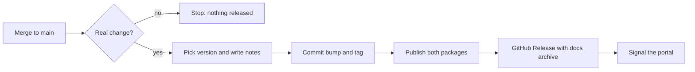
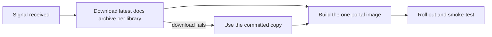

# Merge-to-release pipeline: publish, portal docs, release notes

<strong>In one sentence.</strong> Merging to <code>main</code> is the whole release: the libraries are versioned and published, the docs and playgrounds appear on the developer portal, and release notes are written, with no manual step.

## Outcome

Once every slice has shipped, a merge to `main` of `cli-state-handler` that contains a real change does all of the following without anyone touching a terminal:

1. Picks the next version of `@montionugera/ucsa-core` and `@montionugera/ucsa-cli` (they move together).
2. Writes the release notes into `CHANGELOG.md`, commits the bump back to `main`, and tags it.
3. Publishes both packages to npmjs.com through trusted publishing (no token).
4. Creates a GitHub Release carrying the notes and the built docs site as one archive.
5. Makes the developer portal at `https://dev.joymify.com/cli-state-handler/` serve that docs build, including a public "Release notes" page.

<strong>0</strong> manual steps per release

<strong>0</strong> extra servers in the cluster

<strong>3</strong> places release notes land

## Where we start verified 2026-10-09

| Area | Today |
| --- | --- |
| Publish | Works, token-free, but only when someone pushes a `v*` tag after bumping versions by hand (`.github/workflows/release.yml`; `v0.1.1` is live). |
| Docs and playgrounds | Built by `apps/docs` (Vite + React; playgrounds are components inside it). `.github/workflows/docs.yml` tries GitHub Pages on every merge and fails, because Pages is off. |
| Where docs really live | The `joy-design` repo serves `dev.joymify.com` from one web server in the cluster. It holds a hand-copied build of these docs in `apps/storybook-hub/portal-bundles/cli-state-handler`. Nothing refreshes it. |
| Release notes | None. No changelog, no GitHub Releases. |
| Release catalog | `.claude/refined_backlog/_catalog.json` lists every feature with `id`, `title` and `release_version`. It is the reliable record of what a planned release contains. The merge commit is titled `release 1.8` (older, direct promotes, empty body) or `release 1.9 (#N)` (pull-request promotes, body holding every commit message). At that commit the release's features already carry `release_version` with status `shipped`; they turn `promoted` one commit later. |
| Branch state | `release/1.9` forked before today's publishing work. It still has the old package name `@ucsa/core` and no `release.yml`. |

## Decisions

| Decision | Choice | Why |
| --- | --- | --- |
| What triggers a release | Every merge to `main` | Chosen by the user: add a feature, merge, done. |
| How docs reach the portal | The portal stays one server and downloads each library's docs archive when it builds | The user asked for a small memory footprint; a server per library was rejected for that reason. |
| Where notes go | `CHANGELOG.md`, a GitHub Release, and a page in the portal docs | The repo is private, so the portal page is the only copy outsiders can read. Default taken without asking. |
| Tooling | One small script in this repo, not an off-the-shelf release tool | Off-the-shelf tools read commit titles; a planned release here arrives as one commit titled `release 1.9`, so they would see nothing. The catalog has to be read. |

## How a release flows

Two separate flows, kept apart on purpose: the first must be fast and safe to re-run; the second is slower and may fail without undoing the first.

**Flow A: library release (this repo)**

**Flow B: portal refresh (`joy-design` repo)**

### Picking the version

The script looks at every commit on `main` since the last `v*` tag, not only the commit that started the run. GitHub keeps a single waiting run per queue, so a run started by a later housekeeping commit must still find the release commit before it.

- **Planned release** (a commit in that range titled `release X.Y` or `release X.Y (#N)`): the features in the catalog whose `release_version` is `X.Y`, whatever their status, are the notes. The commit body is ignored on this path. One or more features means a feature-level bump; a planned release with no features is a fix-level bump with the note "maintenance release".
- **Any other merge** (a hotfix or a direct pull request): the commit types in its title and body are the notes. `feat` is a feature-level bump, `fix` and `perf` are a fix-level bump.
- **Already bumped, not yet published** (the version in `package.json` has a tag but is missing from the registry): no new version; publish that one. This is what makes a re-run after a failed publish work.
- **Housekeeping only** (`chore`, `docs`, `ci`, `test`, and the workflow's own `finalize ... cleanup` commit): no release.
- **Breaking change** (a `!` after the type, or `BREAKING CHANGE` in the body): the next major version, except while the version is below 1.0, where it is a feature-level bump.

Both packages always get the same version.

### Committing the bump

The workflow commits `CHANGELOG.md` and the two `package.json` files back to `main` with `[skip ci]`, then tags `v<version>`. Because the planned-release flow pushes a second commit seconds after the merge, runs are queued one at a time and the workflow rebases onto the latest `main` before pushing. `main` has no branch protection or rulesets today, so the push is allowed once the workflow is given write access to repository contents.

<strong>Do not break the publishing trust.</strong> npmjs.com trusts the workflow file named <code>release.yml</code> with no environment. Changing its trigger is safe. Renaming the file, moving the publish step into a shared workflow, or adding an <code>environment:</code> to the job would make every publish fail.

<strong>Side effect to accept.</strong> <code>main</code> gains a commit the local release tooling did not make, so <code>psrw sync-main</code> is needed before starting the next release. The tooling already reports this as "behind origin/main".

### Handing the docs to the portal

The docs are built after the packages are published, so a docs problem can never block a library release. The build is archived from inside `apps/docs/dist` (it is already built for the `/cli-state-handler/` path) and attached to the GitHub Release as `docs-site.tgz`. The docs embed the released version in a small `version.json` so the portal can be checked for the right build. Then this repo starts the portal's deploy workflow.

On the portal side, a step in its pipeline, before the image is built, downloads the latest archive for each library and unpacks it over the committed copy in `apps/storybook-hub/portal-bundles/<library>`. The image build itself is unchanged. If the download fails, the committed copy is simply still there, so the docs section is never empty.

## Failure handling

| What fails | Result |
| --- | --- |
| Tests or build | Nothing is committed, tagged or published. |
| Publish | The bump commit and tag exist but the registry does not have the version. Starting the workflow again by hand on `main` hits the "already bumped, not yet published" rule and publishes it; a version already on the registry is skipped. |
| Docs build | Packages are published. No docs archive is attached and the portal is not signalled, so it keeps the previous docs. The run is red. |
| GitHub Release or signal | Packages are published. The run is red; starting it again repeats only the missing steps. |
| Portal build or rollout | The portal keeps serving the previous docs. The failure shows in `joy-design`, not here. |

## Slices

Before any slice: bring `release/1.9` up to date with `main` (`psrw sync-main`), because the publishing workflow and the package rename exist only on `main`.

1. Version and release-notes script: reads the commits since the last tag and the catalog, returns the next version and the changelog entry, covered by unit tests for every rule in "Picking the version".
2. Release-on-merge workflow: runs the script, commits the bump, tags, publishes, then builds the docs and creates the GitHub Release with `docs-site.tgz`; removes the tag trigger and the failing GitHub Pages workflow. Keeps the file name `release.yml` and adds no environment.
3. Release notes page in the docs site, rendered from `CHANGELOG.md`, plus the `version.json` marker.
4. Portal signal: start the `joy-design` deploy workflow after a successful release.
5. README and epic check: document the release flow and extend the existing `scripts/epic-check.sh` with the pre-merge assertions in `verification.md`.

**Needed from other repos (not slices of this epic):**

- `joy-design`: download docs archives in its pipeline before the image build, skip the Flutter build when the run was started by a library release (today a manually started run always builds Flutter), and make its production smoke test compare `version.json`. Tracked as its own work item there. Slice 4 and the portal assertion cannot be proven until it ships.
- An access credential that lets this repo start the portal workflow and lets the portal read this repo's releases; the built-in Actions token can do neither across repos. Only the repo owner can create it. The `gh-secrets` repo, which distributes such secrets, has no entry for either repo yet.

## Out of scope

- `node-server-decorator` adopting the same pipeline, and `joy-design` publishing its `@joymify` packages to npmjs.com. Both are agreed goals with their own specs to follow. Publishing `@joymify` packages first needs proof that the `@joymify` name on npmjs.com belongs to the owner.
- The docs visual design and navigation, owned by separate work in `fix/docs-design-nav`.
- `zen-ui`.

## Open points to settle inside the slices

- The narrowest permission the credential needs to start a workflow in another private repo (slice 4).
- When one release is promoted and the next is started in a single chain, the next release branch is cut before the bump commit lands, so it starts one commit behind `main`. Accepted; `psrw sync-main` closes it.
- No architecture drawing in draw.io format was produced for this spec; the two flowcharts above are its diagrams.

## Appendix — audit trail

- 2026-10-09 self-grill-audit: verdict safe-with-fixes. Corrected: release commit title now matches both promote styles; version is derived from all commits since the last tag (a queued run could otherwise be replaced and a release dropped); added the "already bumped, not yet published" rule so re-runs work; added syncing `release/1.9` with `main` as a precondition; recorded the `release.yml` file-name constraint of the npm trust; moved the docs build after publish and added it to the failure table; portal download moved to a pipeline step before the image build; added `version.json` so the portal build is checkable; `verification.md` split into pre-merge and post-merge checks; catalog open point closed (confirmed on the 1.8 merge commit). Spot-checked by the author: stale `release/1.9`, existing `scripts/epic-check.sh`, squash-merge setting. Not independently re-checked: the claim that the release tool runs the epic check before the merge.
  Open: the cross-repo credential (owner must create it); `joy-design` work item not yet opened.
