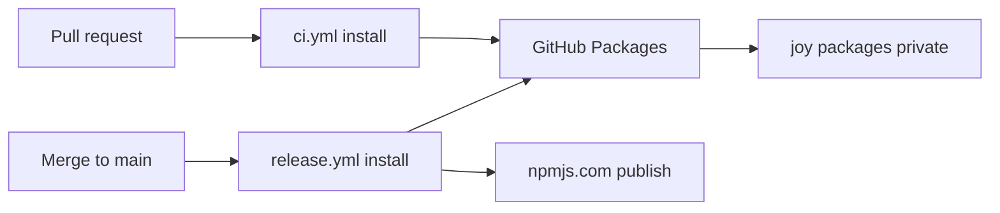
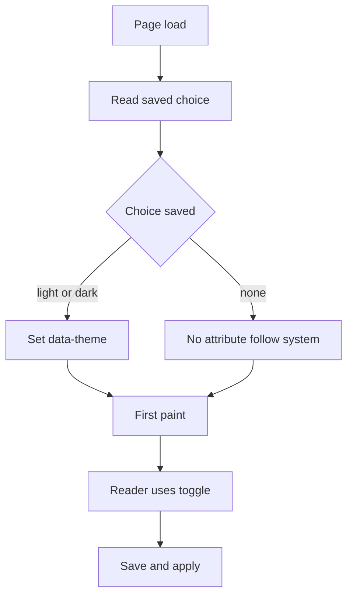

# Adopt the Joymify design system in the docs portal

## Goal

Owner's words: "using its design system for build doc not move into that repo".

The docs portal in this repository (`apps/docs`, package `@ucsa/docs`, React 19 + Vite, hash routes) is built with the Joymify design system, installed as published packages from GitHub Packages. The portal stays in `cli-state-handler`. It gets a light and a dark theme with a toggle, renders markdown through the Joymify markdown component, and renders Mermaid diagrams.

## Scope and non-goals

In scope:

- Replace the sibling-checkout aliases with registry dependencies on `@montionugera/joy-react` 0.2.0 and `@montionugera/joy-tokens` 0.2.0 (which pull in `@montionugera/joy-icons` 0.3.0 and `@montionugera/joy-brand` 0.2.0).
- A repository `.npmrc`, and package access for the two GitHub Actions workflows (`ci.yml`, `release.yml`).
- Pinning the three npm registry calls of the release pipeline, and the two library manifests, to npmjs.com so the new scope mapping cannot redirect them (same destination as today; see "Scope collision").
- Light and dark themes, a toggle that remembers the choice, no flash of the wrong theme on load.
- Self-hosted fonts (Inter, JetBrains Mono) inside the build output. No font CDN.
- Code samples, platform snippet tabs, markdown content and Mermaid diagrams rendered by Joymify components.
- README update for the new install requirement.

Non-goals:

- Moving the portal into the `joy-design` repository, vendoring Joymify source, or linking a sibling checkout.
- Changing routes, page content, the playground models, or the sandbox.
- Changing where or how `@montionugera/ucsa-core` and `@montionugera/ucsa-cli` are published (npmjs.com, trusted publishing, `release.yml` not renamed, no `environment:`).
- Adding the full `mermaid` npm library, or a general markdown library, inside this repository. Gaps in the Joymify components are fixed upstream in `joy-design` (platform rule: enhance upstream, never shim in the consumer).
- A markdown editor in the portal. `MarkdownEditor` is exported upstream but nothing in the portal is edited by readers.

## Current state

Verified by reading the code on 2026-10-09, not taken from reports.

**Base branch.** `fix/docs-design-nav` (worktree `../cli-state-handler-fix-docs-design`) holds two commits, `68ad8b7` and `69f8c42`, on top of an older main `407ca76`. Main is now `3f6a81c`; release branch `release/1.10` starts from it. Since `407ca76`, main changed nine files under `apps/docs` (a Release notes page, a `version-json` Vite plugin, `MultiPlatformDocs.tsx`, `routes.ts`, two new test files).

**How the base branch reaches Joymify.** `apps/docs/joy-alias.ts` maps the old names `@joymify/react`, `@joymify/icons/react`, `@joymify/brand`, `@joymify/tokens/theme.css` to `../../../joy-design/packages/...`. The aliases are spread into `vite.config.ts` and `vitest.config.ts`, and repeated as `paths` in `apps/docs/tsconfig.json` (plus two `react` type paths that exist only to stop duplicate React types from the sibling checkout). Nine source files import from `@joymify/react`; `main.tsx` imports `@joymify/tokens/theme.css`. The package names were since renamed upstream, so this wiring is broken twice over: wrong names, and no sibling checkout in CI.

**Theme.** `apps/docs/index.html` hard-codes `<html data-theme="dark">`. `src/index.css` maps the portal's own variables (`--bg-main`, `--text-main`, ...) onto `--joy-*` tokens, so most colours already follow the theme. Leftovers: 54 inline `style={{...}}` props in components and one hard-coded colour (`--scrim: rgba(0, 0, 0, 0.6)`).

**Fonts.** The tokens stylesheet names `Inter` and `JetBrains Mono` but ships no `@font-face`. Nothing loads the font files today, so the portal falls back to system fonts.

**Markdown, code, diagrams.** There is no markdown rendering today. Tutorial pages are hand-written TSX wrapped in `Prose` (`src/components/Prose.tsx`, which also defines a plain `Callout` and an unhighlighted `CodeBlock`). Platform snippets are plain `<pre class="mp-code">` blocks in `MultiPlatformDocs.tsx`. Release notes parse the repo-root `CHANGELOG.md` with a small hand-written parser (`src/models/changelog.ts`). No file under `apps/docs/src` mentions Mermaid.

**Sidebar.** Still main's anchor sidebar in `App.tsx`: real `<a href="#/...">` links with `aria-current="page"`, a phone drawer with focus handling, `inert`, Escape to close.

**CI.** There is no `docs.yml` any more; main deleted it. Two workflows remain:

- `ci.yml` runs on every pull request to main, `permissions: contents: read`, and states "no secrets". It runs `pnpm install --frozen-lockfile` then `scripts/precheck.sh` (the pre-ship build, typecheck and test check, which includes `apps/docs`).
- `release.yml` runs on every merge to main. It runs `pnpm install --frozen-lockfile` for the whole workspace, publishes the two libraries to npmjs.com through trusted publishing (no stored token), then builds the docs archive `docs-site.tgz` that the Joymify developer portal copies.

The repository has no Actions secrets at all (`gh secret list` is empty).

**Registry calls in the release pipeline (three, not two).** All run with the repository root as working directory, so all read a root `.npmrc`:

1. `scripts/release/next-release.mjs` line 41, `npm view <name>@<version> version`, in the "Decide release" step. It runs on **every** merge to main. Only an `E404` counts as "not published"; any other failure throws and stops the run.
2. `release.yml`, "Publish to npmjs.com" step: `npm view "$name@$version" version` (any failure is read as "not published").
3. Same step: `npm publish "$RUNNER_TEMP"/npmjs/*.tgz --access public`.

`packages/core/package.json` and `apps/cli/package.json` already carry `publishConfig: { "access": "public", "registry": "https://registry.npmjs.org" }`. The README (around line 2672) also documents a manual `npm publish` recipe run from the repository root. Nothing in the repository installs `@montionugera/ucsa-*` from a registry: `apps/cli` and `apps/docs` use `workspace:*`, and there are no examples or smoke tests that install the published libraries.

**Other install sites.** Besides the two workflows, `scripts/precheck.sh` line 67 and `scripts/epic-check.sh` line 15 run `pnpm install` locally. Root `pnpm test` (used by `release.yml` "Unit tests" and by `precheck.sh`) runs the `apps/docs` tests too, so the docs dependencies are needed wherever tests run.

**Tool versions.** Both workflows pin `pnpm/action-setup` to `version: 10` (major only); the root `package.json` has no `packageManager` field; the local machine has pnpm 10.13.1. `release.yml` installs `npm@^11.5.1` for publishing.

**Packages.** `gh api /users/montionugera/packages/npm/joy-react` reports: one version `0.2.0`, visibility **private**, linked to the private repository `montionugera/joy-design`. `cli-state-handler` is also private.

**What `@montionugera/joy-react` 0.2.0 exports** (read from `joy-design` main `02b1dfc8`, `packages/react/src/index.ts`; single entry point `"."`, `sideEffects: false`, peers `react` and `react-dom` `^19.0.0`):

| Need | Export | Notes from the source |
| --- | --- | --- |
| Markdown | `MarkdownViewer` (`content`, `allowCopy`) | Hand-written line parser: headings 1-3, paragraphs, block quotes, tables, rules, fenced code, inline code, bold, italic. A `mermaid` fence is passed to `MermaidViewer`. **No lists, no links, no images.** |
| Diagrams | `MermaidViewer` (`code`, `title`, `initialView`, `allowToggle`, `allowCopy`), `renderMermaidToSvg` | Zero-dependency renderer written in-house. **Flowcharts and sequence diagrams only.** |
| Code | `CodeBlock` (`code`, `language`, `title`, `showLineNumbers`, `allowCopy`), `PolyglotCodeTabs` (`items`, `activeKey`, `onChange`), `highlightCodeToHtml`, `tokenizeCode`, `normalizeLanguage` | Built-in highlighter, no external library. |
| Theme control | none | No provider or hook. Theming is pure CSS in `@montionugera/joy-tokens/theme.css`. `Segmented` and `Switch` are available for the control itself. |
| Navigation | `Menu`, `Anchor`, `Breadcrumb` | `Menu` renders `role="menuitem"` list items with an `onSelect` callback, not links. |

The tarball itself could not be opened here (`npm view` returns 401 without a token); the table is the source that version 0.2.0 was built from.

## Design

### Dependencies and `.npmrc`

Add to `apps/docs/package.json` dependencies: `@montionugera/joy-react` `^0.2.0` and `@montionugera/joy-tokens` `^0.2.0` (the stylesheet import needs tokens as a direct dependency under pnpm's strict layout). `joy-icons` and `joy-brand` arrive as dependencies of `joy-react`.

Add a repository-root `.npmrc` with the scope mapping only:

```
@montionugera:registry=https://npm.pkg.github.com
```

The token line does **not** go in the committed file. It goes in the user-level npm config (`~/.npmrc` locally; the file named by `NPM_CONFIG_USERCONFIG` on a runner), as the literal text `//npm.pkg.github.com/:_authToken=${GITHUB_TOKEN}`, so the token itself is never written to disk and is only present where `GITHUB_TOKEN` is exported.

<div class="callout warn">
<strong>Why not a token line in the repository <code>.npmrc</code>.</strong> pnpm stopped expanding <code>${NAME}</code> in the project-level <code>.npmrc</code> for credentials and registry URLs in v11.5.3: such a line is ignored with a warning (security advisory GHSA-3qhv-2rgh-x77r; source: pnpm.io/npmrc). CI pins pnpm to major 10 only and nothing pins contributors, so a committed <code>_authToken=${GITHUB_TOKEN}</code> line works today and fails with 401 after any move to pnpm 11. User-level config still expands placeholders on every pnpm and npm version. The scope mapping line has no placeholder, so it is unaffected.
</div>

<div class="callout danger">
<strong>Scope collision.</strong> This repository's own libraries are <code>@montionugera/ucsa-core</code> and <code>@montionugera/ucsa-cli</code>, published to npmjs.com. They share the <code>@montionugera</code> scope with the Joymify packages on GitHub Packages. A registry mapping is per scope, not per package. npm picks the registry for a scoped package as: the <code>@scope:registry</code> setting first, and only if there is none, the plain <code>registry</code> setting. Both <code>--registry</code> and <code>publishConfig.registry</code> set the plain <code>registry</code>, so <strong>neither can override a scope mapping</strong>; the <code>publishConfig.registry</code> already present in both manifests does not protect them. Left alone, the new <code>.npmrc</code> points all three registry calls at GitHub Packages. The first to break is the "Decide release" lookup: GitHub Packages answers 401 without a token, the script throws, and the release workflow goes red on every merge to main.
</div>

Sources for the precedence: `pickRegistry` in `npm/npm-registry-fetch` `lib/index.js` (scope mapping, then `registry`); `#getManifest` in `npm/cli` `lib/commands/publish.js` (publishConfig is flattened into the options, minus any key given as a command-line flag); `flatten` in `npm/cli` `workspaces/config/lib/definitions/index.js` (keys matching `@…:registry` are accepted); npm config docs (command line, then environment, then project, user, global). Read from source on 2026-10-09. A local dry-run probe was not permitted in the audit session, so the acceptance checks below are the empirical proof.

Fix, two layers, both keeping npmjs.com as the destination:

1. **Bind the target to the packages.** In `packages/core/package.json` and `apps/cli/package.json`, add the key `"@montionugera:registry": "https://registry.npmjs.org/"` to the existing `publishConfig`. npm applies publishConfig on top of the project `.npmrc` at publish time, so every `npm publish` of these two packages goes to npmjs.com whichever line or person runs it, including the README's manual recipe. This covers publish only.
2. **Explicit flag on every registry call.** `--@montionugera:registry=https://registry.npmjs.org/` on all three calls listed in "Current state": the `npm view` arguments in `scripts/release/next-release.mjs`, and the `npm view` and `npm publish` lines in `release.yml`. A command-line flag outranks the project `.npmrc`. `npm view` reads no manifest, so the flag is the only thing protecting the two lookups.

The publish step is edited in place; the file is not renamed and no `environment:` is added, so trusted publishing keeps working (the token exchange uses the registry npm picked, which stays npmjs.com). `pnpm install` of the workspace is unaffected: `workspace:*` never touches a registry, and no script installs the published libraries.

### Alias removal

- Delete `apps/docs/joy-alias.ts`; remove it from `vite.config.ts` and `vitest.config.ts`, along with `resolve.dedupe` (one React copy once the sibling checkout is gone).
- Remove the four `@joymify/*` paths and the two `react` paths from `apps/docs/tsconfig.json`, returning it to main's single `@montionugera/ucsa-core` path.
- Rename imports: `@joymify/react` to `@montionugera/joy-react`, `@joymify/tokens/theme.css` to `@montionugera/joy-tokens/theme.css`.
- Root `pnpm typecheck` then resolves the packages through `apps/docs/node_modules` with no extra configuration.

### CI package access



Both workflows install the whole workspace, so both need read access to four private packages owned by another repository. Chosen approach (option A): on each of the four packages, in Package settings, "Manage Actions access", add `montionugera/cli-state-handler` with Read. Then both workflows add `packages: read` to `permissions`, add one step before install that appends the literal line `//npm.pkg.github.com/:_authToken=${GITHUB_TOKEN}` to the user-level config (`"${NPM_CONFIG_USERCONFIG:-$HOME/.npmrc}"`; `release.yml` has that variable set by `actions/setup-node`), and pass `GITHUB_TOKEN: ${{ github.token }}` as `env` on the install step only. No stored secret; `ci.yml` stays secret-free.

Coverage: the only two jobs that run `pnpm install` are `precheck` in `ci.yml` and `publish` in `release.yml`; both are covered. No later step installs (`pnpm pack`, `pnpm --filter ... build` and `pnpm test` do not fetch). `scripts/precheck.sh` re-runs `pnpm install` inside the CI job after the install step; with the store already filled it fetches nothing, so it needs no token there.

Two consequences the owner should know about:

- **Write-capable token in the install step of `release.yml`.** That job's token has `contents: write` and `id-token: write`, and the workflow today keeps it out of install, build and test on purpose (its own comment says so). Passing it to install exposes it to dependency install scripts. Exposure is limited because pnpm 10 runs install scripts only for the allowlist in `pnpm-workspace.yaml` (`better-sqlite3`, `esbuild`). Option B (a read-only token) removes the exposure at the cost of a stored secret.
- **Library publishing now depends on GitHub Packages.** The whole-workspace install runs before publish, and root `pnpm test` includes the docs tests, so a revoked grant or a GitHub Packages outage blocks an npm release, against the workflow's stated intent that a docs break must not block one. Recovery is the existing manual re-run of the Release workflow once access is back. Decoupling (installing only the libraries before publish and the docs afterwards) would need the release test scope split and is left as a separate idea. Fallback (option B): a classic personal access token with `read:packages` stored as the secret `JOY_PACKAGES_TOKEN` and passed as `GITHUB_TOKEN` on the install step; it expires and must be rotated, so it is second choice.

### Theme tokens and toggle

The tokens stylesheet already does the work: `[data-theme="dark"]` forces dark, `[data-theme="light"]` forces light, and with no attribute it follows the system setting.



- Remove the hard-coded `data-theme="dark"` from `index.html`. Add a small inline script in `<head>`, before any stylesheet, that reads `localStorage["ucsa-docs-theme"]` inside `try/catch` and sets `data-theme` when the value is `light` or `dark`. Running before first paint is what prevents the flash.
- Toggle: a Joymify `Segmented` control with three options, System, Light, Dark, in the sidebar brand block and reachable in the phone drawer. System removes the attribute and the saved key.
- Move the 54 inline styles that carry colours, and the `--scrim` colour, onto `--joy-*` tokens so both themes are legible.

### Fonts

Add `@fontsource-variable/inter` and `@fontsource-variable/jetbrains-mono` (npmjs.com) and import them in `main.tsx`. Vite copies the font files into `apps/docs/dist/assets`, so the archive stays self-contained and no request leaves the origin.

### Component mapping

| Today | Becomes | Phase |
| --- | --- | --- |
| `Button`, `Badge`, `Input`, `MetricTile` via `@joymify/react` | same components via `@montionugera/joy-react` | 1 |
| `CodeBlock` in `Prose.tsx` (plain `<pre>`) | Joymify `CodeBlock` with highlighting and copy | 2 |
| `<pre class="mp-code">` per platform in `MultiPlatformDocs.tsx` | Joymify `PolyglotCodeTabs` (TypeScript, Dart, C#) where a guide shows all three; `CodeBlock` for single snippets | 2 |
| `Callout` in `Prose.tsx` | Joymify `Alert` | 2 |
| No diagrams | `MermaidViewer`, directly or through a `mermaid` fence in markdown | 2 |
| `ReleaseNotes` hand parser over `CHANGELOG.md` | `MarkdownViewer` with the raw changelog | 3 |
| Tutorial prose in TSX inside `Prose` | markdown segments (`.md` imported with `?raw`) rendered by `MarkdownViewer` between the live playgrounds | 3 |

Phase 3 is gated: `CHANGELOG.md` is all bullet lists and the tutorial prose uses lists and links, which `MarkdownViewer` 0.2.0 does not render. Lists and links are added upstream in `joy-design` (React and Svelte twins) and released first; until then `ReleaseNotes` and `Prose` stay as they are. Phases 1 and 2 do not wait for it.

To satisfy "Mermaid must render" in phase 2 without waiting, the Overview page gains one flowchart of the request path (cache, write-ahead log, outbox) through `MermaidViewer`.

### Sidebar decision

Keep the existing anchor sidebar, styled with tokens. The Joymify `Menu` renders menu items with a callback, not links: adopting it would lose open-in-new-tab, `aria-current="page"`, and the tested drawer focus handling. If a link-based navigation component is wanted, that is an upstream request, filed separately.

### Bundle size

- No Mermaid library is added: the upstream renderer is in-house code (about 740 lines), so the cost is small.
- `joy-react` has one entry point and `sideEffects: false`; Vite drops unused components.
- The markdown, code and diagram components are loaded with `React.lazy` from a single wrapper module, so the first page does not pay for them.
- The tokens stylesheet is about 240 kB before compression and covers every Joymify component. It is accepted as is; the gzip size is recorded in the pull request.

## Testing

- **Baseline.** Record the passing docs test count on the rebased branch before any change (320 on the old base, plus main's two new test files). That number never drops. A test may be edited only where it asserts markup a Joymify component replaced; none is deleted.
- **New unit tests (Vitest + jsdom):** the toggle sets and clears `data-theme` and the saved key; the saved choice is applied on load; storage that throws does not break render; `CodeBlock` output contains highlight spans; a flowchart source produces an `<svg>`; an unsupported diagram type shows its source and does not throw.
- **Release safety test:** with the root `.npmrc` in place, a dry run of the publish step and a real `npm view` prove the libraries still resolve to npmjs.com, and a negative control (same commands without the flag and without the publishConfig key) shows GitHub Packages, proving the test can fail. A unit test in `scripts/release/lib.test.mjs` (or beside it) asserts the `npm view` arguments built by the release script include the scope flag.
- **Browser check:** every route in `src/routes.ts` at 360px and 1280px, in light and in dark: no horizontal page scroll, drawer opens and closes at 360px, no console errors, text legible on every surface.

## Risks and open questions

- **CI package access (highest risk).** The default token of `cli-state-handler` cannot read private packages owned by `joy-design` until each of the four packages grants this repository access. This is a manual step by the owner in GitHub settings, and it is not verifiable from a local machine. If it is missed, `release.yml` fails at install, which **blocks library publishing**, not just the docs. Mitigation: the same install runs in `ci.yml` on the pull request, so a red check appears before merge. Do not merge on a red or skipped install.
- **Scope collision.** Covered in the design by two layers; the checks below are the guard. A fourth registry call added later without the flag would be redirected silently, so the acceptance grep lists every call. If either layer proves insufficient on the runner's npm, the fallback is to run the npm commands from a temporary directory that has no project `.npmrc`.
- **First merge is the real test.** Trusted publishing cannot be exercised before merge. The first merge to main after phase 1a must be watched: "Decide release" green, and a publish (if one is due) landing on npmjs.com. Undo is a revert of the phase 1a commit, which removes the `.npmrc`.
- **pnpm major upgrade.** A committed token line would stop working on pnpm 11.5.3 or later; the design avoids it by keeping the token line in user-level config.
- **Tarball contents.** `joy-react` source declares its siblings as `workspace:*`. The published 0.2.0 must list real versions; if it does not, install fails and the fix is upstream.
- **Local installs now need a token.** `pnpm install` fails with 401 unless the user-level `~/.npmrc` has the token line and `GITHUB_TOKEN` holds a token with `read:packages` (for example `export GITHUB_TOKEN=$(gh auth token)`; the token needs the `read:packages` or `write:packages` scope, added with `gh auth refresh -s read:packages` if missing). This affects every contributor and every agent worktree, including work unrelated to docs, and the local gates `scripts/precheck.sh` and `scripts/epic-check.sh`. The README must give the one-time setup.
- **Markdown and Mermaid coverage.** No lists, links or images; flowcharts and sequence diagrams only. Phase 3 depends on an upstream release.
- **Rebase conflicts.** `vite.config.ts`, `MultiPlatformDocs.tsx` and `routes.ts` changed on both sides.
- **Worktree ownership.** The base worktree is owned by another session; the feature claim must take it over rather than edit beside it.
- **Open question for the owner:** option A (grant repository access, no secret) is assumed, which also means accepting the write-capable job token in the install step of `release.yml` and the dependency of library publishing on GitHub Packages (both described under "CI package access"). Say so if a stored read-only token (option B) is preferred.

## Rollout

Each phase is shippable alone: after it, `main` builds, tests pass, and the release pipeline still publishes to npmjs.com.

0. Prerequisite, not a code change: owner grants `cli-state-handler` read access on the four packages (option A). Nothing merges before this, because the install in `ci.yml` cannot go green without it.
1. Rebase `fix/docs-design-nav` onto `release/1.10`; resolve conflicts; record the test baseline.
2. **Phase 1a, wiring.** Registry dependencies, `.npmrc`, the registry pinning (publishConfig key and the three flags), alias removal, workflow changes, README. Open a draft pull request first to prove the install in `ci.yml`. The portal looks as it does on the base branch (dark only). Ships alone.
3. **Phase 1b, themes.** Toggle, no-flash script, fonts, inline styles onto tokens. Depends on 1a only.
4. **Phase 2, code and diagrams.** `CodeBlock`, `PolyglotCodeTabs`, `Alert`, the Overview diagram, lazy loading. Depends on 1a only.
5. **Phase 3**, a separate feature after the upstream release: markdown for release notes and tutorial prose. It gets its own acceptance criteria when it is specified; none below belong to it.

Each phase ends with verify, independent review, refactor, re-verify. Undo is a revert of the phase's commits; nothing is published or migrated.

## Acceptance criteria

Phase 1a, wiring:

- [ ] `test ! -e apps/docs/joy-alias.ts` succeeds, and `grep -rn -E "@joymify/|joy-design/packages" apps/docs --include='*.ts' --include='*.tsx' --include='*.json' --exclude-dir=node_modules` prints nothing.
- [ ] `grep -n "joy-" apps/docs/package.json` shows `@montionugera/joy-react` and `@montionugera/joy-tokens` with version ranges, not `workspace:` or `link:`.
- [ ] `cat .npmrc` shows the `@montionugera:registry` line, and `grep -c '_authToken' .npmrc` prints 0.
- [ ] With the user-level token line and `GITHUB_TOKEN` set, `pnpm install --frozen-lockfile` exits 0 on a fresh clone that has no sibling `joy-design` directory, and `node -p "require('./apps/docs/node_modules/@montionugera/joy-react/package.json').version"` prints `0.2.0`.
- [ ] `pnpm typecheck` at the repository root exits 0.
- [ ] `bash scripts/precheck.sh` exits 0.
- [ ] `pnpm --filter @ucsa/docs test` exits 0 with a passing count no lower than the baseline recorded after the rebase.
- [ ] `pnpm --filter @ucsa/docs build` exits 0.
- [ ] The pull request's `ci.yml` run is green (the runner has no cache and no sibling checkout, so a green install proves the registry fetch), and `grep -c "npm.pkg.github.com" .github/workflows/ci.yml .github/workflows/release.yml` is at least 1 in each file.
- [ ] `grep -n "packages: read" .github/workflows/ci.yml .github/workflows/release.yml` matches in both files, `gh secret list` shows no new secret (option A), and in each file `GITHUB_TOKEN` appears as `env` on the install step only (plus the existing commit step in `release.yml`).
- [ ] `grep -n '@montionugera:registry' packages/core/package.json apps/cli/package.json` shows `https://registry.npmjs.org/` inside `publishConfig` in both files.
- [ ] `grep -rn -E "npm publish |npm view \"|\['view'" .github/workflows scripts/release --include='*.yml' --include='*.mjs' --exclude='*.test.mjs'` lists exactly three lines (today: `release.yml` 111 and 117, `next-release.mjs` 41), and each of those lines contains `@montionugera:registry=https://registry.npmjs.org/`.
- [ ] From the repository root with the new `.npmrc` present and `GITHUB_TOKEN` unset, `npm view @montionugera/ucsa-core version --@montionugera:registry=https://registry.npmjs.org/` prints a version; the same command without the flag fails (negative control).
- [ ] From the repository root, `npm publish --dry-run` on a tarball made by `pnpm pack` in `packages/core`, once with the flag and once without it, prints `registry.npmjs.org` as the target both times (the second run proves the publishConfig key survives `pnpm pack`).
- [ ] From the repository root with `GITHUB_TOKEN` unset, `node scripts/release/next-release.mjs` (no `--apply`) exits 0.
- [ ] `bash scripts/epic-check.sh E-009` still passes its release-workflow assertions.
- [ ] After the merge to main, the Release workflow run is green through "Decide release", and `npm view @montionugera/ucsa-core version --registry=https://registry.npmjs.org/` run outside the repository still prints the latest released version.
- [ ] `grep -n -E "GITHUB_TOKEN|read:packages" README.md` shows the install instructions.

Phase 1b, themes:

- [ ] `grep -c 'data-theme="dark"' apps/docs/index.html` prints 0.
- [ ] New tests named for the theme toggle pass: choosing Dark sets `data-theme="dark"` and saves it; choosing System removes both; a saved choice is applied on load.
- [ ] In a browser with the system set to dark and a saved choice of Light, a hard reload never shows a dark frame (checked with a throttled reload).
- [ ] `ls apps/docs/dist/assets | grep -c -E "\.woff2$"` prints at least 2, and `grep -rn -E "fonts\.googleapis|fonts\.gstatic" apps/docs/dist` prints nothing.
- [ ] Every route in `apps/docs/src/routes.ts`, at 360px and at 1280px, in light and in dark: `document.documentElement.scrollWidth <= window.innerWidth` and the console shows no errors.

Phase 2, code and diagrams:

- [ ] New tests pass: Joymify `CodeBlock` output contains at least one `joy-syntax-` span; `MermaidViewer` with a flowchart source renders an `svg` element.
- [ ] The Overview route shows a rendered diagram (an `svg`, not raw text) in both themes.
- [ ] `grep -l "joy-mermaid" apps/docs/dist/assets/*.js` lists a file that is not the entry chunk named in `apps/docs/dist/index.html`.
- [ ] The route check above (360px and 1280px, light and dark, no horizontal scroll, no console errors) is repeated and passes.

## Appendix: audit trail

- 2026-10-09 self-grill-audit (independent, read against the source tree): verdict **safe with fixes**. Corrected:
  - CRITICAL: the spec pinned two registry calls; there are three. `scripts/release/next-release.mjs` runs `npm view` on every merge to main and throws on anything but `E404`, so the scope mapping would have turned the release workflow red on every merge. Added to current state, design and acceptance criteria.
  - HIGH: the committed token line `_authToken=${GITHUB_TOKEN}` relies on placeholder expansion that pnpm removed from project-level `.npmrc` in v11.5.3 (pnpm.io/npmrc). Moved the token line to user-level config; the committed file keeps only the scope mapping.
  - HIGH: the manifests already had `publishConfig.registry` and it does not override a scope mapping (npm-registry-fetch `pickRegistry`). Added the `@montionugera:registry` key to `publishConfig` as a second layer, so manual publishes are covered too.
  - HIGH: the release safety check had no `npm view` check, no negative control and no post-merge check. Added.
  - HIGH: acceptance criterion "install log shows packages fetched from npm.pkg.github.com" is not observable (pnpm does not log registry hosts). Replaced with a green uncached run plus the installed version.
  - HIGH: two rollout steps were both "Phase 1" and the criteria were not tied to phases. Split into 1a and 1b, stated what each depends on, grouped the criteria by phase.
  - Recorded, not changed: the write-capable job token reaches the install step of `release.yml`; library publishing now depends on GitHub Packages. Both are owner decisions under option A.
  - LOW: nine files import `@joymify/react`, not eight. The count of 54 inline styles is all inline styles on the base branch, not only those carrying colours.
  - Confirmed without change: every named export exists in `joy-design` `packages/react/src/index.ts` at `02b1dfc8`; `MarkdownViewer` has no lists, links or images; the diagram renderer handles flowchart or graph and sequence diagrams only; both jobs that run `pnpm install` are covered; nothing installs `@montionugera/ucsa-*` from a registry.
  - Not verified: a local `npm publish --dry-run` probe was not permitted in the audit session, so the precedence facts rest on npm and pnpm source and docs; the phase 1a criteria prove them. Whether pnpm keeps `publishConfig` in a packed tarball, and the GitHub "Manage Actions access" grant, are likewise proved only by those criteria.
  - Open: option A versus a stored read-only token (see "Risks and open questions").
