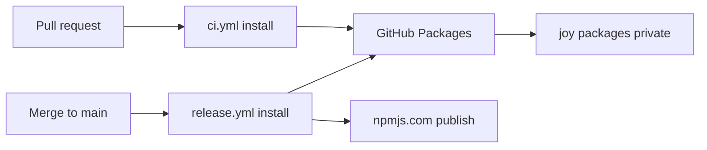
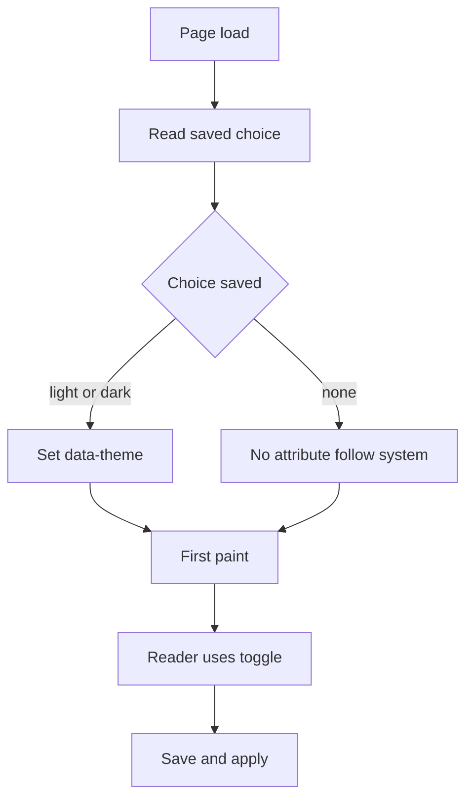

# Adopt the Joymify design system in the docs portal

## Goal

Owner's words: "using its design system for build doc not move into that repo".

The docs portal in this repository (`apps/docs`, package `@ucsa/docs`, React 19 + Vite, hash routes) is built with the Joymify design system, installed as published packages from GitHub Packages. The portal stays in `cli-state-handler`. It gets a light and a dark theme with a toggle, renders markdown through the Joymify markdown component, and renders Mermaid diagrams.

## Scope and non-goals

In scope:

- Replace the sibling-checkout aliases with registry dependencies on `@montionugera/joy-react` 0.2.0 and `@montionugera/joy-tokens` 0.2.0 (which pull in `@montionugera/joy-icons` 0.3.0 and `@montionugera/joy-brand` 0.2.0).
- A repository `.npmrc`, and package access for the two GitHub Actions workflows (`ci.yml`, `release.yml`).
- Light and dark themes, a toggle that remembers the choice, no flash of the wrong theme on load.
- Self-hosted fonts (Inter, JetBrains Mono) inside the build output. No font CDN.
- Code samples, platform snippet tabs, markdown content and Mermaid diagrams rendered by Joymify components.
- README update for the new install requirement.

Non-goals:

- Moving the portal into the `joy-design` repository, vendoring Joymify source, or linking a sibling checkout.
- Changing routes, page content, the playground models, or the sandbox.
- Changing how `@montionugera/ucsa-core` and `@montionugera/ucsa-cli` are published to npmjs.com.
- Adding the full `mermaid` npm library, or a general markdown library, inside this repository. Gaps in the Joymify components are fixed upstream in `joy-design` (platform rule: enhance upstream, never shim in the consumer).
- A markdown editor in the portal. `MarkdownEditor` is exported upstream but nothing in the portal is edited by readers.

## Current state

Verified by reading the code on 2026-10-09, not taken from reports.

**Base branch.** `fix/docs-design-nav` (worktree `../cli-state-handler-fix-docs-design`) holds two commits, `68ad8b7` and `69f8c42`, on top of an older main `407ca76`. Main is now `3f6a81c`; release branch `release/1.10` starts from it. Since `407ca76`, main changed nine files under `apps/docs` (a Release notes page, a `version-json` Vite plugin, `MultiPlatformDocs.tsx`, `routes.ts`, two new test files).

**How the base branch reaches Joymify.** `apps/docs/joy-alias.ts` maps the old names `@joymify/react`, `@joymify/icons/react`, `@joymify/brand`, `@joymify/tokens/theme.css` to `../../../joy-design/packages/...`. The aliases are spread into `vite.config.ts` and `vitest.config.ts`, and repeated as `paths` in `apps/docs/tsconfig.json` (plus two `react` type paths that exist only to stop duplicate React types from the sibling checkout). Eight source files import from `@joymify/react`; `main.tsx` imports `@joymify/tokens/theme.css`. The package names were since renamed upstream, so this wiring is broken twice over: wrong names, and no sibling checkout in CI.

**Theme.** `apps/docs/index.html` hard-codes `<html data-theme="dark">`. `src/index.css` maps the portal's own variables (`--bg-main`, `--text-main`, ...) onto `--joy-*` tokens, so most colours already follow the theme. Leftovers: 54 inline `style={{...}}` props in components and one hard-coded colour (`--scrim: rgba(0, 0, 0, 0.6)`).

**Fonts.** The tokens stylesheet names `Inter` and `JetBrains Mono` but ships no `@font-face`. Nothing loads the font files today, so the portal falls back to system fonts.

**Markdown, code, diagrams.** There is no markdown rendering today. Tutorial pages are hand-written TSX wrapped in `Prose` (`src/components/Prose.tsx`, which also defines a plain `Callout` and an unhighlighted `CodeBlock`). Platform snippets are plain `<pre class="mp-code">` blocks in `MultiPlatformDocs.tsx`. Release notes parse the repo-root `CHANGELOG.md` with a small hand-written parser (`src/models/changelog.ts`). No file under `apps/docs/src` mentions Mermaid.

**Sidebar.** Still main's anchor sidebar in `App.tsx`: real `<a href="#/...">` links with `aria-current="page"`, a phone drawer with focus handling, `inert`, Escape to close.

**CI.** There is no `docs.yml` any more; main deleted it. Two workflows remain:

- `ci.yml` runs on every pull request to main, `permissions: contents: read`, and states "no secrets". It runs `pnpm install --frozen-lockfile` then `scripts/precheck.sh` (the pre-ship build, typecheck and test check, which includes `apps/docs`).
- `release.yml` runs on every merge to main. It runs `pnpm install --frozen-lockfile` for the whole workspace, publishes the two libraries to npmjs.com through trusted publishing (no stored token), then builds the docs archive `docs-site.tgz` that the Joymify developer portal copies.

The repository has no Actions secrets at all (`gh secret list` is empty).

**Packages.** `gh api /users/montionugera/packages/npm/joy-react` reports: one version `0.2.0`, visibility **private**, linked to the private repository `montionugera/joy-design`. `cli-state-handler` is also private.

**What `@montionugera/joy-react` 0.2.0 exports** (read from `joy-design` main `02b1dfc8`, `packages/react/src/index.ts`; single entry point `"."`, `sideEffects: false`, peers `react` and `react-dom` `^19.0.0`):

| Need | Export | Notes from the source |
| --- | --- | --- |
| Markdown | `MarkdownViewer` (`content`, `allowCopy`) | Hand-written line parser: headings 1-3, paragraphs, block quotes, tables, rules, fenced code, inline code, bold, italic. A `mermaid` fence is passed to `MermaidViewer`. **No lists, no links, no images.** |
| Diagrams | `MermaidViewer` (`code`, `title`, `initialView`, `allowToggle`, `allowCopy`), `renderMermaidToSvg` | Zero-dependency renderer written in-house. **Flowcharts and sequence diagrams only.** |
| Code | `CodeBlock` (`code`, `language`, `title`, `showLineNumbers`, `allowCopy`), `PolyglotCodeTabs` (`items`, `activeKey`, `onChange`), `highlightCodeToHtml`, `tokenizeCode`, `normalizeLanguage` | Built-in highlighter, no external library. |
| Theme control | none | No provider or hook. Theming is pure CSS in `@montionugera/joy-tokens/theme.css`. `Segmented` and `Switch` are available for the control itself. |
| Navigation | `Menu`, `Anchor`, `Breadcrumb` | `Menu` renders `role="menuitem"` list items with an `onSelect` callback, not links. |

The tarball itself could not be opened here (`npm view` returns 401 without a token); the table is the source that version 0.2.0 was built from.

## Design

### Dependencies and `.npmrc`

Add to `apps/docs/package.json` dependencies: `@montionugera/joy-react` `^0.2.0` and `@montionugera/joy-tokens` `^0.2.0` (the stylesheet import needs tokens as a direct dependency under pnpm's strict layout). `joy-icons` and `joy-brand` arrive as dependencies of `joy-react`.

Add a repository-root `.npmrc`:

```
@montionugera:registry=https://npm.pkg.github.com
//npm.pkg.github.com/:_authToken=${GITHUB_TOKEN}
```

<div class="callout danger">
<strong>Scope collision.</strong> This repository's own libraries are <code>@montionugera/ucsa-core</code> and <code>@montionugera/ucsa-cli</code>, published to npmjs.com. They share the <code>@montionugera</code> scope with the Joymify packages on GitHub Packages. A registry mapping is per scope, not per package, and for npm a scope mapping outranks both <code>--registry</code> and <code>publishConfig.registry</code>. Left alone, the new <code>.npmrc</code> would point the release workflow's <code>npm view</code> check and <code>npm publish</code> at GitHub Packages.
</div>

Fix, in `release.yml` only: the two npm commands in the "Publish to npmjs.com" step get an explicit flag `--@montionugera:registry=https://registry.npmjs.org/`. A command-line flag outranks the project `.npmrc`. The step is edited in place; the file is not renamed and no `environment:` is added, so trusted publishing keeps working. Workspace dependencies (`workspace:*`) never touch a registry, so installs are unaffected.

### Alias removal

- Delete `apps/docs/joy-alias.ts`; remove it from `vite.config.ts` and `vitest.config.ts`, along with `resolve.dedupe` (one React copy once the sibling checkout is gone).
- Remove the four `@joymify/*` paths and the two `react` paths from `apps/docs/tsconfig.json`, returning it to main's single `@montionugera/ucsa-core` path.
- Rename imports: `@joymify/react` to `@montionugera/joy-react`, `@joymify/tokens/theme.css` to `@montionugera/joy-tokens/theme.css`.
- Root `pnpm typecheck` then resolves the packages through `apps/docs/node_modules` with no extra configuration.

### CI package access



Both workflows install the whole workspace, so both need read access to four private packages owned by another repository. Chosen approach (option A): on each of the four packages, in Package settings, "Manage Actions access", add `montionugera/cli-state-handler` with Read. Then both workflows add `packages: read` to `permissions` and pass `GITHUB_TOKEN: ${{ github.token }}` as `env` on the install step. No stored secret; `ci.yml` stays secret-free. Fallback (option B): a classic personal access token with `read:packages` stored as the secret `JOY_PACKAGES_TOKEN` and passed as `GITHUB_TOKEN` on the install step; it expires and must be rotated, so it is second choice.

### Theme tokens and toggle

The tokens stylesheet already does the work: `[data-theme="dark"]` forces dark, `[data-theme="light"]` forces light, and with no attribute it follows the system setting.



- Remove the hard-coded `data-theme="dark"` from `index.html`. Add a small inline script in `<head>`, before any stylesheet, that reads `localStorage["ucsa-docs-theme"]` inside `try/catch` and sets `data-theme` when the value is `light` or `dark`. Running before first paint is what prevents the flash.
- Toggle: a Joymify `Segmented` control with three options, System, Light, Dark, in the sidebar brand block and reachable in the phone drawer. System removes the attribute and the saved key.
- Move the 54 inline styles that carry colours, and the `--scrim` colour, onto `--joy-*` tokens so both themes are legible.

### Fonts

Add `@fontsource-variable/inter` and `@fontsource-variable/jetbrains-mono` (npmjs.com) and import them in `main.tsx`. Vite copies the font files into `apps/docs/dist/assets`, so the archive stays self-contained and no request leaves the origin.

### Component mapping

| Today | Becomes | Phase |
| --- | --- | --- |
| `Button`, `Badge`, `Input`, `MetricTile` via `@joymify/react` | same components via `@montionugera/joy-react` | 1 |
| `CodeBlock` in `Prose.tsx` (plain `<pre>`) | Joymify `CodeBlock` with highlighting and copy | 2 |
| `<pre class="mp-code">` per platform in `MultiPlatformDocs.tsx` | Joymify `PolyglotCodeTabs` (TypeScript, Dart, C#) where a guide shows all three; `CodeBlock` for single snippets | 2 |
| `Callout` in `Prose.tsx` | Joymify `Alert` | 2 |
| No diagrams | `MermaidViewer`, directly or through a `mermaid` fence in markdown | 2 |
| `ReleaseNotes` hand parser over `CHANGELOG.md` | `MarkdownViewer` with the raw changelog | 3 |
| Tutorial prose in TSX inside `Prose` | markdown segments (`.md` imported with `?raw`) rendered by `MarkdownViewer` between the live playgrounds | 3 |

Phase 3 is gated: `CHANGELOG.md` is all bullet lists and the tutorial prose uses lists and links, which `MarkdownViewer` 0.2.0 does not render. Lists and links are added upstream in `joy-design` (React and Svelte twins) and released first; until then `ReleaseNotes` and `Prose` stay as they are. Phases 1 and 2 do not wait for it.

To satisfy "Mermaid must render" in phase 2 without waiting, the Overview page gains one flowchart of the request path (cache, write-ahead log, outbox) through `MermaidViewer`.

### Sidebar decision

Keep the existing anchor sidebar, styled with tokens. The Joymify `Menu` renders menu items with a callback, not links: adopting it would lose open-in-new-tab, `aria-current="page"`, and the tested drawer focus handling. If a link-based navigation component is wanted, that is an upstream request, filed separately.

### Bundle size

- No Mermaid library is added: the upstream renderer is in-house code (about 740 lines), so the cost is small.
- `joy-react` has one entry point and `sideEffects: false`; Vite drops unused components.
- The markdown, code and diagram components are loaded with `React.lazy` from a single wrapper module, so the first page does not pay for them.
- The tokens stylesheet is about 240 kB before compression and covers every Joymify component. It is accepted as is; the gzip size is recorded in the pull request.

## Testing

- **Baseline.** Record the passing docs test count on the rebased branch before any change (320 on the old base, plus main's two new test files). That number never drops. A test may be edited only where it asserts markup a Joymify component replaced; none is deleted.
- **New unit tests (Vitest + jsdom):** the toggle sets and clears `data-theme` and the saved key; the saved choice is applied on load; storage that throws does not break render; `CodeBlock` output contains highlight spans; a flowchart source produces an `<svg>`; an unsupported diagram type shows its source and does not throw.
- **Release safety test:** a dry run of the publish step proves the libraries still target npmjs.com.
- **Browser check:** every route in `src/routes.ts` at 360px and 1280px, in light and in dark: no horizontal page scroll, drawer opens and closes at 360px, no console errors, text legible on every surface.

## Risks and open questions

- **CI package access (highest risk).** The default token of `cli-state-handler` cannot read private packages owned by `joy-design` until each of the four packages grants this repository access. This is a manual step by the owner in GitHub settings, and it is not verifiable from a local machine. If it is missed, `release.yml` fails at install, which **blocks library publishing**, not just the docs. Mitigation: the same install runs in `ci.yml` on the pull request, so a red check appears before merge. Do not merge on a red or skipped install.
- **Scope collision.** Covered in the design; the dry-run check below is the guard. If the flag proves insufficient, the fallback is to publish from a temporary directory that has no project `.npmrc`.
- **Tarball contents.** `joy-react` source declares its siblings as `workspace:*`. The published 0.2.0 must list real versions; if it does not, install fails and the fix is upstream.
- **Local installs now need a token.** `pnpm install` fails with 401 unless `GITHUB_TOKEN` holds a token with `read:packages`. This affects every contributor and every agent worktree, including work unrelated to docs. The README must say so.
- **Markdown and Mermaid coverage.** No lists, links or images; flowcharts and sequence diagrams only. Phase 3 depends on an upstream release.
- **Rebase conflicts.** `vite.config.ts`, `MultiPlatformDocs.tsx` and `routes.ts` changed on both sides.
- **Worktree ownership.** The base worktree is owned by another session; the feature claim must take it over rather than edit beside it.
- **Open question for the owner:** option A (grant repository access, no secret) is assumed. Say so if a stored token is preferred.

## Rollout

1. Owner grants `cli-state-handler` read access on the four packages (option A).
2. Rebase `fix/docs-design-nav` onto `release/1.10`; resolve conflicts; record the test baseline.
3. Phase 1: registry dependencies, `.npmrc`, alias removal, workflow changes, README. Open a draft pull request early to prove the install in `ci.yml`.
4. Phase 1 continued: themes, toggle, fonts, inline styles onto tokens.
5. Phase 2: `CodeBlock`, `PolyglotCodeTabs`, `Alert`, the Overview diagram, lazy loading.
6. Phase 3, separate feature after the upstream release: markdown for release notes and tutorial prose.

Each phase ends with verify, independent review, refactor, re-verify. Undo is a revert of the phase's commits; nothing is published or migrated.

## Acceptance criteria

- [ ] `test ! -e apps/docs/joy-alias.ts` succeeds, and `grep -rn -E "@joymify/|joy-design/packages" apps/docs --include='*.ts' --include='*.tsx' --include='*.json' --exclude-dir=node_modules` prints nothing.
- [ ] `grep -n "joy-" apps/docs/package.json` shows `@montionugera/joy-react` and `@montionugera/joy-tokens` with version ranges, not `workspace:` or `link:`.
- [ ] With `GITHUB_TOKEN` set, `pnpm install --frozen-lockfile` exits 0 on a fresh clone that has no sibling `joy-design` directory.
- [ ] `pnpm typecheck` at the repository root exits 0.
- [ ] `bash scripts/precheck.sh` exits 0.
- [ ] `pnpm --filter @ucsa/docs test` exits 0 with a passing count no lower than the baseline recorded after the rebase.
- [ ] `pnpm --filter @ucsa/docs build` exits 0.
- [ ] The pull request's `ci.yml` run is green, and its install step log shows packages fetched from `npm.pkg.github.com`.
- [ ] `grep -n "packages: read" .github/workflows/ci.yml .github/workflows/release.yml` matches in both files, and `gh secret list` shows no new secret (option A).
- [ ] From the repository root, `npm publish --dry-run --@montionugera:registry=https://registry.npmjs.org/` on a packed `packages/core` tarball reports `registry.npmjs.org` as the target, and `git diff main -- .github/workflows/release.yml` shows the same flag on both the `npm view` and `npm publish` lines.
- [ ] `grep -c 'data-theme="dark"' apps/docs/index.html` prints 0.
- [ ] New tests named for the theme toggle pass: choosing Dark sets `data-theme="dark"` and saves it; choosing System removes both; a saved choice is applied on load.
- [ ] In a browser with the system set to dark and a saved choice of Light, a hard reload never shows a dark frame (checked with a throttled reload).
- [ ] `ls apps/docs/dist/assets | grep -c -E "\.woff2$"` prints at least 2, and `grep -rn -E "fonts\.googleapis|fonts\.gstatic" apps/docs/dist` prints nothing.
- [ ] New tests pass: Joymify `CodeBlock` output contains at least one `joy-syntax-` span; `MermaidViewer` with a flowchart source renders an `svg` element.
- [ ] The Overview route shows a rendered diagram (an `svg`, not raw text) in both themes.
- [ ] `grep -l "joy-mermaid" apps/docs/dist/assets/*.js` lists a file that is not the entry chunk named in `apps/docs/dist/index.html`.
- [ ] Every route in `apps/docs/src/routes.ts`, at 360px and at 1280px, in light and in dark: `document.documentElement.scrollWidth <= window.innerWidth` and the console shows no errors.
- [ ] `grep -n -E "GITHUB_TOKEN|read:packages" README.md` shows the install instructions.
