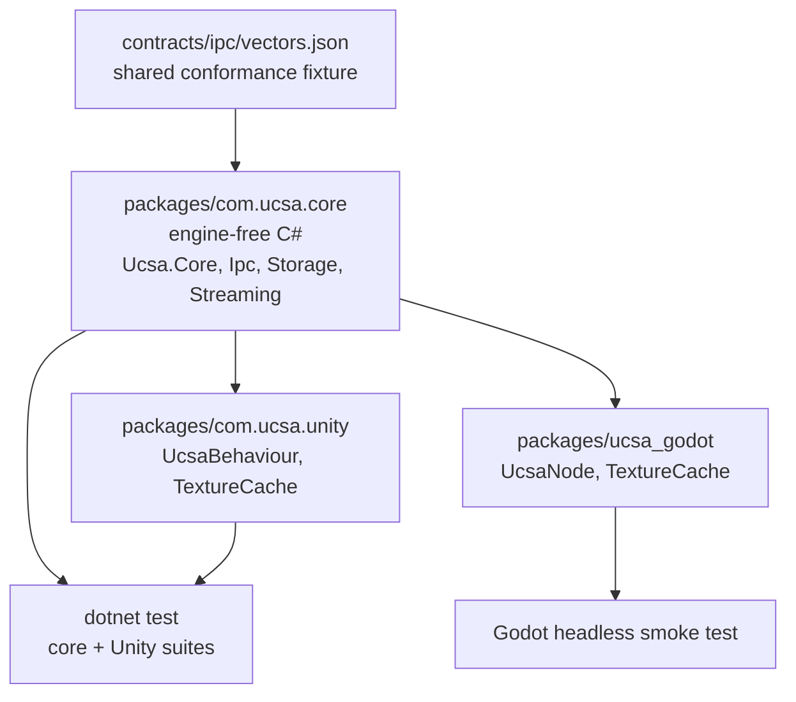
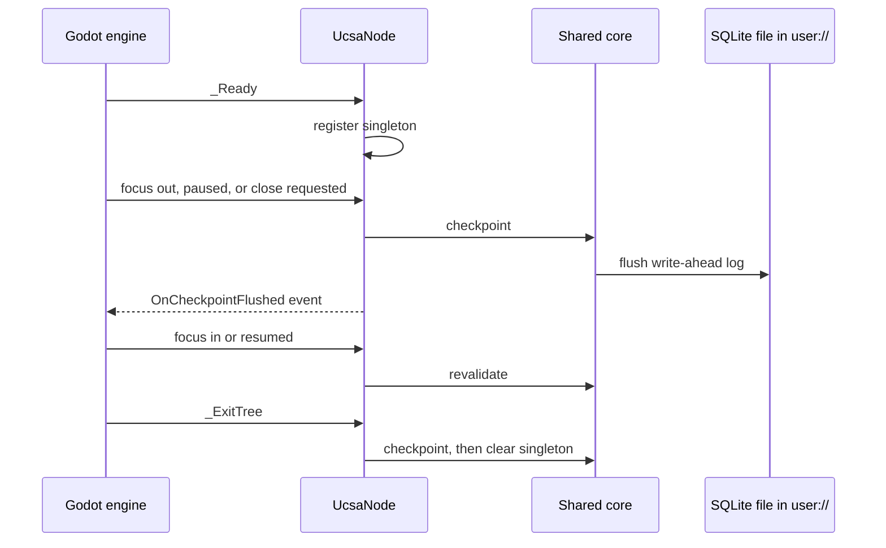

# Godot engine support for UCSA client state

<strong>One-paragraph summary.</strong> Add a Godot 4 (.NET / C#) package for UCSA, the client-state library in this repo. The engine-free C# that today lives inside the Unity package moves into a shared core package; Unity and Godot each become a thin engine binding on top of it. "Shipped" means in the repo, tested in the pre-ship check and CI, and documented, the same bar as the Dart, Flutter and Unity packages. Nothing is published to a registry and the release workflow is not touched.

<strong>~5,900</strong> lines of engine-free C# reused, not rewritten

<strong>2</strong> engine-bound classes to re-create for Godot

<strong>0</strong> other repos referencing the Unity package

<strong>0</strong> changes to <code>release.yml</code>

## Problem

UCSA has a TypeScript core and hand-written ports for Dart, Flutter and Unity. There is no Godot support: no tracked file mentions Godot. A Godot game cannot use UCSA's query cache, offline mutation outbox, content-addressable storage, or stream resume.

The Unity package already contains almost everything a Godot C# port needs, but it is locked inside one Unity assembly: two classes are named `UnitySqliteAdapter` and `UnityCasStore`, every namespace starts with `Ucsa.Unity`, and a mock `UnityEngine` namespace is compiled into the same source set.

## Why now

The owner asked for Godot support delivered end to end. Release 1.13 is open and the backlog is otherwise empty.

## Decisions (batch-grill, 2026-10-13)

- Language → <mark>C# on Godot .NET</mark> (owner) — reuses the tested C# runtime; GDScript would be a full rewrite with no built-in SQLite.
- Shipped → <mark>in-repo, same as Unity and Dart</mark> (owner) — static version 0.1.0, tested, documented; no registry, no `release.yml` change.
- Code sharing → <mark>extract a shared C# core</mark> (owner) — one source of truth for Unity and Godot.
- In-engine verification → headless smoke test in a real Godot .NET build (default, not asked) — `dotnet test` alone never loads the engine.
- CI → install a pinned Godot .NET build in `ci.yml` so the smoke test runs on every pull request (default, not asked) — otherwise it would be silently skipped the way Dart and Flutter tests are today.
- CLI → no change (default, not asked) — `apps/cli` has no per-platform code.
- Docs → Godot becomes a fourth platform on the docs site and in the README (default, not asked).

## Approaches considered

| Approach | Verdict |
|---|---|
| **A. Shared core as its own source package**, consumed by Unity through an assembly reference and by Godot through a project reference | **Chosen.** Source-level sharing keeps Unity's ahead-of-time compilation working and needs no build step. |
| B. Build the core to a DLL and drop it into each engine | Rejected. Adds a binary build and copy step, and committed binaries drift from source. |
| C. Godot compiles the Unity package's files in place | Rejected by the owner's choice. Leaves Unity names in the Godot API. |

## Sketch

### Package layout after the change

**`packages/com.ucsa.core` (new).** Holds the four engine-free folders moved out of the Unity package: `Runtime/Core`, `Runtime/Ipc`, `Runtime/Storage`, `Runtime/Streaming` (13 files, verified free of `UnityEngine` and of the mock).

- `package.json` (name `com.ucsa.core`, version `0.1.0`, no dependencies) and `Runtime/com.ucsa.core.asmdef` with `noEngineReferences: true`, so Unity refuses to compile it if an engine type leaks in.
- `Ucsa.Core.csproj` at the package root: library, `net8.0`, `Nullable` and `ImplicitUsings` enabled, `Microsoft.Data.Sqlite` 10.0.12, default globbing off and an explicit `Compile Include="Runtime/**/*.cs"` so it never picks up `Tests/`.
- `Tests/Ucsa.Core.Tests.csproj` with the engine-free NUnit tests moved from the Unity package. The lookup of `contracts/ipc/vectors.json` walks up from the binary directory, so it survives the move.
- Namespaces drop the `Unity` segment: `Ucsa.Unity.Core` becomes `Ucsa.Core`, and likewise `Ucsa.Ipc`, `Ucsa.Storage`, `Ucsa.Streaming`.
- `UnitySqliteAdapter` becomes `SqliteAdapter` and `UnityCasStore` becomes `CasStore`; these are the only two prefixed types. No compatibility aliases: a workspace-wide search found no consumer outside this repo.

**`packages/com.ucsa.unity` (shrinks).** Keeps `Runtime/Unity/UcsaBehaviour.cs`, `Runtime/Unity/UnityCompatibility.cs` (the mock) and `Runtime/Transports/TextureCache.cs`, with their namespaces unchanged.

- Its assembly definition adds a reference to `com.ucsa.core`.
- Its `package.json` does **not** declare a dependency on the core. Unity's package manager only resolves dependencies from a registry, and this repo's pnpm workspace would try to fetch that name from npmjs. A Unity project lists both packages in its own manifest; the README says so.
- `Linker.xml` preserves both assemblies.
- Its test project keeps the three engine-bound test files (`UcsaBehaviourTests`, `TextureCacheTests`, `E2EFullChainTests`) and references the core project.

**`packages/ucsa_godot` (new).** A Godot 4 .NET project that is also the addon, namespace `Ucsa.Godot`:

- `project.godot` and `UcsaGodot.csproj` (Godot .NET SDK, project reference to `Ucsa.Core.csproj`). It has no `package.json`, so the pnpm workspace ignores it.
- `addons/ucsa/UcsaNode.cs`: the Godot counterpart of `UcsaBehaviour`.
- `addons/ucsa/TextureCache.cs`: the Godot counterpart of the Unity texture cache, producing `ImageTexture`.
- `tests/Smoke.tscn` and `tests/Smoke.cs`: the in-engine smoke test.
- `README.md`: install by copying or linking `addons/ucsa` plus the core project.

No editor plugin, no `plugin.cfg`, no GDScript wrapper.

### Engine lifecycle binding

`UcsaNode` mirrors what `UcsaBehaviour` actually does today, and no more: it is a singleton that raises the same two events (`OnApplicationStateChanged`, `OnCheckpointFlushed`) and runs the same pause and quit handlers, which checkpoint the write-ahead log and revalidate on resume. It does **not** open, migrate or dispose the database. As in Unity, the game constructs the storage adapter itself, using `ProjectSettings.GlobalizePath("user://")` for the directory.

| Unity (`UcsaBehaviour`) | Godot (`UcsaNode`) | Fires on |
|---|---|---|
| `Awake` | `_Ready` | all |
| `OnApplicationPause(true)` | `NotificationApplicationPaused` | mobile |
| (none) | `NotificationApplicationFocusOut` | desktop |
| `OnApplicationPause(false)` | `NotificationApplicationResumed`, `NotificationApplicationFocusIn` | mobile, desktop |
| `OnApplicationQuit` | `NotificationWMCloseRequest`, `_ExitTree` | desktop, all |
| `OnDestroy` | `_ExitTree` | all |
| `Debug.Log*` | `GD.Print`, `GD.PushWarning`, `GD.PushError` | all |

<strong>Two behaviours are new, not ported.</strong> Godot's paused and resumed notifications fire only on mobile, and a programmatic quit sends no close request. So on desktop, the only target verified here, <code>UcsaNode</code> also checkpoints on focus-out and in <code>_ExitTree</code>. Both get their own smoke assertions. Revalidating on focus-in means an alt-tab can trigger refetches; this matches the TypeScript core's focus manager and is accepted.

### Error handling

- Checkpoint on focus-out, pause or close is best-effort: failures are logged through `GD.PushError`, never thrown into the engine's notification dispatch.
- A second `UcsaNode` entering the tree logs a warning and does not replace the singleton, as in Unity.
- Core error behaviour is unchanged; this feature moves code, it does not alter it.

### Testing

| Layer | How | Where it runs |
|---|---|---|
| Shared core | Existing NUnit tests, moved, via `dotnet test` | Local, pre-ship check, CI |
| Unity binding | Existing three test files against the mock `UnityEngine` | Local, pre-ship check, CI |
| Godot binding | Headless smoke scene in a real Godot .NET build | Local, pre-ship check when a Godot .NET build is present, CI always |

The smoke scene asserts:

1. With a `SqliteAdapter` opened under `user://`, a focus-out notification sent to `UcsaNode` raises `OnCheckpointFlushed`, and a value written before it is readable from a freshly opened adapter.
2. Freeing `UcsaNode` (the `_ExitTree` path) checkpoints and clears the singleton.
3. The frame codec passes every vector in `contracts/ipc/vectors.json` inside the engine.
4. `TextureCache` decodes a PNG, returns a non-null texture, and serves the second request from cache.

So that it cannot pass falsely or hang: the scene wraps all assertions in a try/catch and always calls `GetTree().Quit(code)` with 0 only when every assertion passed (an unhandled C# exception does not set Godot's exit code); the runner script builds the project first, runs it under a timeout, and requires a literal `SMOKE PASS 4/4` line in the output as well as exit code 0.

### Tooling changes

- `scripts/precheck.sh`: run both .NET test projects; add a Godot phase that runs when a Godot .NET binary is found (`GODOT_MONO_BIN`, else a `godot` whose version string contains `mono`) and prints a visible skip line otherwise.
- `scripts/integration.sh`: repoint its core-only test filter at the core test project.
- `scripts/e2e-full-chain.sh`: its filter spans both future projects, so it becomes two invocations, each failing if it matched zero tests (a filter that matches nothing exits 0 today).
- `pnpm-lock.yaml`: the new `packages/com.ucsa.core/package.json` falls inside the `packages/*` workspace glob, so the lockfile gains one empty importer entry. It is regenerated in phase 1 and `pnpm install --frozen-lockfile` is verified, because both `ci.yml` and `release.yml` install that way.
- `.gitignore`: add `.godot/` and the Godot project's `bin/` and `obj/`.
- `.github/workflows/ci.yml`: add one step that downloads a pinned Godot .NET Linux build and exports `GODOT_MONO_BIN`, plus a .NET SDK setup step only if that Godot version needs a newer SDK than the runner has.
- `.github/workflows/release.yml`: untouched.
- Local machine: install the Godot .NET build matching the installed 4.7.2 next to the existing standard build; the standard build stays.

### Documentation

- `apps/docs/src/content/guides/types.ts` (the `CS` source-root constant), `parity.ts` and the guide files that cite renamed C# files: updated **in phase 1**, because the docs tests assert that every cited path exists and the pre-ship check runs them.
- `README.md`: the roughly 20 existing references to the renamed classes and paths are updated in phase 1; the new Godot section, the two-package Unity install note and corrected test commands land in phase 4.
- `apps/docs`: add platform `godot` to `types.ts` and `guides/index.ts`, Godot snippets to the six guide files, a Godot column to `parity.ts`, and update the docs tests that assert platform lists.

### Delivery phases

Each phase ends with verify, independent review, refactor, re-verify, and leaves the pre-ship check green.

1. **Extract the shared core.** Move and rename only; no behaviour change. Includes the lockfile, the three scripts, and every docs and README reference to a moved path. Gate: record the .NET test count before the move by running the suite (137 per the last handoff note); the combined count after is identical; frozen install and docs tests pass.
2. **Godot package and smoke test.** First task confirms the Godot 4.7.2 .NET facts listed under assumptions. Gate: smoke runner prints `SMOKE PASS 4/4` and exits 0 locally.
3. **Pre-ship check and CI wiring for Godot.** Gate: pre-ship check green locally; CI run green with the Godot step executed, not skipped.
4. **README and docs site for Godot.** Gate: docs tests and docs build green.

## Out of scope

- GDScript API, GDExtension, editor plugin.
- Publishing to NuGet, the Godot Asset Library, or any registry; version automation.
- Godot mobile and web export. C# web export is unsupported by Godot 4 and mobile export is not verifiable here; the README says desktop is the verified target.
- Having `UcsaNode` own the database lifecycle (open, migrate, dispose). Unity does not do this either.
- The network transports and other core modules that the Unity port also lacks.
- Any change to `apps/cli`, `packages/core`, the Dart or Flutter packages, `pnpm-workspace.yaml`, or `release.yml`.

## Risks and assumptions

<strong>The Unity package is restructured without a real Unity editor to check it.</strong> Today the Unity package is only ever compiled by <code>dotnet</code> against mock engine types, and that stays true. After this change a Unity project must list two packages (<code>com.ucsa.core</code> and <code>com.ucsa.unity</code>) in its manifest and the class names change. The mock-based tests will pass or fail honestly, but nothing here proves the two-package layout resolves inside the Unity editor.

- **Unverified Godot facts, confirmed as the first task of phase 2 before any binding code:** Godot 4.7.2 .NET targets `net8.0`; its SDK accepts a project reference outside the Godot folder; the notification constant names in the table; the .NET build's version string contains `mono`. If it needs a newer .NET, the core project multi-targets and `ci.yml` gains an SDK setup step; the design does not change.
- **Assumed, checked by the smoke test:** `Microsoft.Data.Sqlite`'s bundled native library loads inside Godot on macOS and Linux, and `ImageTexture` can be created under the headless renderer. If texture creation is unavailable headless, assertion 4 checks the decoded `Image` and the cache hit instead.
- **Blast radius:** phase 1 is costly to reverse in the sense that it touches every C# file by path and namespace, plus the lockfile, three scripts and the docs source paths. It is one mechanical commit, undone with a single revert, and lands before any Godot code.
- **Rollback:** nothing is published, so reverting the feature branch restores the previous state completely.

## Acceptance criteria

- [ ] `packages/com.ucsa.core` exists with the four engine-free folders, namespaces `Ucsa.Core`, `Ucsa.Ipc`, `Ucsa.Storage`, `Ucsa.Streaming`, and an assembly definition with `noEngineReferences: true`; `git grep -l "UnityEngine" -- packages/com.ucsa.core` prints nothing.
- [ ] `dotnet test` on the core and Unity test projects passes with a combined test count equal to the count recorded before the extraction.
- [ ] `pnpm install --frozen-lockfile` succeeds on the feature branch.
- [ ] `packages/ucsa_godot` builds, and its smoke runner prints `SMOKE PASS 4/4` and exits 0 in a Godot .NET build locally.
- [ ] `scripts/precheck.sh` runs the Godot smoke test when a Godot .NET binary is present and prints an explicit skip line when it is not.
- [ ] A CI run on the feature branch shows the Godot smoke step executed and green.
- [ ] `git diff main -- .github/workflows/release.yml pnpm-workspace.yaml` is empty.
- [ ] `README.md` has a Godot section and the docs site lists Godot as a platform in the guides and the parity matrix; docs tests and docs build pass.

## Appendix — audit trail

- 2026-10-13 self-grill-audit: verdict safe-with-fixes (no critical, four high; all four confirmed on disk before editing). Corrected:
  - A third engine-bound test file (`UcsaBehaviourTests`) stays in the Unity test project; the draft named two.
  - `UcsaNode` no longer claims to port database open, migration and dispose: `UcsaBehaviour` only registers a singleton and handles pause and quit. Focus-out and `_ExitTree` checkpoints are labelled new, with smoke assertions.
  - The new `package.json` lands in the pnpm workspace: lockfile regeneration and a frozen-install check added; the Unity `package.json` dependency declaration removed.
  - Docs source paths and README references to moved files move into phase 1, so the pre-ship check stays green between phases.
  - Medium and low: explicit csproj globbing and settings; two-invocation end-to-end script with zero-match guard; smoke test exit code, timeout and pass marker; `.godot/` ignore; namespaces spelled out; reused-line metric corrected from about 6,450 to about 5,900.
  - Open: none needing the owner beyond approval of this spec. The Godot 4.7.2 .NET facts remain unverified until phase 2's first task.
