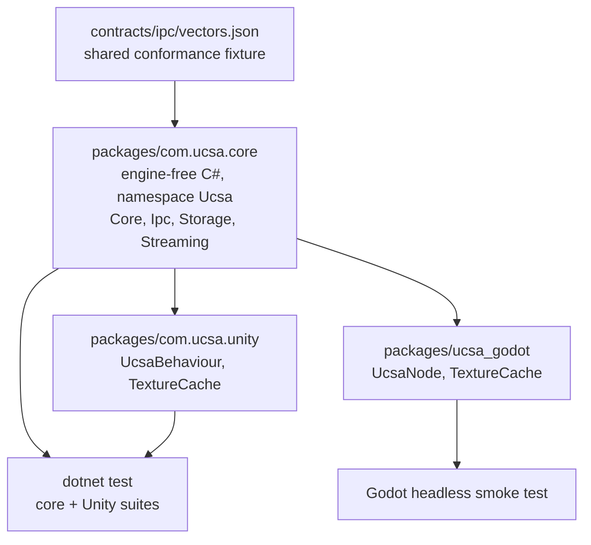
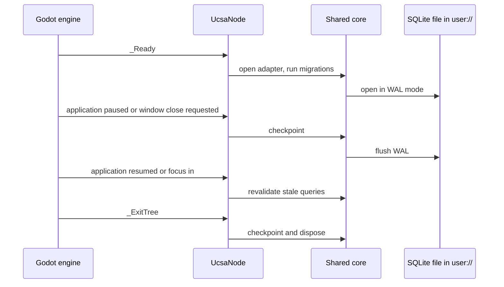

# Godot engine support for UCSA client state

<strong>One-paragraph summary.</strong> Add a Godot 4 (.NET / C#) package for UCSA, the client-state library in this repo. The engine-free C# that today lives inside the Unity package moves into a shared core package; Unity and Godot each become a thin engine binding on top of it. "Shipped" means in the repo, tested in the pre-ship check and CI, and documented, the same bar as the Dart, Flutter and Unity packages. Nothing is published to a registry and the release workflow is not touched.

<strong>~6,450</strong> lines of C# runtime reused, not rewritten

<strong>2</strong> engine-bound files to re-create for Godot

<strong>0</strong> other repos referencing the Unity package

<strong>0</strong> changes to <code>release.yml</code>

## Problem

UCSA has a TypeScript core and hand-written ports for Dart, Flutter and Unity. There is no Godot support: no tracked file mentions Godot. A Godot game cannot use UCSA's query cache, offline mutation outbox, content-addressable storage, or stream resume.

The Unity package already contains almost everything a Godot C# port needs, but it is locked inside one Unity assembly: classes are named `UnitySqliteAdapter` and `UnityCasStore`, everything is in namespace `Ucsa.Unity`, and a mock `UnityEngine` namespace is compiled into the same source set.

## Why now

The owner asked for Godot support delivered end to end. Release 1.13 is open and the backlog is otherwise empty.

## Decisions (batch-grill, 2026-10-13)

- Language → <mark>C# on Godot .NET</mark> (owner) — reuses the tested C# runtime; GDScript would be a full rewrite with no built-in SQLite.
- Shipped → <mark>in-repo, same as Unity and Dart</mark> (owner) — static version 0.1.0, tested, documented; no registry, no `release.yml` change.
- Code sharing → <mark>extract a shared C# core</mark> (owner) — one source of truth for Unity and Godot.
- In-engine verification → headless smoke test in a real Godot .NET build (default, not asked) — `dotnet test` alone never loads the engine.
- CI → install a pinned Godot .NET build in `ci.yml` so the smoke test runs on every pull request (default, not asked) — otherwise it would be silently skipped the way Dart and Flutter tests are today.
- CLI → no change (default, not asked) — `apps/cli` has no per-platform code.
- Docs → Godot becomes a fourth platform on the docs site and in the README (default, not asked).

## Approaches considered

| Approach | Verdict |
|---|---|
| **A. Shared core as its own source package**, consumed by Unity through its package manager and by Godot through a project reference | **Chosen.** Source-level sharing keeps Unity's ahead-of-time compilation working and needs no build step. |
| B. Build the core to a DLL and drop it into each engine | Rejected. Adds a binary build and copy step, and committed binaries drift from source. |
| C. Godot compiles the Unity package's files in place | Rejected by the owner's choice. Leaves Unity names in the Godot API. |

## Sketch

### Package layout after the change

**`packages/com.ucsa.core` (new).** Holds the four engine-free folders moved out of the Unity package: `Runtime/Core`, `Runtime/Ipc`, `Runtime/Storage`, `Runtime/Streaming`. It is shaped to be read by both toolchains:

- `package.json` (name `com.ucsa.core`, version `0.1.0`) and `Runtime/com.ucsa.core.asmdef` with `noEngineReferences: true`, so Unity refuses to compile it if an engine type leaks in.
- `Ucsa.Core.csproj` (library, `net8.0`, `Microsoft.Data.Sqlite` 10.0.12) for .NET and Godot.
- `Tests/Ucsa.Core.Tests.csproj` with the engine-free NUnit tests moved from the Unity package.
- Namespace becomes `Ucsa`. Every type in these folders with a `Unity` prefix loses it (known: `UnitySqliteAdapter` becomes `SqliteAdapter`, `UnityCasStore` becomes `CasStore`). No compatibility aliases: a workspace-wide search found no consumer outside this repo.

**`packages/com.ucsa.unity` (shrinks).** Keeps `Runtime/Unity/UcsaBehaviour.cs`, `Runtime/Unity/UnityCompatibility.cs` and `Runtime/Transports/TextureCache.cs`. Its assembly definition references `com.ucsa.core`; `package.json` declares the dependency; `Linker.xml` preserves both assemblies. Its test project keeps `TextureCacheTests` and `E2EFullChainTests` and references the core project.

**`packages/ucsa_godot` (new).** A Godot 4 .NET project that is also the addon:

- `project.godot` and `UcsaGodot.csproj` (Godot .NET SDK, project reference to `Ucsa.Core.csproj`).
- `addons/ucsa/UcsaNode.cs`: the Godot counterpart of `UcsaBehaviour`.
- `addons/ucsa/TextureCache.cs`: the Godot counterpart of the Unity texture cache, producing `ImageTexture`.
- `tests/Smoke.tscn` and `tests/Smoke.cs`: the in-engine smoke test.
- `README.md`: install by copying or linking `addons/ucsa` plus the core project.

No editor plugin, no `plugin.cfg`, no GDScript wrapper.

### Engine lifecycle binding

`UcsaNode` maps Godot's lifecycle onto the same core calls `UcsaBehaviour` makes today.

| Unity (`UcsaBehaviour`) | Godot (`UcsaNode`) |
|---|---|
| `Awake` | `_Ready` |
| `OnApplicationPause(true)` | `NotificationApplicationPaused` |
| `OnApplicationPause(false)` | `NotificationApplicationResumed`, `NotificationApplicationFocusIn` |
| `OnApplicationQuit` | `NotificationWMCloseRequest` |
| `OnDestroy` | `_ExitTree` |
| `Debug.Log*` | `GD.Print`, `GD.PushWarning`, `GD.PushError` |
| `Application.persistentDataPath` | `ProjectSettings.GlobalizePath("user://")` |

### Error handling

- A failed open or migration in `_Ready` logs through `GD.PushError` and leaves the node in a not-ready state that throws a clear exception on use. It does not crash the scene tree.
- Checkpoint on pause or close is best-effort: failures are logged, never thrown into the engine's notification dispatch.
- Core error behaviour is unchanged; this feature moves code, it does not alter it.

### Testing

| Layer | How | Where it runs |
|---|---|---|
| Shared core | Existing NUnit tests, moved, via `dotnet test` | Local, pre-ship check, CI |
| Unity binding | Existing two test files against the mock `UnityEngine` | Local, pre-ship check, CI |
| Godot binding | Headless smoke scene in a real Godot .NET build, exit code 0 on pass | Local, pre-ship check when a .NET build of Godot is present, CI always |

The smoke scene asserts: (1) `UcsaNode` opens a database under `user://` and a written query value survives a simulated pause notification followed by a fresh node; (2) the frame codec passes every vector in `contracts/ipc/vectors.json` inside the engine; (3) `TextureCache` decodes a PNG, returns a non-null texture, and serves the second request from cache.

### Tooling changes

- `scripts/precheck.sh`: point the .NET phase at both test projects; add a Godot phase that runs when a Godot .NET binary is found (`GODOT_MONO_BIN`, else a `godot` whose version string contains `mono`) and prints a visible skip line otherwise.
- `scripts/integration.sh`, `scripts/e2e-full-chain.sh`: update the hard-coded .NET paths.
- `.github/workflows/ci.yml`: add one step that downloads a pinned Godot .NET Linux build and exports `GODOT_MONO_BIN`.
- `.github/workflows/release.yml`: untouched.
- Local machine: install the Godot .NET build matching the installed 4.7.2 next to the existing standard build; the standard build stays.

### Documentation

- `README.md`: new Godot section; Unity section updated for the renamed classes and the two-package install; test-command section updated.
- `apps/docs/src/content/guides/types.ts` and `guides/index.ts`: add platform `godot`; add Godot snippets to the six guide files.
- `apps/docs/src/content/parity.ts`: add a Godot column; update the docs tests that assert platform lists.

### Delivery phases

Each phase ends with verify, independent review, refactor, re-verify.

1. **Extract the shared core.** Pure move and rename; no behaviour change. Gate: the same number of .NET tests pass before and after.
2. **Godot package and smoke test.** Gate: smoke scene exits 0 in the local Godot .NET build.
3. **Scripts and CI.** Gate: pre-ship check green locally; CI run green with the Godot step executing, not skipped.
4. **README and docs site.** Gate: docs tests and docs build green.

## Out of scope

- GDScript API, GDExtension, editor plugin.
- Publishing to NuGet, the Godot Asset Library, or any registry; version automation.
- Godot mobile and web export. C# web export is unsupported by Godot 4 and mobile export is not verifiable here; the README says desktop is the verified target.
- The network transports and other core modules that the Unity port also lacks.
- Any change to `apps/cli`, `packages/core`, the Dart or Flutter packages, or `release.yml`.

## Risks and assumptions

<strong>The Unity package is restructured without a real Unity editor to check it.</strong> Today the Unity package is only ever compiled by <code>dotnet</code> against mock engine types, and that stays true. After this change a Unity project must install two packages (<code>com.ucsa.core</code> and <code>com.ucsa.unity</code>) and the class names change. The mock-based tests will pass or fail honestly, but nothing here proves the two-package layout resolves inside the Unity editor.

- **Assumed, checked first in phase 2:** Godot 4.7.2 .NET targets `net8.0` and its SDK accepts a project reference to a project outside the Godot folder. If it requires a newer .NET, the core project multi-targets; the design does not change.
- **Assumed, checked in the smoke test:** `Microsoft.Data.Sqlite`'s bundled native library loads inside Godot on macOS and Linux, and `ImageTexture` can be created under the headless renderer. If texture creation is unavailable headless, assertion 3 checks the decoded `Image` and the cache hit instead.
- **Blast radius:** phase 1 touches every C# file by path and namespace. It is one mechanical commit, reversible with a single revert, and lands before any Godot code.
- **Rollback:** nothing is published, so reverting the feature branch restores the previous state completely.

## Acceptance criteria

- [ ] `packages/com.ucsa.core` exists with the four engine-free folders, namespace `Ucsa`, and an assembly definition with `noEngineReferences: true`; `git grep -l "UnityEngine" -- packages/com.ucsa.core` prints nothing.
- [ ] `dotnet test` on the core and Unity test projects passes with a combined test count equal to the count before the extraction.
- [ ] `packages/ucsa_godot` builds with `dotnet build` and its headless smoke scene exits 0 in a Godot .NET build locally, with all three smoke assertions reported as passed.
- [ ] `scripts/precheck.sh` runs the Godot smoke test when a Godot .NET binary is present and prints an explicit skip line when it is not.
- [ ] A CI run on the feature branch shows the Godot smoke step executed and green.
- [ ] `git diff main -- .github/workflows/release.yml` is empty.
- [ ] `README.md` has a Godot section and the docs site lists Godot as a platform in the guides and the parity matrix; docs tests and docs build pass.
