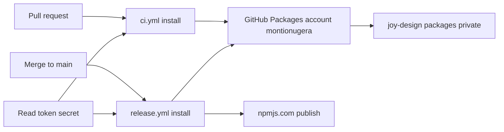
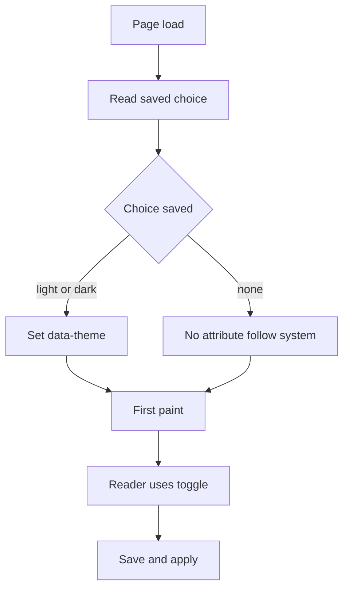

# Adopt the Joymify design system in the docs portal

## Goal

Owner's words: "using its design system for build doc not move into that repo".

The docs portal in this repository (`apps/docs`, package `@ucsa/docs`, React 19 + Vite, hash routes) is built with the Joymify design system, installed as the published `@montionugera/joy-*` packages from GitHub Packages (private, account `montionugera`, repository `joy-design`). The portal stays in `cli-state-handler`. It gets a light and a dark theme with a toggle, renders markdown through the Joymify markdown component, and renders Mermaid diagrams.

## Scope and non-goals

In scope:

- Replace the sibling-checkout aliases with registry dependencies on `@montionugera/joy-react` 0.2.0 and `@montionugera/joy-tokens` 0.2.0 (which pull in `@montionugera/joy-icons` 0.3.0 and `@montionugera/joy-brand` 0.2.0). All four are published; see "Packages" under "Current state". Import specifiers on the base branch are renamed to these names.
- A scope mapping that only pnpm reads (a `registries` block in `pnpm-workspace.yaml`, **no** root `.npmrc`), and package access for the two GitHub Actions workflows (`ci.yml`, `release.yml`) through one read-only token stored as an Actions secret.
- One regression check that the library release still targets npmjs.com. No change to the release scripts, the publish step or the library manifests (see "Scope clash, and how it is designed out").
- Light and dark themes, a toggle that remembers the choice, no flash of the wrong theme on load.
- Self-hosted fonts (Inter, JetBrains Mono) inside the build output. No font CDN.
- Code samples, platform snippet tabs, markdown content and Mermaid diagrams rendered by Joymify components.
- README update for the new install requirement.

Non-goals:

- Moving the portal into the `joy-design` repository, vendoring Joymify source, or linking a sibling checkout.
- Changing routes, page content, the playground models, or the sandbox.
- Changing where or how `@montionugera/ucsa-core` and `@montionugera/ucsa-cli` are published (npmjs.com, trusted publishing, `release.yml` not renamed, no `environment:`). The libraries keep the `@montionugera` scope.
- Bumping the pinned versions of the workflow actions. Another session owns that (idea I-046); this spec edits steps, not action versions.
- Adding the full `mermaid` npm library, or a general markdown library, inside this repository. Gaps in the Joymify components are fixed upstream in `joy-design` (platform rule: enhance upstream, never shim in the consumer).
- A markdown editor in the portal. `MarkdownEditor` is exported upstream but nothing in the portal is edited by readers.

## Current state

Verified by reading the code on 2026-10-09, not taken from reports.

**Base branch.** `fix/docs-design-nav` (worktree `../cli-state-handler-fix-docs-design`) holds two commits, `68ad8b7` and `69f8c42`, on top of an older main `407ca76`. Main is now `3f6a81c`; release branch `release/1.10` starts from it. Since `407ca76`, main changed nine files under `apps/docs` (a Release notes page, a `version-json` Vite plugin, `MultiPlatformDocs.tsx`, `routes.ts`, two new test files).

**How the base branch reaches Joymify.** `apps/docs/joy-alias.ts` maps the names `@joymify/react`, `@joymify/icons/react`, `@joymify/brand`, `@joymify/tokens/theme.css` to `../../../joy-design/packages/...`. The aliases are spread into `vite.config.ts` and `vitest.config.ts`, and repeated as `paths` in `apps/docs/tsconfig.json` (plus two `react` type paths that exist only to stop duplicate React types from the sibling checkout). Nine source files import from `@joymify/react`; `main.tsx` imports `@joymify/tokens/theme.css`. The import names are already the names the packages will be published under, so the source files need no rename. What is broken is only the route: the aliases point at a sibling checkout that does not exist in CI.

**Theme.** `apps/docs/index.html` hard-codes `<html data-theme="dark">`. `src/index.css` maps the portal's own variables (`--bg-main`, `--text-main`, ...) onto `--joy-*` tokens, so most colours already follow the theme. Leftovers: 54 inline `style={{...}}` props in components and one hard-coded colour (`--scrim: rgba(0, 0, 0, 0.6)`).

**Fonts.** The tokens stylesheet names `Inter` and `JetBrains Mono` but ships no `@font-face`. Nothing loads the font files today, so the portal falls back to system fonts.

**Markdown, code, diagrams.** There is no markdown rendering today. Tutorial pages are hand-written TSX wrapped in `Prose` (`src/components/Prose.tsx`, which also defines a plain `Callout` and an unhighlighted `CodeBlock`). Platform snippets are plain `<pre class="mp-code">` blocks in `MultiPlatformDocs.tsx`. Release notes parse the repo-root `CHANGELOG.md` with a small hand-written parser (`src/models/changelog.ts`). No file under `apps/docs/src` mentions Mermaid.

**Sidebar.** Still main's anchor sidebar in `App.tsx`: real `<a href="#/...">` links with `aria-current="page"`, a phone drawer with focus handling, `inert`, Escape to close.

**CI.** There is no `docs.yml` any more; main deleted it. Two workflows remain:

- `ci.yml` runs on every pull request to main, `permissions: contents: read`, and its header comment states "no secrets". It runs `pnpm install --frozen-lockfile` then `scripts/precheck.sh` (the pre-ship build, typecheck and test check, which includes `apps/docs`).
- `release.yml` runs on every merge to main. It runs `pnpm install --frozen-lockfile` for the whole workspace, publishes the two libraries to npmjs.com through trusted publishing (no stored token), then builds the docs archive `docs-site.tgz` that the Joymify developer portal copies.

The repository has no Actions secrets at all (`gh secret list` is empty).

**Registry calls in the release pipeline (three).** All run with the repository root as working directory, so all would read a root `.npmrc`. All three are for `@montionugera/ucsa-*` names:

1. `scripts/release/next-release.mjs` line 41, `npm view <name>@<version> version`, in the "Decide release" step. It runs on **every** merge to main. Only an `E404` counts as "not published"; any other failure throws and stops the run.
2. `scripts/release/publish-packages.sh`, called by the `release.yml` step "Publish to npmjs.com (trusted publishing)": `npm view --prefer-online "$name@$version" version` (an `E404` is read as "not published"; any other failure stops the run).
3. Same script: `npm publish "$dest"/*.tgz --access public`, on a tarball made by `pnpm pack`.

(Corrected 2026-10-11: calls 2 and 3 moved from inline in `release.yml` into that script; `pnpm publish` is not used anywhere.)

`packages/core/package.json` and `apps/cli/package.json` already carry `publishConfig: { "access": "public", "registry": "https://registry.npmjs.org" }`. The README (around line 2672) also documents a manual `npm publish` recipe run from the repository root. Nothing in the repository installs `@montionugera/ucsa-*` from a registry: `apps/cli` and `apps/docs` use `workspace:*`, and there are no examples or smoke tests that install the published libraries.

**Other install sites.** Besides the two workflows, `scripts/precheck.sh` line 67 and `scripts/epic-check.sh` line 15 run `pnpm install` locally. Root `pnpm test` (used by `release.yml` "Unit tests" and by `precheck.sh`) runs the `apps/docs` tests too, so the docs dependencies are needed wherever tests run.

**Tool versions.** Both workflows pin `pnpm/action-setup` to `version: 10` (major only, so the runner gets the newest pnpm 10); the root `package.json` has no `packageManager` field; the local machine has pnpm 10.13.1. `release.yml` installs `npm@^11.5.1` for publishing. `actions/setup-node` in `release.yml` is given `registry-url`, which makes it write a user-level npm config file and export its path as `NPM_CONFIG_USERCONFIG`; in `ci.yml` it is not, so the user-level file there is `~/.npmrc`.

**Packages (published; corrected 2026-10-11).** The four packages are on GitHub Packages as `@montionugera/joy-tokens` 0.2.0, `@montionugera/joy-icons` 0.3.0, `@montionugera/joy-brand` 0.2.0 and `@montionugera/joy-react` 0.2.0: private, owned by the account `montionugera`, published from the repository `montionugera/joy-design` (checked with `gh api /users/montionugera/packages...` on 2026-10-11). The names `@joymify/tokens`, `@joymify/icons`, `@joymify/brand` and `@joymify/react`, which this spec used from 2026-10-09 (late) until this correction, **do not exist**: the registry answers E404 and GitHub Packages has no `joymify` owner. The owner has decided the packages stay private under the `@montionugera/joy-*` names and are not republished as `@joymify/*`. So "the four packages resolve from the registry" now depends only on a token that can read them, which is still a precondition with its own acceptance checks. `cli-state-handler` is private. The scope `@montionugera` is also the scope of this repository's own libraries on npmjs.com; see "Scope clash, and how it is designed out".

**What `@montionugera/joy-react` 0.2.0 is expected to export.** The table was read from `joy-design` main `02b1dfc8`, `packages/react/src/index.ts`, which is the source `@montionugera/joy-react` 0.2.0 is understood to be built from: single entry point `"."`, `sideEffects: false`, peers `react` and `react-dom` `^19.0.0`. That the published tarball matches this table is **not verified** (no token exists yet to download it) and phase 1a checks it against the installed package.

| Need | Export | Notes from the source |
| --- | --- | --- |
| Markdown | `MarkdownViewer` (`content`, `allowCopy`) | Hand-written line parser: headings 1-3, paragraphs, block quotes, tables, rules, fenced code, inline code, bold, italic. A `mermaid` fence is passed to `MermaidViewer`. **No lists, no links, no images.** |
| Diagrams | `MermaidViewer` (`code`, `title`, `initialView`, `allowToggle`, `allowCopy`), `renderMermaidToSvg` | Zero-dependency renderer written in-house. **Flowcharts and sequence diagrams only.** |
| Code | `CodeBlock` (`code`, `language`, `title`, `showLineNumbers`, `allowCopy`), `PolyglotCodeTabs` (`items`, `activeKey`, `onChange`), `highlightCodeToHtml`, `tokenizeCode`, `normalizeLanguage` | Built-in highlighter, no external library. |
| Theme control | none | No provider or hook. Theming is pure CSS in `@montionugera/joy-tokens/theme.css`. `Segmented` and `Switch` are available for the control itself. |
| Navigation | `Menu`, `Anchor`, `Breadcrumb` | `Menu` renders `role="menuitem"` list items with an `onSelect` callback, not links. |

No `@montionugera/joy-*` tarball could be opened yet (no read token on this machine); the table is source, not the published artefact.

## Design

### Dependencies and the scope mapping

Add to `apps/docs/package.json` dependencies: `@montionugera/joy-react` `^0.2.0` and `@montionugera/joy-tokens` `^0.2.0` (the stylesheet import needs tokens as a direct dependency under pnpm's strict layout). `@montionugera/joy-icons` and `@montionugera/joy-brand` arrive as dependencies of `@montionugera/joy-react`. If any file under `apps/docs/src` imports icons or brand directly (the alias file maps both), that package becomes a direct dependency too, for the same reason. No pnpm alias (`npm:`) is used.

Add the scope mapping to `pnpm-workspace.yaml`, and **create no root `.npmrc`**:

```yaml
registries:
  default: https://registry.npmjs.org/
  '@montionugera': https://npm.pkg.github.com/
```

pnpm reads this block; npm does not read `pnpm-workspace.yaml` at all. That difference is the whole design: see "Scope clash, and how it is designed out". The `default` entry is required (without it pnpm 10.13.1 fails on every unscoped package).

The token line is not committed anywhere. It goes in the user-level npm config, as the literal text:

```
//npm.pkg.github.com/:_authToken=${JOYMIFY_PACKAGES_READ_TOKEN}
```

"User-level" means `~/.npmrc` on a developer machine, and on a runner the file named by `NPM_CONFIG_USERCONFIG` when that variable is set, otherwise `~/.npmrc`. The token itself is never written to disk; it is present only where the environment variable `JOYMIFY_PACKAGES_READ_TOKEN` is exported. The variable is deliberately not called `GITHUB_TOKEN`, so the workflow's own job token is never the one handed to the installer. The token line is keyed to the host `npm.pkg.github.com`; it is not a scope mapping, sends no request anywhere, and is safe in a file npm reads. The scope mapping is the opposite: it must never be written to a user-level file either.

<div class="callout warn">
<strong>Why not a token line in the repository <code>.npmrc</code>.</strong> pnpm no longer expands <code>${NAME}</code> in a project-level <code>.npmrc</code> for registry URLs, URL-scoped keys and credential values: such a line is ignored with a warning. The pnpm 11 documentation dates this to v11.5.3; the pnpm 10 documentation dates the same restriction to v10.34.2 (security advisory GHSA-3qhv-2rgh-x77r; sources: pnpm.io/npmrc and pnpm.io/10.x/npmrc, read 2026-10-09). CI pins pnpm to major 10 only, so the runner is already on a pnpm 10 that ignores such a line: a committed <code>_authToken=${...}</code> line would answer 401 today, not only after a move to pnpm 11. Both documentation sets state that placeholders are still expanded in the user-level <code>.npmrc</code>, and that pnpm honours <code>NPM_CONFIG_USERCONFIG</code>. The scope mapping has no placeholder and no longer lives in a <code>.npmrc</code> at all.
</div>

Two limits of what was checked: the behaviour above is taken from the pnpm documentation, not from a run; and both documentation sets list `~/.npmrc` as a fallback behind pnpm's own auth file, which is fine here because nothing else sets a token for `npm.pkg.github.com`. The green install in `ci.yml` (pnpm 10) is the empirical proof for pnpm 10. No pnpm 11 run exists in this repository, so pnpm 11 stays **documented, not exercised**.

### Scope clash, and how it is designed out

<div class="callout danger">
<strong>The design-system packages and this repository's own libraries share one scope.</strong> <code>@montionugera/joy-*</code> lives on GitHub Packages; <code>@montionugera/ucsa-core</code> and <code>@montionugera/ucsa-cli</code> are published to npmjs.com by <code>release.yml</code>. npm maps registries per scope, not per package. A line <code>@montionugera:registry=https://npm.pkg.github.com</code> in any file npm reads would redirect the release pipeline.
</div>

Reproduced on 2026-10-11 with npm 11.17.0 and pnpm 10.13.1, using a dead local address as the mapped registry so nothing could be uploaded:

| Setup | `npm view @montionugera/ucsa-core version` | dry-run `npm publish` of a tarball with `publishConfig.registry` = npmjs.com |
| --- | --- | --- |
| Today (no mapping) | npmjs.com, prints the version | `Publishing to https://registry.npmjs.org` |
| Mapping in a root `.npmrc` | goes to the mapped registry | `Publishing to` the mapped registry |
| Same, plus `--registry=https://registry.npmjs.org` | still the mapped registry | still the mapped registry |
| Same, plus `--@montionugera:registry=https://registry.npmjs.org` | npmjs.com | not run |
| Mapping in the user-level file (`NPM_CONFIG_USERCONFIG`) | goes to the mapped registry | not run |
| **Mapping in `pnpm-workspace.yaml` `registries` (chosen)** | npmjs.com, prints the version; `npm config get @montionugera:registry` is `undefined` | `Publishing to https://registry.npmjs.org` |

With the chosen setup `pnpm add @montionugera/<name>` goes to the mapped registry, and unscoped packages still resolve from npmjs.com.

Three designs were weighed:

1. **Root `.npmrc` scope line plus pins on the publish side. Rejected.** A plain `--registry` flag and `publishConfig.registry` do not override a scope mapping, so the pin has to be the exact flag `--@montionugera:registry=https://registry.npmjs.org` on all three registry calls plus a `"@montionugera:registry"` key in the `publishConfig` of both manifests. That edits `next-release.mjs`, `publish-packages.sh` and both manifests, which is the trusted-publishing path this spec promises to leave alone, and it fails open: any npm call added later without the flag, and the manual `npm publish` recipe in the README, is silently redirected. A missed pin would most likely not publish to the wrong place (the read-only token cannot write; inferred, not run), but it would turn "Decide release" red on every merge to main.
2. **Keep the mapping out of everything npm reads. Chosen.** The mapping is the `registries` block in `pnpm-workspace.yaml`. The release pipeline calls npm for `view` and `publish` and pnpm only for `install`, `pack`, build and test, so the three registry calls behave exactly as today with no flag, and `next-release.mjs`, `publish-packages.sh`, the step "Publish to npmjs.com (trusted publishing)", `packages/core/package.json` and `apps/cli/package.json` are not edited. `release.yml` is not renamed and gets no `environment:`. A variant that writes the mapping into the user-level file only for the install step was dropped: it redirects npm the same way if the file outlives that step, and it would put the mapping in every contributor's `~/.npmrc`.
3. **pnpm aliases that keep the old import names. Rejected.** `"@joymify/react": "npm:@montionugera/joy-react@^0.2.0"` would leave the import lines alone, but an alias still resolves the real name through the same scope mapping, so it removes none of the above. `@montionugera/joy-react` also depends on its siblings by their real names, so both names would appear in `node_modules`, and lockfile entries, error messages and type paths would show a name the imports do not. Renaming eleven specifiers once is simpler and honest.

What guards the choice, so that a later edit cannot quietly undo it: a unit test in the docs suite (run by Gate 1 and therefore by `ci.yml`) fails if a root `.npmrc` exists or the `registries` block changes; from the repository root `npm config get @montionugera:registry` must print `undefined`, `npm view @montionugera/ucsa-core version` must print the released version, and `node scripts/release/next-release.mjs` (no `--apply`, no token in the environment) must exit 0; no workflow may write a mapping line into an npm config file; `pnpm publish` must not appear in the release scripts (pnpm does read the mapping); the README tells contributors never to add the line to a `.npmrc`. All are in the phase 1a acceptance criteria.

Two limits of what was checked: pnpm honouring `registries` was run on pnpm 10.13.1 only, and the runner gets the newest pnpm 10; and no install was possible (no token), so pnpm authenticating to a registry named only in `pnpm-workspace.yaml` with the user-level token line is unproven. The local install and the green `ci.yml` run settle both. If the runner's pnpm ignores the block, the install fails with a 404 from npmjs.com; the answer is to stop and pin pnpm, never to add a `.npmrc` line.

`pnpm install` of the workspace does not fetch the libraries at all: `workspace:*` never touches a registry, and no script installs the published libraries.

### Alias removal

The base branch imports working names that were never published (`@joymify/react` in nine files; `@joymify/tokens/theme.css` in `main.tsx`; one more mention in `index.css`). **Those specifiers are renamed** to `@montionugera/joy-react` and `@montionugera/joy-tokens` (corrected 2026-10-11; the earlier "no import statement changes" assumed the packages would be published as `@joymify/*`). Nothing else in an import changes. Then the route to the packages changes, from alias to `node_modules`:

- Delete `apps/docs/joy-alias.ts`; remove it from `apps/docs/vite.config.ts`, `apps/docs/vitest.config.ts` and the repository-root `vitest.config.ts` (which imports it too), along with `resolve.dedupe` (one React copy once the sibling checkout is gone).
- Remove the four `@joymify/*` alias paths and the two `react` paths from `apps/docs/tsconfig.json`, returning it to main's single `@montionugera/ucsa-core` path.
- Root `pnpm typecheck` then resolves the packages through `apps/docs/node_modules` with no extra configuration.

### CI package access



Both workflows install the whole workspace, so both need read access to four private packages owned by the account `montionugera` and published from `joy-design`. The job's own token cannot read them unless that repository grants this one access, and the owner chose a stored token instead:

- **The secret.** An Actions secret in `cli-state-handler` named `JOYMIFY_PACKAGES_READ_TOKEN`. Its value is a classic personal access token with the single scope `read:packages`, created by an account that can read the four packages. Classic, because GitHub Packages does not accept fine-grained tokens (GitHub documentation, not re-read in this revision). The token expires; rotation is an owner task and its expiry date belongs in the README.
- **The workflow change, same in both files.** Only the token line is written; the scope mapping is never written to an npm config file by a workflow. One step before `pnpm install` appends the literal token line shown above (placeholder intact, quoted so the shell does not expand it) to `"${NPM_CONFIG_USERCONFIG:-$HOME/.npmrc}"`. The install step gets `env: JOYMIFY_PACKAGES_READ_TOKEN: ${{ secrets.JOYMIFY_PACKAGES_READ_TOKEN }}`. In `release.yml` the user-level file is the one `actions/setup-node` already wrote for npmjs.com; the line is appended, nothing in it is replaced. That file has **no final newline** (`actions/setup-node` v4, `src/authutil.ts`), so the append must start with a newline (`printf '\n%s\n' '<line>' >> file`); a bare `echo '<line>' >> file` joins the token line onto `always-auth=false` and the token is lost.
- **No `permissions` change.** `packages: read` is not added: it governs the job token, which is not used for this.
- **Action versions are not touched** (owned by I-046).
- **`ci.yml` no longer "no secrets".** Its header comment says so today and must be corrected in the same change. The secret is read-only for packages and is exposed to the install step only.

Coverage: the only two jobs that run `pnpm install` are `precheck` in `ci.yml` and `publish` in `release.yml`; both are covered. No later step fetches (`pnpm pack`, `pnpm --filter ... build` and `pnpm test` do not). `scripts/precheck.sh` re-runs `pnpm install` inside the CI job after the install step, with the store already filled and without the variable. Whether pnpm then only warns about the unresolved placeholder or fails is **not verified**; if it fails, the same `env` goes on the precheck step as well, and the green `ci.yml` run is what settles it.

Pull requests that do not receive Actions secrets (forks, Dependabot) would fail at install. The repository is private and has no Dependabot configuration today, so no access is designed for them; the install step only checks that the variable is not empty and stops with one explicit error, so such a run fails clearly instead of with a 401 from the registry.

Two consequences the owner should know about:

- **`release.yml` installs the whole workspace, so its install step needs the read token too.** The write-capable job token (`contents: write`, `id-token: write`) is still kept out of install, build and test, as the workflow's own comment intends: the installer sees only the read-only package token. That is an improvement on the earlier design, which passed the job token to install.
- **Library publishing now depends on GitHub Packages.** The whole-workspace install runs before publish, and root `pnpm test` includes the docs tests, so an expired or revoked token, a missing secret or a GitHub Packages outage blocks an npm release, against the workflow's stated intent that a docs break must not block one. Recovery is the existing manual re-run of the Release workflow once access is back. Decoupling (installing only the libraries before publish and the docs afterwards) would need the release test scope split and is left as a separate idea.

### Theme tokens and toggle

The tokens stylesheet already does the work: `[data-theme="dark"]` forces dark, `[data-theme="light"]` forces light, and with no attribute it follows the system setting.



- Remove the hard-coded `data-theme="dark"` from `index.html`. Add a small inline script in `<head>`, before any stylesheet, that reads `localStorage["ucsa-docs-theme"]` inside `try/catch` and sets `data-theme` when the value is `light` or `dark`. Running before first paint is what prevents the flash.
- Toggle: a Joymify `Segmented` control with three options, System, Light, Dark, in the sidebar brand block and reachable in the phone drawer. System removes the attribute and the saved key.
- Move the hard-coded colours onto `--joy-*` tokens so both themes are legible. As checked for the plan: none of the 54 inline styles carries a colour literal (they already use portal variables mapped to tokens), so the real leftovers are `--scrim` and two forced `color-scheme: dark` rules (`LifecycleGraph.css`, `StaleTimeline.css`); a guard test keeps colour literals out of stylesheets and inline styles.

### Fonts

Add `@fontsource-variable/inter` and `@fontsource-variable/jetbrains-mono` (npmjs.com) and import them in `main.tsx`. Vite copies the font files into `apps/docs/dist/assets`, so the archive stays self-contained and no request leaves the origin. The variable packages register the families as `"Inter Variable"` and `"JetBrains Mono Variable"`, while the tokens name `Inter` and `JetBrains Mono`, so the import alone changes nothing: `index.css` redefines the two custom properties `--joy-font-family-sans` and `--joy-font-family-mono` with the variable names first. Setting a token's custom property is the tokens' intended theming interface, not a shim of a component.

### Component mapping

| Today | Becomes | Phase |
| --- | --- | --- |
| `Button`, `Badge`, `Input`, `MetricTile` via `@montionugera/joy-react` through the alias | same components, same import, from the installed `@montionugera/joy-react` | 1a |
| `CodeBlock` in `Prose.tsx` (plain `<pre>`) | Joymify `CodeBlock` with highlighting and copy | 2 |
| `<pre class="mp-code">` per platform in `MultiPlatformDocs.tsx` | Joymify `PolyglotCodeTabs` (TypeScript, Dart, C#) where a guide shows all three; `CodeBlock` for single snippets | 2 |
| `Callout` in `Prose.tsx` | Joymify `Alert` | 2 |
| No diagrams | `MermaidViewer`, directly or through a `mermaid` fence in markdown | 2 |
| `ReleaseNotes` hand parser over `CHANGELOG.md` | `MarkdownViewer` with the raw changelog | 3 |
| Tutorial prose in TSX inside `Prose` | markdown segments (`.md` imported with `?raw`) rendered by `MarkdownViewer` between the live playgrounds | 3 |

Phase 3 is gated: `CHANGELOG.md` is all bullet lists and the tutorial prose uses lists and links, which `MarkdownViewer` 0.2.0 does not render. Lists and links are added upstream in `joy-design` (React and Svelte twins) and released first; until then `ReleaseNotes` and `Prose` stay as they are. Phases 1 and 2 do not wait for it.

To satisfy "Mermaid must render" in phase 2 without waiting, the Overview page gains one flowchart of the request path (cache, write-ahead log, outbox) through `MermaidViewer`.

### Sidebar decision

Keep the existing anchor sidebar, styled with tokens. The Joymify `Menu` renders menu items with a callback, not links: adopting it would lose open-in-new-tab, `aria-current="page"`, and the tested drawer focus handling. If a link-based navigation component is wanted, that is an upstream request, filed separately.

### Bundle size

- No Mermaid library is added: the upstream renderer is in-house code (about 740 lines), so the cost is small.
- `@montionugera/joy-react` has one entry point and `sideEffects: false`; Vite drops unused components.
- The markdown, code and diagram components are loaded with `React.lazy` from a single wrapper module, so the first page does not pay for them.
- The tokens stylesheet is about 240 kB before compression and covers every Joymify component. It is accepted as is; the gzip size is recorded in the pull request.

## Testing

- **Baseline.** Record the passing docs test count of `release/1.10` before the base commits are brought over (320 on the old base, plus main's two new test files); the two base commits add no test file, and the branch cannot run its tests between the cherry-pick and the alias removal. That number never drops. A test may be edited only where it asserts markup a Joymify component replaced; none is deleted.
- **New unit tests (Vitest + jsdom):** the toggle sets and clears `data-theme` and the saved key; the saved choice is applied on load; storage that throws does not break render; `CodeBlock` output contains highlight spans; a flowchart source produces an `<svg>`; a definition the renderer rejects (a `sequenceDiagram` with no participants) shows its source and does not throw. (Corrected 2026-10-10: the earlier wording "an unsupported diagram type shows its source" cannot pass, because the upstream renderer draws `pie`, `classDiagram` and `gantt` as a flowchart and reports success. That is filed upstream, not shimmed.)
- **Release safety check:** a unit test asserts that no root `.npmrc` exists and that `pnpm-workspace.yaml` holds the `registries` block. With no token in the environment, `npm config get @montionugera:registry` prints `undefined`, `npm view @montionugera/ucsa-core version` prints the released version and `node scripts/release/next-release.mjs` exits 0. No change to the release scripts.
- **Browser check:** every route in `src/routes.ts` at 360px and 1280px, in light and in dark: no horizontal page scroll, drawer opens and closes at 360px, no console errors, text legible on every surface.

## Risks and open questions

- **Package access not set up yet (blocks everything).** The four packages are published, but nothing can read them from this repository until the owner creates the token, the secret and the local setup. No phase starts until the four packages resolve with that token (rollout step 0). If the published versions differ from 0.2.0 / 0.3.0, the ranges in this spec are corrected first.
- **CI package access (highest risk once published).** The secret `JOYMIFY_PACKAGES_READ_TOKEN` is created by the owner in GitHub settings; its value cannot be checked from a local machine, only its presence (`gh secret list`). If it is missing, wrong or expired, `release.yml` fails at install, which **blocks library publishing**, not just the docs. Mitigation: the same install runs in `ci.yml` on the pull request, so a red check appears before merge. Do not merge on a red or skipped install.
- **Token expiry.** A classic token expires. An expiry between releases shows up as a red install on the next pull request or merge. Mitigation: expiry date in the README, and the fix is a new token in the same secret, then a re-run.
- **Release pipeline regression (the main design risk).** The design-system packages share the `@montionugera` scope with the libraries published to npmjs.com. The mapping is kept where only pnpm reads it, and the checks listed under "Scope clash, and how it is designed out" guard against a later edit moving it into a `.npmrc`. Residual risk: a contributor's own `~/.npmrc` carrying the mapping would redirect a manual `npm publish` from that machine; the README warns against it and phase 0 checks the owner's machine.
- **First merge is still watched.** Trusted publishing cannot be exercised before merge. The first merge to main after phase 1a must be watched: install green, "Decide release" green, and a publish (if one is due) landing on npmjs.com. Undo is a revert of the phase 1a commits, which removes the `registries` block and the workflow steps.
- **pnpm versions.** A committed token line is already ignored by current pnpm 10 and by pnpm 11; the design avoids it by keeping the token line in user-level config. pnpm 11 behaviour is from documentation only.
- **Tarball contents.** `joy-design` declares sibling packages as `workspace:*` in source. The published `@montionugera/joy-react` 0.2.0 must list real `@montionugera/joy-*` versions; if it does not, install fails and the fix is upstream. Not checked yet: no token.
- **pnpm version on the runner.** `registries` in `pnpm-workspace.yaml` was run on pnpm 10.13.1; CI takes the newest pnpm 10. A runner that ignored it would fail the install with a 404 from npmjs.com, visibly and before merge.
- **Local installs now need a token.** `pnpm install` fails with 401 unless the user-level `~/.npmrc` has the token line and `JOYMIFY_PACKAGES_READ_TOKEN` is exported with a token that has `read:packages` and can read the private `montionugera/joy-design` packages (for example `export JOYMIFY_PACKAGES_READ_TOKEN=$(gh auth token)` once the `gh` login has that scope, added with `gh auth refresh -s read:packages`). This affects every contributor and every agent worktree, including work unrelated to docs, and the local gates `scripts/precheck.sh` and `scripts/epic-check.sh`. In shells where the variable is not exported, npm and pnpm meet an unresolved placeholder in `~/.npmrc`; whether that is silent, a warning or an error in other projects is **not verified**. The fallback is to store the token itself with `npm config set //npm.pkg.github.com/:_authToken <token>`, which writes it to `~/.npmrc` in clear text. The README must give the one-time setup and both forms.
- **Markdown and Mermaid coverage.** No lists, links or images; flowcharts and sequence diagrams only. Phase 3 depends on an upstream release.
- **Rebase conflicts.** `vite.config.ts` and `MultiPlatformDocs.tsx` conflict; `routes.ts` and `README.md` merge cleanly (replayed 2026-10-10).
- **Worktree ownership.** The base worktree is owned by another session; the feature claim must take it over rather than edit beside it.
- **No open question on access.** The owner chose the stored read-only token. The "Manage Actions access" grant on the packages (possible again now that they are confirmed to be personal-account packages linked to `joy-design`) is not requested; it would be a separate owner decision.

## Rollout

Each phase is shippable alone: after it, `main` builds, tests pass, and the release pipeline still publishes to npmjs.com.

0. Preconditions, not code changes, all owner actions. The four `@montionugera/joy-*` packages are already published (2026-10-11). Still needed: (a) a token that can read them, set up locally; (b) the secret `JOYMIFY_PACKAGES_READ_TOKEN` in `cli-state-handler`; (c) that token's expiry date. Nothing merges before these, because the install in `ci.yml` cannot go green without them.
1. Rebase `fix/docs-design-nav` onto `release/1.10`; resolve conflicts; record the test baseline.
2. **Phase 1a, wiring.** Registry dependencies, the `registries` block in `pnpm-workspace.yaml` (no `.npmrc`), the import rename, alias removal, the token step and `env` in both workflows, the `ci.yml` header comment, README. No change to the release scripts, the publish step or the library manifests. Open a draft pull request first to prove the install in `ci.yml`. The portal looks as it does on the base branch (dark only). Ships alone.
3. **Phase 1b, themes.** Toggle, no-flash script, fonts, inline styles onto tokens. Depends on 1a only.
4. **Phase 2, code and diagrams.** `CodeBlock`, `PolyglotCodeTabs`, `Alert`, the Overview diagram, lazy loading. Depends on 1a only.
5. **Phase 3**, a separate feature after the upstream release: markdown for release notes and tutorial prose. It gets its own acceptance criteria when it is specified; none below belong to it.

Each phase ends with verify, independent review, refactor, re-verify. Undo is a revert of the phase's commits; nothing is published or migrated.

## Acceptance criteria

Phase 0, preconditions (owner actions, checked before any code change):

- [ ] With a token that has `read:packages` exported as `JOYMIFY_PACKAGES_READ_TOKEN` and the user-level token line in place, each of `npm view @montionugera/joy-tokens@0.2.0 version`, `npm view @montionugera/joy-icons@0.3.0 version`, `npm view @montionugera/joy-brand@0.2.0 version` and `npm view @montionugera/joy-react@0.2.0 version`, run with `--@montionugera:registry=https://npm.pkg.github.com`, prints that version.
- [ ] `npm view @montionugera/joy-react@0.2.0 dependencies --@montionugera:registry=https://npm.pkg.github.com` lists `@montionugera/joy-*` names with version ranges, none starting with `workspace:`.
- [ ] `gh secret list` in `cli-state-handler` shows `JOYMIFY_PACKAGES_READ_TOKEN`.

Phase 1a, wiring:

- [ ] `test ! -e apps/docs/joy-alias.ts` succeeds, and `grep -rn -E "joy-design/packages|joy-alias|@joymify/" apps/docs --include='*.ts' --include='*.tsx' --include='*.json' --include='*.css' --exclude-dir=node_modules` prints nothing (no alias and no unpublished name is left).
- [ ] `grep -n "@montionugera/joy-" apps/docs/package.json` shows `@montionugera/joy-react` and `@montionugera/joy-tokens` with version ranges, not `workspace:`, `link:` or `npm:`, and `grep -c "@montionugera/joy-" apps/docs/tsconfig.json` prints 0.
- [ ] `grep -rl -E "from ['\"]@montionugera/joy-react['\"]" apps/docs/src | wc -l` prints at least 9 (the same files import the components, now by the published name), and `grep -c "@montionugera/joy-tokens/theme.css" apps/docs/src/main.tsx` prints 1.
- [ ] `test ! -e .npmrc` succeeds (no root `.npmrc`); `pnpm-workspace.yaml` has a `registries` block with exactly two entries, `default: https://registry.npmjs.org/` and `'@montionugera': https://npm.pkg.github.com/`; `grep -c -E "@montionugera:registry|registry=https://npm.pkg.github.com" .github/workflows/ci.yml .github/workflows/release.yml` prints 0 for both; `grep -c "pnpm publish" scripts/release/publish-packages.sh .github/workflows/release.yml` prints 0 for both.
- [ ] With the user-level token line and `JOYMIFY_PACKAGES_READ_TOKEN` set, `pnpm install --frozen-lockfile` exits 0 on a fresh clone that has no sibling `joy-design` directory, and `node -p "require('./apps/docs/node_modules/@montionugera/joy-react/package.json').version"` prints `0.2.0`.
- [ ] `grep -c -E "MarkdownViewer|MermaidViewer|CodeBlock|PolyglotCodeTabs|Segmented|Alert" apps/docs/node_modules/@montionugera/joy-react/dist/index.d.ts` is at least 6 (adjust the path to the package's declared `types` entry), confirming the exports table against the published package.
- [ ] `pnpm typecheck` at the repository root exits 0.
- [ ] `bash scripts/precheck.sh` exits 0.
- [ ] `pnpm --filter @ucsa/docs test` exits 0 with a passing count no lower than the baseline recorded after the rebase.
- [ ] `pnpm --filter @ucsa/docs build` exits 0.
- [ ] The pull request's `ci.yml` run is green (the runner has no cache and no sibling checkout, so a green install proves the registry fetch and the token mechanism on pnpm 10), and `grep -c "npm.pkg.github.com" .github/workflows/ci.yml .github/workflows/release.yml` is at least 1 in each file.
- [ ] `grep -n "JOYMIFY_PACKAGES_READ_TOKEN" .github/workflows/ci.yml .github/workflows/release.yml` shows, in each file, the placeholder line written to the user-level config and the secret passed as `env` on the install step (plus the precheck step in `ci.yml` only if that proved necessary); `grep -c "packages: read" .github/workflows/ci.yml .github/workflows/release.yml` prints 0 for both; `grep -n "no secrets" .github/workflows/ci.yml` prints nothing.
- [ ] `git diff <rebased base>..HEAD -- .github/workflows | grep -E '^[+-] *- uses:|^[+-] *uses:'` prints nothing (no action version touched).
- [ ] Release regression check: `git diff --stat <rebased base>..HEAD -- scripts/release packages/core/package.json apps/cli/package.json` prints nothing; `grep -c "Publish to npmjs.com (trusted publishing)" .github/workflows/release.yml` prints 1 and the job has no `environment:` key; from the repository root with the `registries` block present and no token in the environment, `npm config get @montionugera:registry` prints `undefined`, `npm view @montionugera/ucsa-core version` prints the released version and `node scripts/release/next-release.mjs` (no `--apply`) exits 0.
- [ ] `bash scripts/epic-check.sh E-009` still passes its release-workflow assertions.
- [ ] After the merge to main, the Release workflow run is green through install and "Decide release", a publish (if one is due) logs `Publishing to https://registry.npmjs.org`, and `npm view @montionugera/ucsa-core version --registry=https://registry.npmjs.org/` run outside the repository still prints the latest released version.
- [ ] `grep -n -E "JOYMIFY_PACKAGES_READ_TOKEN|read:packages" README.md` shows the install instructions and the token's expiry date.

Phase 1b, themes:

- [ ] `grep -c 'data-theme="dark"' apps/docs/index.html` prints 0.
- [ ] New tests named for the theme toggle pass: choosing Dark sets `data-theme="dark"` and saves it; choosing System removes both; a saved choice is applied on load.
- [ ] In a browser with the system set to dark and a saved choice of Light, a hard reload never shows a dark frame (checked with a throttled reload).
- [ ] `ls apps/docs/dist/assets | grep -c -E "\.woff2$"` prints at least 2, and `grep -rn -E "fonts\.googleapis|fonts\.gstatic" apps/docs/dist` prints nothing.
- [ ] Every route in `apps/docs/src/routes.ts`, at 360px and at 1280px, in light and in dark: `document.documentElement.scrollWidth <= window.innerWidth` and the console shows no errors.

Phase 2, code and diagrams:

- [ ] New tests pass: Joymify `CodeBlock` output contains at least one `joy-syntax-` span; `MermaidViewer` with a flowchart source renders an `svg` element.
- [ ] The Overview route shows a rendered diagram (an `svg`, not raw text) in both themes.
- [ ] `grep -l "joy-mermaid" apps/docs/dist/assets/*.js` lists a file that is not the entry chunk named in `apps/docs/dist/index.html`.
- [ ] The route check above (360px and 1280px, light and dark, no horizontal scroll, no console errors) is repeated and passes.

## Appendix: audit trail

- 2026-10-09 self-grill-audit (independent, read against the source tree): verdict **safe with fixes**. Corrected:
  - CRITICAL: the spec pinned two registry calls; there are three. `scripts/release/next-release.mjs` runs `npm view` on every merge to main and throws on anything but `E404`, so the scope mapping would have turned the release workflow red on every merge. Added to current state, design and acceptance criteria.
  - HIGH: the committed token line `_authToken=${GITHUB_TOKEN}` relies on placeholder expansion that pnpm removed from project-level `.npmrc` in v11.5.3 (pnpm.io/npmrc). Moved the token line to user-level config; the committed file keeps only the scope mapping.
  - HIGH: the manifests already had `publishConfig.registry` and it does not override a scope mapping (npm-registry-fetch `pickRegistry`). Added the `@montionugera:registry` key to `publishConfig` as a second layer, so manual publishes are covered too.
  - HIGH: the release safety check had no `npm view` check, no negative control and no post-merge check. Added.
  - HIGH: acceptance criterion "install log shows packages fetched from npm.pkg.github.com" is not observable (pnpm does not log registry hosts). Replaced with a green uncached run plus the installed version.
  - HIGH: two rollout steps were both "Phase 1" and the criteria were not tied to phases. Split into 1a and 1b, stated what each depends on, grouped the criteria by phase.
  - Recorded, not changed: the write-capable job token reaches the install step of `release.yml`; library publishing now depends on GitHub Packages. Both are owner decisions under option A.
  - LOW: nine files import `@joymify/react`, not eight. The count of 54 inline styles is all inline styles on the base branch, not only those carrying colours.
  - Confirmed without change: every named export exists in `joy-design` `packages/react/src/index.ts` at `02b1dfc8`; `MarkdownViewer` has no lists, links or images; the diagram renderer handles flowchart or graph and sequence diagrams only; both jobs that run `pnpm install` are covered; nothing installs `@montionugera/ucsa-*` from a registry.
  - Not verified: a local `npm publish --dry-run` probe was not permitted in the audit session, so the precedence facts rest on npm and pnpm source and docs; the phase 1a criteria prove them. Whether pnpm keeps `publishConfig` in a packed tarball, and the GitHub "Manage Actions access" grant, are likewise proved only by those criteria.
  - Open: option A versus a stored read-only token (see "Risks and open questions").
- 2026-10-09 (late) revision for a changed owner decision, recorded in `research.md` ("packages move to `@joymify`"). Not a new audit; the earlier findings stand except where listed.
  - Renamed throughout: the dependencies are `@joymify/tokens` 0.2.0, `@joymify/icons` 0.3.0, `@joymify/brand` 0.2.0 and `@joymify/react` 0.2.0, private, organisation `joymify` on GitHub Packages (`joy-design` F-073, release 3.8). Stated as **to be published**; resolving from the registry is now rollout step 0 with its own acceptance checks.
  - Removed: the scope-clash mitigation from the first audit (CRITICAL and two HIGH items above). The registry line is `@joymify:registry=...` and does not touch `@montionugera`, so the three explicit npmjs.com flags (`release.yml` `npm view` and `npm publish`, `scripts/release/next-release.mjs:41`), the `"@montionugera:registry"` key in `publishConfig`, the negative-control publish dry runs and the unit test for the flag are all dropped. Replaced by one regression check (`npm config get @montionugera:registry` is `undefined`, and the release script's dry run exits 0).
  - Changed: CI access is a classic `read:packages` token in the Actions secret `JOYMIFY_PACKAGES_READ_TOKEN`. The "Manage Actions access" grant route, `packages: read`, and the option A / option B question are removed. Side effect: the write-capable job token no longer reaches the install step of `release.yml`.
  - Kept and tightened: the token line stays out of the committed `.npmrc`. Re-read of the pnpm documentation found the placeholder restriction also applies to pnpm 10 from v10.34.2 (not only pnpm 11 from v11.5.3), so a committed line would already fail on the CI runner. The user-level placeholder line is documented to work on both.
  - Simplified: alias removal no longer renames imports; the base branch already imports `@joymify/react` in nine files.
  - Kept without change: phases each shippable alone, the exports table and the limits of `MarkdownViewer` and `MermaidViewer`, fonts, the sidebar decision, the 360px checks, the coupling of library releases to GitHub Packages. Workflow action versions are left to I-046.
  - Not verified in this revision: that F-073 keeps the exports of `02b1dfc8` (checked in phase 1a); pnpm 10 and 11 placeholder behaviour beyond the documentation (pnpm 10 proved by the green `ci.yml` run, pnpm 11 not exercised); how npm and pnpm treat the unresolved placeholder when the variable is not exported; that GitHub Packages still rejects fine-grained tokens; the `types` path used in the exports check.
- 2026-10-10 self-grill-audit of `plan.md` (independent, read against the source tree). Lines of this spec the plan or the audit proved wrong are corrected in place; the rest is recorded here so a reviewer does not flag the plan for departing from the spec.
  - CRITICAL, corrected ("CI package access"): "the line is appended" was unsafe for `release.yml`. `actions/setup-node` writes its config file without a final newline, so a plain append destroys the token line and turns every merge to main red at install. The append must start with a newline. Reproduced locally.
  - Corrected ("CI package access"): a run without the secret now stops with an explicit error in the install step. The variable is still given to that step only.
  - Corrected ("Alias removal"): the root `vitest.config.ts` imports the alias file as well.
  - Corrected ("Theme tokens and toggle", "Fonts", "Testing", "Risks"): no inline style carries a colour literal; the fonts need the two font-family custom properties redefined; the diagram test asserts a rejected definition, not an unsupported type; the baseline is measured before the cherry-pick; `routes.ts` does not conflict.
  - Recorded, spec unchanged: Dart and C# snippets render without highlighting (the upstream highlighter has no grammar for them; request filed upstream, nothing shimmed), so "highlighting" in the component mapping holds for TypeScript only today. The platform guide keeps its own copy button and passes `allowCopy={false}`, because the Joymify button hides a failed copy. Callouts pass `role="note"` over the `Alert` default `role="alert"`.
  - Recorded, not automatable: the criterion "a hard reload never shows a dark frame (checked with a throttled reload)" cannot be run by the browser tooling the agents have. The plan proves the ordering of the inline script in the built page and leaves the throttled reload as a manual check for the owner.
  - Owner go-ahead added: the draft pull request of rollout step 2 pushes a branch and opens a pull request against `main`; the plan stops for explicit approval before it, with a recorded path if it is declined.
- 2026-10-11 correction of a wrong fact: the package names. Not a new audit; `plan.md` carries the same entry in its "Audit trail" and the reasoning in its finding 16.
  - Wrong: the revision of 2026-10-09 (late) said the packages would be published as `@joymify/*` under an organisation `joymify`. Checked with `gh api /users/montionugera/packages...`: those names do not exist (E404; no `joymify` owner on GitHub Packages). The packages are published, private, from `montionugera/joy-design`, at the assumed versions, as `@montionugera/joy-tokens` 0.2.0, `@montionugera/joy-icons` 0.3.0, `@montionugera/joy-brand` 0.2.0, `@montionugera/joy-react` 0.2.0. Owner decision: they stay private under those names. Renamed throughout; the entries above keep their original wording as history.
  - CRITICAL, designed out: the scope clash that the first audit found, and that the 2026-10-09 (late) revision removed as moot, is back, because the packages share `@montionugera` with the libraries published to npmjs.com. Reproduced with npm 11.17.0 (table in "Scope clash, and how it is designed out"): a mapping in a root or user-level `.npmrc` redirects `npm view` and `npm publish` for `@montionugera/ucsa-*`; `--registry` and `publishConfig.registry` do not override it. This run also closes the first audit's "not verified" note about the precedence facts, which until now rested on npm source.
  - Design: instead of bringing back the three pins and the `publishConfig` key, the mapping moves to `registries` in `pnpm-workspace.yaml`, which npm never reads. No root `.npmrc`. The release scripts, the publish step and the manifests stay unedited. Rejected alternatives and the reasons are in the design section.
  - Changed: "Alias removal" now renames the import specifiers; "CI package access" names the account `montionugera`; rollout step 0, the risks and the phase 0 and 1a acceptance criteria follow. Current state corrected: the publish calls live in `scripts/release/publish-packages.sh`.
  - Not verified (no token exists, nothing can be installed): pnpm authenticating to a registry named only in `pnpm-workspace.yaml`; the newest pnpm 10 on the runner honouring `registries`; the published tarball's dependency names and exports.
  - Open, owner: the Actions secret `JOYMIFY_PACKAGES_READ_TOKEN`, that token's expiry date, the local token line and variable.
