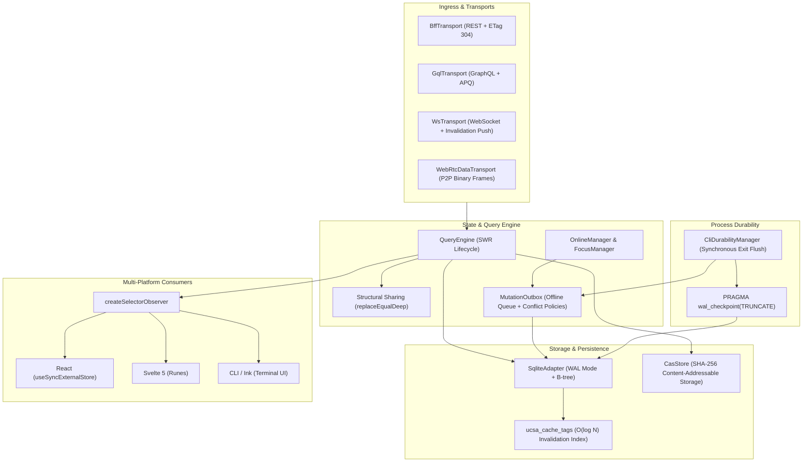
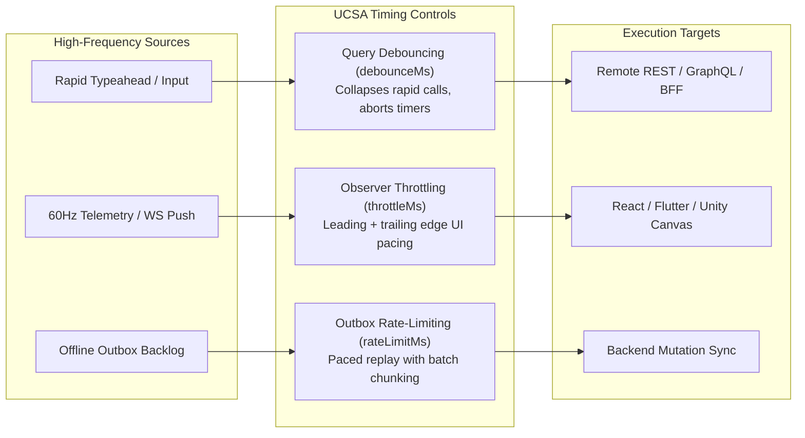
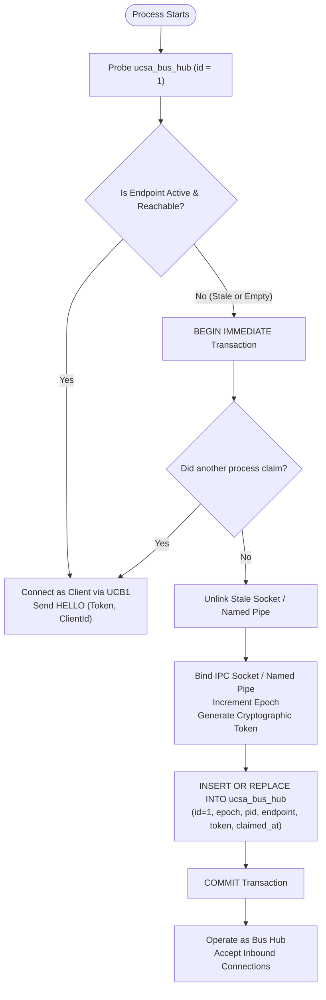
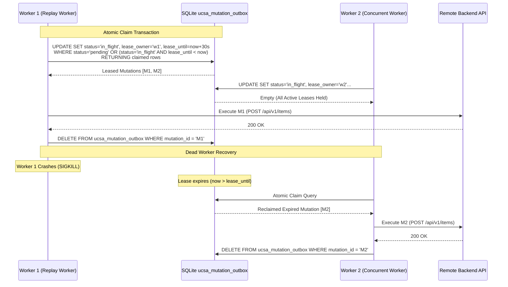
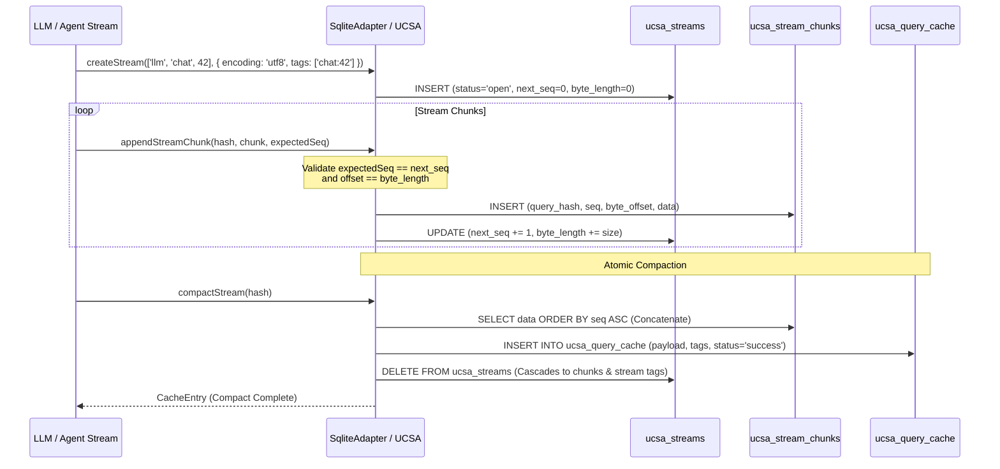
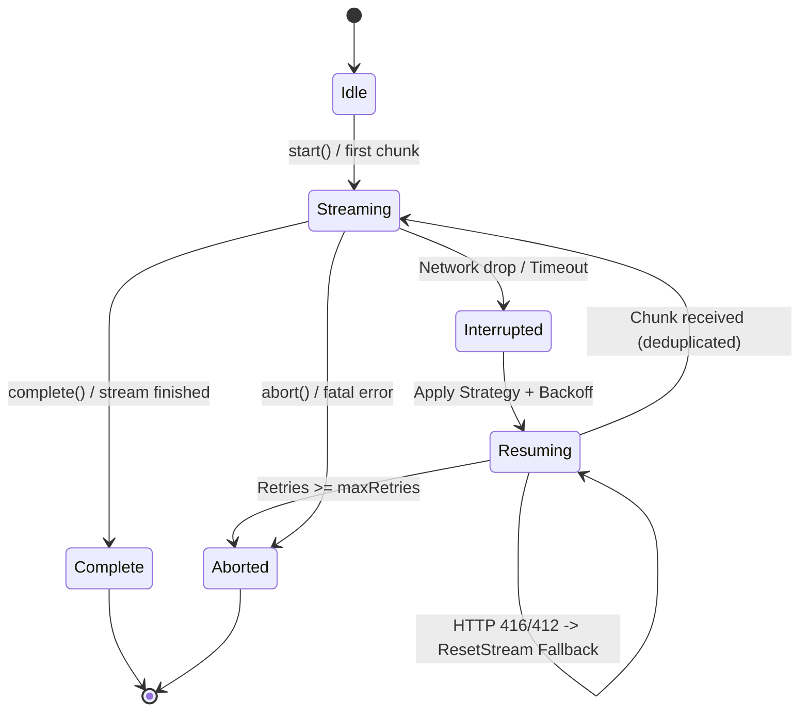
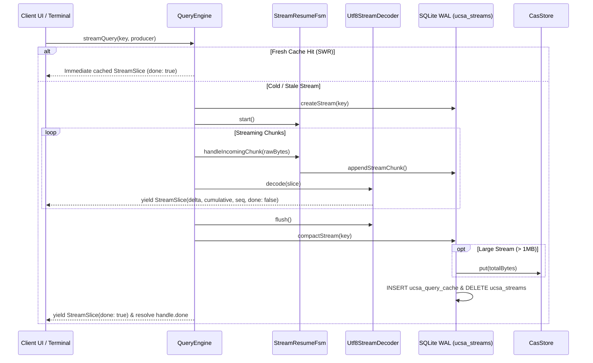

# Unified Client State Architecture (UCSA)

A high-performance, deterministic client-side state and caching engine designed for modern CLI tools, desktop runtimes, and local developer agents.

UCSA combines **TanStack Query**-inspired caching semantics with embedded **SQLite Write-Ahead Logging (WAL)** persistence, indexed **$O(\log N)$ tag invalidation**, **Content-Addressable Storage (CAS)** package caching, and **multi-transport** abstraction.

---

## Core Concepts

### 1. TanStack Query Semantics
UCSA implements standard declarative client state primitives:
- **`QueryKey`**: Deterministic array keys (e.g. `['users', 42, { filter: 'active' }]`) serialized safely without numeric coercion.
- **`QueryStatus`**: Lifecycle states (`'idle' | 'loading' | 'success' | 'error' | 'retrying'`).
- **Cache Lifecycle**: Granular `stale_at` (stale-while-revalidate) and `expires_at` (garbage collection threshold) timestamps per query entry.

### 2. SQLite WAL Persistence
Unlike naive in-memory or single-file JSON caches that corrupt under concurrent access or sudden CLI termination:
- **Write-Ahead Logging**: Configured via `PRAGMA journal_mode = WAL; PRAGMA synchronous = NORMAL;`, allowing concurrent readers while a writer commits.
- **Explicit Affinity**: Query keys and data payloads use strict `TEXT NOT NULL` column affinities, preventing SQLite from coercing numeric strings (e.g. `"0123"`) into numbers.
- **Crash Durability**: Every write is committed through ACID transactions, ensuring atomic mutation outbox transitions and zero corruption if a user sends `SIGINT` (Ctrl+C).

### 3. $O(\log N)$ Tag Invalidation
Invalidating collections by key prefix scanning is $O(N)$. UCSA introduces an indexed junction table:
- **`ucsa_cache_tags`**: Composite primary key `(tag, query_hash)` with foreign key references to `ucsa_query_cache(query_hash) ON DELETE CASCADE`.
- **Targeted Purges**: Invalidation by tag (e.g. `users`, `repo:123`) executes in $O(\log N)$ time using B-tree indexed lookups.
- **Automatic Cascades**: Deleting or replacing a cache entry cascades cleanly across tag index records.

### 4. Content-Addressable Storage (CAS) Package Caching
- State artifacts, schema definitions, and transport payloads are hash-addressed via deterministic digests (`query_hash`).
- Eliminates duplicate payloads across queries and processes.

### 5. Multi-Transport Support
Abstracted via the `TransportAdapter` interface:
- **REST & HTTP**: Standard ETag caching, `304 Not Modified` handling, and conditional requests.
- **GraphQL**: Query document hashing and schema-driven entity tagging.
- **gRPC / WebSockets / SSE**: Unified async subscription protocol with real-time push invalidations.

### 6. Deterministic Schema Versioning & Migrations
- **`PRAGMA user_version`**: Explicit SQLite schema version tracking with transactional guarantees.
- **`ucsa_migrations`**: Immutable ledger recording migration version, name, applied timestamp, and SHA-256 checksum.
- **Canonical Contracts (`contracts/migrations/`)**: Language-neutral baseline SQL definitions shared across TypeScript, Dart, and C#.
- **Zero-Data-Loss Legacy Adoption**: Seamlessly upgrades unversioned databases to version 1 while preserving 100% of cached data.

### 7. Durable Change Log & Cross-Process Reactivity
- **`ucsa_change_log`**: Append-only ledger recording all state invalidations, mutations, streams, and resets with monotonic sequence IDs (`seq`).
- **Atomic Journaling**: Cache deletions and tag invalidations (`invalidateByTag`) execute inside the exact same ACID transaction as the change log insert.
- **Catch-up Reader (`readChangesSince`)**: Lightweight, gap-detecting reader enabling subscriber processes to catch up on missed invalidations without continuous polling or lost events.
- **Opportunistic Pruning**: Safe retention management (`pruneChangeLog`) maintaining the newest 10,000 rows or 24-hour time window.

### 8. Elected Hub, IPC Daemon & Token Authentication
- **In-Process Hub Election**: Dynamic leadership election via SQLite `ucsa_bus_hub` epoch locking with zero lock-file churn.
- **Dedicated Daemon (`ucsa daemon`)**: Standalone background service providing persistent IPC event routing and graceful shutdown handling.
- **Token Authentication & Slow-Consumer Safety**: Mutual auth using database-level tokens, echo-suppressed broadcasts, and automatic `RESYNC` backpressure fallback.

### 9. Generative AI & LLM Streaming Chunk Store
- **`ucsa_streams` & `ucsa_stream_chunks`**: Dedicated append-only tables isolating high-frequency token generation from query cache churn.
- **Strict Ingestion Validation**: Rejects out-of-order chunks and byte offset drift via monotonic sequence and size checks.
- **Atomic Compaction & CAS Offloading**: Coalesces completed streams directly into `ucsa_query_cache` in a single ACID transaction, with automatic offloading to `CasStore` for payloads exceeding 1MB.

### 10. Resumable Streaming Strategies & Failure Recovery
- **Four Resume Strategies**: Pluggable support for HTTP Range (`bytes=X-`), SSE `Last-Event-ID`, application-level continuation, and atomic full restart.
- **Overlap Deduplication**: Slices off redundant sliding window tokens on reconnection to guarantee zero duplicate emission.
- **Adaptive Recovery & 416/412 Fallback**: Automatic status code fallbacks, exponential backoff with full jitter, and transactional SQLite chunk purges.

### 11. Streaming Query API & CLI Live Stream
- **`streamQuery` Returning `StreamHandle`**: Async iterable streaming interface yielding incremental `StreamSlice` tokens.
- **Multi-Byte Safe UTF-8 Decoding**: Zero replacement character (`\uFFFD`) leaks across split multi-byte chunk boundaries.
- **Atomic Cache Compaction & SWR Return**: Immediate cache hit resolution on fresh cache entries and transactional promotion of completed streams into SQLite/CAS query cache.

---

## Architecture Overview

UCSA is structured into five decoupled layers designed for deterministic execution, high-concurrency safety, and zero unnecessary re-renders:



### Architectural Subsystems

1. **Ingress & Transports**: Protocol adapters (`BffTransport`, `GqlTransport`, `WsTransport`, `WebRtcDataTransport`) normalizing remote APIs, real-time push invalidations, and P2P data channels into uniform request/response and event abstractions.
2. **State & Query Engine**: Central `QueryEngine` orchestrating stale-while-revalidate (SWR) lifecycles, memory caching, query cancellation via `AbortSignal`, and deep structural sharing (`replaceEqualDeep`).
3. **Storage & Persistence**: Embedded SQLite backing in WAL mode (`SqliteAdapter`), indexed B-tree tag invalidation (`ucsa_cache_tags`), and cryptographic content-addressable storage (`CasStore`) for package binaries.
4. **Multi-Platform Consumers**: Framework-agnostic observer bindings (`createSelectorObserver`) providing synchronous snapshots and eliminating re-renders across React, Svelte 5, Vue, and CLI terminal components.
5. **CLI Process Durability**: Synchronous exit hooks (`CliDurabilityManager`, `registerExitFlush`) ensuring all in-memory mutations flush and SQLite WAL files checkpoint before ephemeral processes terminate.

---

## Quickstart

### Installation

```bash
pnpm add cli-state-handler
```

### Basic Usage

```typescript
import { SqliteAdapter, type CacheEntry } from 'cli-state-handler';

// 1. Initialize SQLite adapter with file persistence
// Default options apply: journal_mode = WAL, synchronous = NORMAL, busy_timeout = 5000
const adapter = new SqliteAdapter('./.cache/state.db');

// 2. Persist a query with associated invalidation tags
const userQuery: CacheEntry<{ id: number; name: string; role: string }> = {
  query_hash: 'usr_hash_100',
  query_key: ['users', 100],
  data_payload: { id: 100, name: 'Alice', role: 'admin' },
  etag: '"v1.0.0"',
  created_at: Date.now(),
  stale_at: Date.now() + 60_000,       // Stale after 1 minute
  expires_at: Date.now() + 3_600_000,  // Expire after 1 hour
};

adapter.setQuery(userQuery, ['users', 'role:admin', 'tenant:corp']);

// 3. Read cached query
const cached = adapter.getQuery<{ id: number; name: string }>('usr_hash_100');
console.log(cached?.data_payload.name); // "Alice"

// 4. Query hashes by tag
const userHashes = adapter.getQueryHashesByTag('role:admin');
console.log(userHashes); // ['usr_hash_100']

// 5. Invalidate queries by tag
const invalidated = adapter.invalidateByTag('users');
console.log(invalidated); // ['usr_hash_100']

// Clean up connection
adapter.close();
```

---

## QueryEngine & SWR Lifecycle

The `QueryEngine` provides TanStack Query-style asynchronous state caching with synchronous reads, background revalidations, automatic SQLite persistence, structural sharing, and `AbortSignal` cancellation.

### 1. Initialization with SQLite Persistence

`QueryEngine` can operate entirely in-memory or with an optional `SqliteAdapter` backing WAL persistence across CLI invocations.

```typescript
import { SqliteAdapter, QueryEngine } from 'cli-state-handler';

// Initialize SQLite adapter with file persistence
const sqliteAdapter = new SqliteAdapter('./.cache/state.db');

// Instantiate QueryEngine with SQLite persistence and custom defaults
const queryEngine = new QueryEngine({
  sqliteAdapter,
  defaultStaleTime: 30_000, // 30 seconds fresh time
  defaultGcTime: 300_000,   // 5 minutes garbage collection threshold
});
```

### 2. Querying with `fetchQuery` and `useQuery`

#### One-Shot Fetch with `fetchQuery`
`fetchQuery` returns cached data immediately if fresh. If stale or absent, it executes the fetch function, caches the result, and updates the SQLite store:

```typescript
const user = await queryEngine.fetchQuery(
  ['users', 42],
  async ({ signal }) => {
    const res = await fetch('https://api.example.com/users/42', { signal });
    if (!res.ok) throw new Error('Failed to fetch user');
    return res.json();
  },
  { staleTime: 60_000, tags: ['users', 'user:42'] }
);
```

#### Reactive Subscription & SWR with `useQuery`
`useQuery` implements Stale-While-Revalidate (SWR):
- **Immediate Synchronous Read:** If cached in memory or SQLite, `getSnapshot()` immediately returns the cached data without waiting for network I/O.
- **Background Revalidation:** If the cached entry is stale (`Date.now() >= stale_at`), a background fetch is dispatched (`isFetching: true`).
- **Subscription Notification:** When background revalidation completes, subscribers are notified with updated state.

```typescript
const query = queryEngine.useQuery(
  ['users', 42],
  async ({ signal }) => {
    const res = await fetch('https://api.example.com/users/42', { signal });
    return res.json();
  },
  { staleTime: 10_000, tags: ['users'] }
);

// Synchronously read state snapshot
const snapshot = query.getSnapshot();
console.log('Status:', snapshot.status); // 'success' if cached, 'loading' if empty
console.log('Data:', snapshot.data);
console.log('Revalidating:', snapshot.isFetching);

// Subscribe to state transitions
const unsubscribe = query.subscribe(() => {
  const current = query.getSnapshot();
  console.log('Updated state:', current.status, current.data);
});

// Clean up subscription when no longer needed
unsubscribe();
```

### 3. Request Cancellation via `AbortSignal`

All query functions receive a context containing a standard `AbortSignal` (`{ signal }`). If a query is cancelled or superseded, `QueryEngine` aborts the controller:

```typescript
const query = queryEngine.useQuery(
  ['search', 'query-cache'],
  async ({ signal }) => {
    const res = await fetch('https://api.example.com/search?q=query-cache', { signal });
    return res.json();
  }
);

// Cancel the in-flight network request directly
query.cancel();

// Or cancel from the QueryEngine instance using the query key
queryEngine.cancelQuery(['search', 'query-cache']);
```

### 4. Structural Sharing (`replaceEqualDeep`)

CLI UI libraries (such as Ink) and reactive view models re-render whenever state object references change. UCSA incorporates TanStack's deep structural sharing algorithm (`replaceEqualDeep`):

- When background revalidation fetches new data, `replaceEqualDeep` recursively compares the new payload with the cached payload.
- **Reference Preservation:** If the structure and primitive values are identical, the existing memory reference is retained (`prev === next`).
- **Partial Immutability:** If only a subset of nested properties change, unchanged objects and arrays retain their existing references, while only modified parent paths receive new references.
- **Zero Re-Render Penalty:** Prevents unnecessary CLI UI re-renders, flicker, and wasted CPU cycles when background polling returns unchanged data.

### 5. Fast Tag Invalidation (`invalidateByTag`)

Queries can be tagged with domain identifiers (e.g. `users`, `repo:42`). `invalidateByTag` purges cached records from SQLite and marks active memory records as stale in $O(\log N)$ time, automatically triggering background revalidation for active queries:

```typescript
// Invalidate all queries tagged with 'users'
const invalidatedHashes = await queryEngine.invalidateByTag('users');
console.log(`Invalidated ${invalidatedHashes.length} queries`);
```

### 6. Payload Versioning Pipeline & On-Read Upcasting (`PayloadRegistry`)

When application data models evolve across releases, cached payloads on disk may reflect older schemas. UCSA provides `PayloadRegistry` and lazy on-read upcasting integrated directly into `QueryEngine`:

- **Canonical Migration `0002_payload_version.sql`**: Introduces a dedicated `payload_version INTEGER NOT NULL DEFAULT 1` column to `ucsa_query_cache` with an index, tracking version numbers per cached query row across TypeScript, Dart, and C#.
- **Sequential Multi-Version Chaining**: Define discrete step transformations (e.g. `v1 -> v2` and `v2 -> v3`). The engine uses breadth-first search (BFS) to automatically discover the shortest chained transformation path (e.g. `1 -> 2 -> 3`).
- **Lazy On-Read Elevation**: When `getQueryData`, `fetchQuery`, or `useQuery` reads a cache entry whose `payload_version < targetPayloadVersion`, it transforms the payload transparently into the target structure without blocking or requiring bulk offline database rewrites.
- **Immediate Write-Back**: Upcasted payloads and their updated version numbers are persisted back to SQLite without adding latency to the consumer read path.
- **Prefix & Wildcard Routing**: Upcasters are registered by query key prefixes or patterns (e.g. `['users', '*']`), allowing fine-grained domain payload transformations.

```typescript
import { QueryEngine, SqliteAdapter, PayloadRegistry } from 'cli-state-handler';

// 1. Define transformation steps in the payload registry
const registry = new PayloadRegistry();

// Step 1 -> 2: Flatten user profile name
registry.register<{ name: string }, { fullName: string; migrated: boolean }>(
  'users',
  1,
  2,
  (v1, ctx) => ({
    fullName: v1.name,
    migrated: true,
  })
);

// Step 2 -> 3: Nest into structured user object
registry.register<{ fullName: string; migrated: boolean }, { profile: { fullName: string }; v: 3 }>(
  'users',
  2,
  3,
  (v2, ctx) => ({
    profile: { fullName: v2.fullName },
    v: 3,
  })
);

// 2. Configure QueryEngine with registry and target version
const sqliteAdapter = new SqliteAdapter('./.cache/state.db');
const engine = new QueryEngine({
  sqliteAdapter,
  payloadRegistry: registry,
  targetPayloadVersion: 3,
});

// 3. Read cached entry - automatically chains 1 -> 2 -> 3 and writes back to SQLite
const user = engine.getQueryData<{ profile: { fullName: string }; v: 3 }>(['users', 42]);
console.log(user?.profile.fullName);
```

---

## Content-Addressable Storage (CAS)

The `CasStore` provides a high-performance content-addressable storage engine for package binaries, heavy assets, and cached payloads. Every object is addressed strictly by its cryptographic SHA-256 digest, guaranteeing immutability, deduplication, and verification across CLI processes.

### 1. Initialization with SQLite Tracking & Quota Limits

`CasStore` can operate standalone on the filesystem or coupled with `SqliteAdapter` for access tracking and LRU quota enforcement:

```typescript
import { SqliteAdapter, CasStore } from 'cli-state-handler';

const sqliteAdapter = new SqliteAdapter('./.cache/state.db');

// Initialize CAS store with root directory, SQLite indexer, and a 500 MB max quota
const cas = new CasStore({
  baseDir: './.cache/cas',
  sqliteAdapter,
  maxSizeBytes: 500 * 1024 * 1024, // 500 MB quota
});

await cas.init();
```

### 2. Atomic Writes & SHA-256 Verification (`put`)

To eliminate corruptions caused by interrupted CLI processes or sudden termination (`SIGINT`/Ctrl+C), `CasStore` never writes directly to its final destination path:

1. **Staged Temporary Write:** Data is written to `<baseDir>/tmp/<uuid>.tmp`.
2. **Checksum Verification:** The SHA-256 digest is computed on the fly. If `expectedHash` is provided and does not match, the temporary file is unlinked immediately and an `IntegrityError` is thrown.
3. **Atomic Rename:** The file is atomically renamed into the sharded storage tree `<baseDir>/objects/<hash[0..2]>/<hash>`.
4. **Metadata Indexing:** If `sqliteAdapter` is configured, object size and access timestamp are recorded in the `ucsa_cas_objects` table.

```typescript
const packageBuffer = Buffer.from('console.log("hello world");');

// Automatic SHA-256 calculation & atomic write
const result = await cas.put(packageBuffer);
console.log('SHA-256 Hash:', result.hash);
console.log('Disk Path:', result.path); // .cache/cas/objects/d4/d41d8cd9...
console.log('Size (bytes):', result.size);

// With optional expected hash verification:
try {
  await cas.put(packageBuffer, 'expected-sha256-hash...');
} catch (err) {
  if (err instanceof IntegrityError) {
    console.error(`Integrity mismatch: expected ${err.expected}, got ${err.actual}`);
  }
}
```

### 3. Object Retrieval & Access Touch (`get`)

When retrieving objects using `get(hash)`:
- Returns the binary `Buffer` or `null` if the object does not exist.
- **Filesystem `mtime` Touch:** Automatically updates the filesystem modification timestamp (`fs.utimes`) on hit.
- **SQLite Access Timestamp Update:** Updates `last_accessed_at` in the SQLite database to keep LRU tracking current.

```typescript
const data = await cas.get(result.hash);
if (data) {
  console.log('Retrieved content length:', data.length);
}

// Fast existence check
const exists = await cas.has(result.hash);
```

### 4. LRU Pruning & High-Watermark Eviction

When multiple packages or build artifacts accumulate, disk space must be bounded:
- **High-Watermark Trigger:** When `put()` detects that total tracked storage exceeds `maxSizeBytes` (the high watermark), `prune()` is triggered automatically.
- **Target Ratio Eviction:** The LRU pruner identifies candidate objects ordered by `last_accessed_at ASC` and purges the oldest unaccessed objects until total storage drops to the target ratio (defaulting to 70% of quota).
- **Manual Eviction:** You can also trigger pruning manually with custom target ratios or quota overrides:

```typescript
// Manually prune down to 70% of quota
const { prunedCount, bytesFreed } = await cas.prune(0.7);
console.log(`Pruned ${prunedCount} objects, freed ${bytesFreed} bytes`);
```

### 5. Why Explicit SQLite Tracking Circumvents OS `noatime` Limits

Modern Linux, macOS, and container environments (such as Docker, Kubernetes, or cloud VMs) mount filesystems with `noatime` or `relatime` by default to minimize disk write I/O overhead. Under `noatime`, read operations do not update inode access times on disk, rendering standard filesystem-level `atime`-based LRU algorithms ineffective or wildly inaccurate.

To circumvent this OS limitation reliably:
1. `CasStore` records access timestamps explicitly inside the embedded SQLite database table `ucsa_cas_objects (hash TEXT PRIMARY KEY, size INTEGER NOT NULL, last_accessed_at INTEGER NOT NULL)`.
2. Every `get()` and `put()` updates `last_accessed_at` within SQLite transactions, backed by SQLite's WAL mode.
3. Disk quota calculations (`getTotalCasSize`) and eviction candidate ordering (`getLruCasObjects`) execute in $O(\log N)$ or fast index scans directly from SQLite B-trees without traversing directory trees on disk.

---

## Pluggable Network Transports & Managers

UCSA abstracts network protocols and runtime connectivity behind uniform interfaces, allowing local developer agents, CLI tools, and desktop applications to seamlessly adapt across diverse protocols and transient network states.

### 1. BFF REST Transport (`BffTransport`)

`BffTransport` provides an HTTP client tailored for Backend-for-Frontend (BFF) REST architectures, featuring automatic Bearer token injection, conditional ETag caching (`304 Not Modified`), and RFC 7807 Problem Details error translation.

```typescript
import { BffTransport, BffHttpError } from 'cli-state-handler';

// Initialize BFF transport with base URL and dynamic auth token getter
const bff = new BffTransport({
  baseUrl: 'https://api.example.com',
  token: async () => {
    // Dynamically retrieve or refresh session token
    return await getCliAuthToken();
  },
  headers: {
    'X-Client-Id': 'developer-agent-cli',
  },
});

// 1. First fetch: Server responds with 200 OK + ETag: "v1-cache-hash"
const response1 = await bff.fetch<{ id: number; name: string }>({
  endpoint: '/v1/users/42',
  method: 'GET',
});
console.log('Status:', response1.status); // 200
console.log('ETag:', response1.etag);     // '"v1-cache-hash"'
console.log('Data:', response1.data);

// 2. Subsequent fetch: Automatically sends `If-None-Match: "v1-cache-hash"`
// When server responds with 304 Not Modified, bff returns the cached data without payload overhead
const response2 = await bff.fetch<{ id: number; name: string }>({
  endpoint: '/v1/users/42',
});
console.log('Status:', response2.status); // 304
console.log('Data (cached):', response2.data);

// 3. RFC 7807 Problem Details error handling
try {
  await bff.fetch({ endpoint: '/v1/restricted' });
} catch (err) {
  if (err instanceof BffHttpError) {
    console.error(`HTTP ${err.status}: ${err.message}`);
    console.error('Problem Details:', err.problemDetails?.detail);
  }
}
```

### 2. GraphQL Transport (`GqlTransport`)

`GqlTransport` provides execution for GraphQL queries and mutations, supporting Automatic Persisted Queries (APQ) via SHA-256 document hashes, automatic response unwrapping, and structured `GqlError` extraction.

```typescript
import { GqlTransport, GqlError } from 'cli-state-handler';

const gql = new GqlTransport({
  endpoint: 'https://api.example.com/graphql',
  token: 'bearer-api-token',
});

// 1. Standard GraphQL query execution
const userResult = await gql.fetch<{ user: { id: string; name: string } }>({
  payload: {
    query: `
      query GetUser($id: ID!) {
        user(id: $id) {
          id
          name
        }
      }
    `,
    variables: { id: 'u-100' },
  },
});
console.log('User:', userResult.data.user);

// 2. Persisted Document Query (APQ) using SHA-256 hash
// Payload sends { variables, extensions: { persistedQuery: { version: 1, sha256Hash } } }
const ordersResult = await gql.fetch<{ orders: Array<{ id: number; total: number }> }>({
  payload: {
    sha256Hash: 'a6c8e31b67f1b2c4e5f6a7b8c9d0e1f2a3b4c5d6e7f8a9b0c1d2e3f4a5b6c7d8',
    variables: { limit: 10 },
  },
});
console.log('Orders:', ordersResult.data.orders);
```

### 3. WebSocket Transport (`WsTransport`)

`WsTransport` provides real-time bidirectional communication featuring a Finite State Machine (FSM) connection lifecycle, periodic ping/pong keepalive frames, exponential backoff reconnection, and real-time cache invalidation listeners.

```typescript
import { WsTransport, QueryEngine } from 'cli-state-handler';

const queryEngine = new QueryEngine();

const ws = new WsTransport({
  url: 'wss://realtime.example.com/state',
  pingInterval: 30_000,       // Send heartbeat ping every 30s
  pongTimeout: 10_000,        // Await pong response for 10s
  reconnect: true,            // Auto-reconnect with exponential backoff
  reconnectBaseDelay: 500,    // Initial backoff delay (500ms)
  reconnectMaxDelay: 30_000,  // Max backoff delay (30s)
});

// Track connection lifecycle transitions
ws.onStateChange((state) => {
  // States: 'connecting' | 'connected' | 'reconnecting' | 'disconnected'
  console.log(`WebSocket state changed: ${state}`);
});

// Listen for server push invalidation frames: { type: 'INVALIDATE', tags: ['users', 'repo:42'] }
// Automatically invalidates matching queries in the QueryEngine
ws.subscribe((event) => {
  if (event.type === 'INVALIDATE' && event.tags) {
    for (const tag of event.tags) {
      queryEngine.invalidateByTag(tag);
      console.log(`Cache tag invalidated via push: ${tag}`);
    }
  }
});

// Open connection
ws.connect();

// Multiplexed request/response over WebSocket
const res = await ws.fetch({
  endpoint: 'subscribe.events',
  payload: { topic: 'deployments' },
});
```

### 4. WebRTC DataChannel Transport (`WebRtcDataTransport`)

`WebRtcDataTransport` enables peer-to-peer (P2P) low-latency state synchronization over WebRTC `RTCDataChannel`, featuring binary frame packing and real-time state invalidation framing.

```typescript
import { WebRtcDataTransport } from 'cli-state-handler';

const rtc = new WebRtcDataTransport();

// Track DataChannel lifecycle
rtc.onStateChange((state) => {
  // States: 'new' | 'connecting' | 'connected' | 'disconnected' | 'failed' | 'closed'
  console.log(`WebRTC state: ${state}`);
});

// Bind an established browser or Node WebRTC data channel
rtc.bindDataChannel(peerDataChannel);

// Subscribe to incoming P2P invalidation events
rtc.subscribe((event) => {
  console.log('Received P2P cache invalidation:', event.tags);
});

// Low-latency binary framing: [1-byte FrameType] [4-byte Length] [Payload]
// Type 0x01: JSON Invalidation message
const frame = WebRtcDataTransport.encodeFrame(
  0x01,
  JSON.stringify({ type: 'INVALIDATE', tags: ['p2p:workspace:active'] })
);
rtc.sendRaw(frame);

// Decode received binary frames
const decoded = WebRtcDataTransport.decodeFrame(receivedBuffer);
console.log('Decoded frame type:', decoded.type);
```

### 5. Online & Focus Managers (`OnlineManager`, `FocusManager`)

`OnlineManager` and `FocusManager` track connectivity and window/tab/terminal focus state, coordinating background cache revalidation and outbox replays when network connectivity is restored or an application returns to the foreground.

```typescript
import {
  OnlineManager,
  FocusManager,
  onlineManager,
  focusManager,
  QueryEngine,
  MutationOutbox,
} from 'cli-state-handler';

// 1. OnlineManager: Monitors network connectivity
onlineManager.subscribe((isOnline) => {
  console.log(`Network status: ${isOnline ? 'Online' : 'Offline'}`);
  if (isOnline) {
    // Replay queued offline mutations upon reconnection
    outbox.replay(mutationExecutor);
  }
});

// Custom network event listener for CLI / Node.js runtimes
onlineManager.setEventListener((setOnline) => {
  const checkConnection = async () => {
    // Custom OS or DNS probe logic
    setOnline(true);
  };
  const timer = setInterval(checkConnection, 10_000);
  return () => clearInterval(timer);
});

// 2. FocusManager: Monitors terminal/window foreground focus
focusManager.subscribe((isFocused) => {
  console.log(`Window focus: ${isFocused ? 'Focused' : 'Unfocused'}`);
  if (isFocused) {
    // Trigger SWR background revalidations for active queries
  }
});
```

### 6. Offline Mutation Outbox & Conflict Resolution (`MutationOutbox`)

`MutationOutbox` persists mutations performed while offline into an embedded SQLite table (`ucsa_mutation_outbox`). When connectivity is restored, pending mutations are replayed sequentially with deterministic conflict resolution on HTTP 409.

#### Conflict Resolution Policies

| Policy | Behavior on HTTP 409 Conflict | Mechanism |
| :--- | :--- | :--- |
| **`server-wins`** | Discards local modification and adopts upstream authoritative state. | Executes `onRollback(mutation)` callback to restore previous client state, then removes mutation from the outbox. |
| **`client-wins`** | Enforces local modification over remote state. | Re-queues mutation with `forced: 1` and `X-Force-Overwrite: true` header to overwrite upstream on replay. |
| **`merge`** | Reconciles local and server states via domain logic. | Executes `mergeResolver(localPayload, serverConflictData)`, updates SQLite payload with the merged result, and remains queued for replay. |

```typescript
import { SqliteAdapter, MutationOutbox, type OutboxMutation } from 'cli-state-handler';

const sqliteAdapter = new SqliteAdapter('./.cache/state.db');
const outbox = new MutationOutbox({
  sqliteAdapter,
  maxRetries: 3, // Retry transient 5xx or connection drops up to 3 times before marking 'failed'
});

// 1. Enqueue an offline mutation with 'server-wins' policy
outbox.enqueue({
  mutation_id: 'mut-profile-edit',
  endpoint: '/api/v1/profile',
  method: 'PATCH',
  payload: { displayName: 'Alice L.' },
  conflictPolicy: 'server-wins',
  onRollback: (mutation) => {
    console.warn(`409 Conflict: Rolling back optimistic update for ${mutation.mutation_id}`);
    // Roll back in-memory or UI state to server value
  },
});

// 2. Enqueue an offline mutation with 'client-wins' policy
outbox.enqueue({
  mutation_id: 'mut-document-title',
  endpoint: '/api/v1/documents/101',
  method: 'PUT',
  payload: { title: 'Final Report (Approved)' },
  conflictPolicy: 'client-wins',
  // On 409, automatically re-queued with forced: 1 and headers: { 'X-Force-Overwrite': 'true' }
});

// 3. Enqueue an offline mutation with 'merge' policy
outbox.enqueue({
  mutation_id: 'mut-task-labels',
  endpoint: '/api/v1/tasks/55',
  method: 'PATCH',
  payload: { tags: ['urgent'], status: 'in_progress' },
  conflictPolicy: 'merge',
  mergeResolver: (localData: any, serverData: any) => ({
    ...serverData,
    ...localData,
    tags: Array.from(new Set([...serverData.tags, ...localData.tags])),
  }),
});

// 4. Replay pending mutations sequentially
const result = await outbox.replay(
  async (mutation: OutboxMutation) => {
    const res = await fetch(`https://api.example.com${mutation.endpoint}`, {
      method: mutation.method,
      headers: {
        'Content-Type': 'application/json',
        ...(mutation.headers || {}),
      },
      body: mutation.payload ? JSON.stringify(mutation.payload) : undefined,
    });

    return {
      status: res.status,
      data: await res.json().catch(() => null),
    };
  }
);

console.log(`Replay complete: ${result.successful} successful, ${result.failed} failed, ${result.processed} processed.`);
```

---

## Concurrency & CLI Durability Guarantees

In multi-command CLI workflows, multiple CLI processes or subagents frequently access the same cache database in parallel:

| Guarantee | Mechanism | Benefit |
| :--- | :--- | :--- |
| **No `SQLITE_BUSY` Crashes** | `PRAGMA busy_timeout = 5000;` | Concurrent CLI processes automatically back off and retry for up to 5 seconds during lock contention. |
| **Concurrent Reads & Writes** | `PRAGMA journal_mode = WAL;` | Long-running queries or reads never block incoming mutations; writers write to the write-ahead log without waiting for active readers. |
| **Strict Type Serialization** | `TEXT NOT NULL` affinity | Prevents JSON key corruption, preserves exact numeric keys, and guarantees array structure integrity across deserialization. |
| **Atomic Outbox Queue** | `ucsa_mutation_outbox` table | CLI mutations performed offline or during transient failures are stored with transaction isolation (`pending`, `in_flight`, `failed`) and replayed reliably. |
| **Cascade Consistency** | SQLite Foreign Key Cascade | Eliminates orphaned tag mappings when cache records expire or get deleted. |

---

## Consumer Bindings & Zero Re-render Selectors

In modern reactive UI architectures (React 18/19, Svelte 5 runes, Vue) and CLI terminal interfaces (Ink, Pastel), re-rendering components is expensive. Naive state subscriptions notify components on every query fetch or cache touch, causing unnecessary re-renders even when the queried data has not changed or when changes affect unrelated fields outside the component's concern.

`createSelectorObserver` bridges `QueryEngine` to UI/CLI subscriber models with **guaranteed zero unnecessary notifications**:

### Re-render Elimination Guarantees

| Scenario | Cache State | Component Re-render Count | Mechanism |
| :--- | :--- | :--- | :--- |
| **Initial Fetch** | Empty -> Populated | **Exactly 1** | Synchronous initial snapshot + notification on initial payload arrival. |
| **Background Revalidation** | Identical payload | **0 (Zero)** | `replaceEqualDeep` preserves exact reference (`prev === next`). |
| **Unselected Field Mutation** | Sibling field altered | **0 (Zero)** | Selector output reference/value is identical (`isEqual` returns `true`). |
| **Selected Slice Mutation** | Target field altered | **Exactly 1** | Notification dispatched; reference preserved for unchanged sub-trees. |
| **Rapid Burst Polling** | 10+ identical bursts | **0 (Zero)** | Structural sharing prevents duplicate subscriber dispatches. |

### API Usage

```typescript
import { createSelectorObserver, QueryEngine } from 'cli-state-handler';

const engine = new QueryEngine();
const queryKey = ['users', 'profile', 42];

// Create observer selecting only the user's display name
const observer = createSelectorObserver(
  engine,
  queryKey,
  (user: { id: number; name: string; avatarUrl: string; theme: string }) => user.name,
  {
    // Optional: auto-fetch on subscription if cache is empty
    queryFn: async () => fetchUserData(42),
    // Optional: custom equality comparator (defaults to deep structural equality)
    isEqual: (prev, next) => prev === next,
  }
);

// 1. Synchronously read current snapshot
const currentName = observer.getSnapshot(); // "Alice"

// 2. Subscribe listener (fires ONLY when user.name changes)
const unsubscribe = observer.subscribe(() => {
  console.log('User name updated to:', observer.getSnapshot());
});

// Clean up
unsubscribe();
```

### React Integration (`useSyncExternalStore`)

`createSelectorObserver` adheres to the React `useSyncExternalStore` contract:

```typescript
import { useMemo, useSyncExternalStore } from 'react';
import {
  createSelectorObserver,
  type QueryEngine,
  type QueryKey,
} from 'cli-state-handler';

export function useQuerySelector<TData, TSelected>(
  engine: QueryEngine,
  queryKey: QueryKey,
  selector: (data: TData) => TSelected
): TSelected | undefined {
  const serializedKey = JSON.stringify(queryKey);

  const observer = useMemo(
    () => createSelectorObserver(engine, queryKey, selector),
    [engine, serializedKey]
  );

  return useSyncExternalStore(
    observer.subscribe,
    observer.getSnapshot,
    observer.getSnapshot
  );
}

// React Component Example
function UserBadge({ engine, userId }: { engine: QueryEngine; userId: string }) {
  // Re-renders ONLY when `name` changes, ignoring avatar/settings updates
  const userName = useQuerySelector(
    engine,
    ['users', userId],
    (user: any) => user?.name
  );

  return <span className="badge">{userName ?? 'Loading...'}</span>;
}
```

### Svelte 5 Integration (Runes)

```svelte
<script lang="ts">
  import { createSelectorObserver, type QueryEngine } from 'cli-state-handler';

  interface Props {
    engine: QueryEngine;
    packageId: string;
  }
  const { engine, packageId }: Props = $props();

  const observer = createSelectorObserver(
    engine,
    ['packages', packageId],
    (pkg: { name: string; version: string; downloads: number }) => ({
      name: pkg.name,
      version: pkg.version,
    })
  );

  let pkgInfo = $state(observer.getSnapshot());

  $effect(() => {
    const unsubscribe = observer.subscribe(() => {
      pkgInfo = observer.getSnapshot();
    });
    return unsubscribe;
  });
</script>

<div>
  <h3>{pkgInfo?.name ?? 'Loading...'}</h3>
  <code>{pkgInfo?.version}</code>
</div>
```

### CLI & Terminal Integration (Ink)

```typescript
import React, { useState, useEffect } from 'react';
import { Text, Box } from 'ink';
import { createSelectorObserver, type QueryEngine } from 'cli-state-handler';

export function CliDeploymentStatus({
  engine,
  deployId,
}: {
  engine: QueryEngine;
  deployId: string;
}) {
  const observer = React.useMemo(
    () =>
      createSelectorObserver(
        engine,
        ['deployments', deployId],
        (d: any) => d?.status
      ),
    [engine, deployId]
  );

  const [status, setStatus] = useState(observer.getSnapshot());

  useEffect(() => {
    return observer.subscribe(() => {
      setStatus(observer.getSnapshot());
    });
  }, [observer]);

  return (
    <Box borderStyle="round" borderColor="cyan" padding={1}>
      <Text bold>Deployment [{deployId}]: </Text>
      <Text color={status === 'success' ? 'green' : 'yellow'}>
        {status ?? 'Pending'}
      </Text>
    </Box>
  );
}
```

---

## Timing Controls: Observer Throttling, Query Debouncing & Outbox Rate-Limiting

In high-throughput event environments (such as 60Hz real-time telemetry, rapid user typeahead, and offline mutation replays), unbounded execution causes UI frame drops, duplicate network storms, and HTTP `429 Too Many Requests` API rejections.

UCSA provides native, zero-dependency **Timing Controls** across TypeScript Core, Dart 3+, and C# Unity:



### 1. Observer Throttling & Debouncing

Rate-limits consumer observer updates during high-frequency data arrival while guaranteeing the newest snapshot is always delivered:

- **Throttling (`throttleMs`)**: Executes the **leading edge immediately** (`now - lastInvoked >= throttleMs`), and automatically schedules a **trailing edge invocation** with the newest state snapshot when the throttle window expires.
- **Debouncing (`debounceMs`)**: Postpones subscriber notification until data arrival has ceased for the specified quiet duration.

#### TypeScript
```typescript
import { createSelectorObserver } from 'cli-state-handler';

// Throttle high-frequency updates to at most once every 100ms
const observer = createSelectorObserver(
  engine,
  ['market', 'ticks'],
  (data: MarketData) => data.lastPrice,
  {
    throttleMs: 100, // Leading edge immediate + trailing edge newest snapshot
  }
);
```

#### Dart & Flutter
```dart
final observer = SelectorObserver<MarketData, double>(
  engine: engine,
  queryKey: ['market', 'ticks'],
  selector: (data) => data.lastPrice,
  throttleDuration: const Duration(milliseconds: 100),
);
```

#### C# Unity
```csharp
var observer = new StateObserver<MarketData, float>(
    data => data.LastPrice,
    throttleMs: 100
);
```

---

### 2. Query Execution Debouncing & Cancellation

Collapses rapid burst query invocations (e.g. search suggestions as the user types) into a single remote network fetch. Any pending debounce timer is automatically superseded and cancelled when a new query invocation arrives or when `cancelQuery()` is invoked.

#### TypeScript
```typescript
// Rapid search typeahead collapsed into a single network execution
const results = await engine.fetchQuery(
  ['search', userInput],
  async ({ signal }) => fetchSearchResults(userInput, signal),
  { debounceMs: 150 }
);

// Standalone helper
import { debounceQuery } from 'cli-state-handler';
const data = await debounceQuery(engine, ['search', q], fetchFn, 150);

// Explicit cancellation aborts timer without firing queryFn
engine.cancelQuery(['search', userInput]);
```

#### Dart
```dart
final results = await engine.fetchQuery<SearchResults>(
  ['search', query],
  (ct) => searchApi(query),
  debounceDuration: const Duration(milliseconds: 150),
);
```

#### C# Unity
```csharp
// Debounced query with CancellationToken support
var results = await engine.FetchQueryAsync(
    new object[] { "search", query },
    async ct => await SearchApiAsync(query, ct),
    new QueryOptions { DebounceMs = 150 }
);

// Or via convenience helper
var data = await engine.DebounceQueryAsync(
    new object[] { "search", query },
    queryFn,
    150
);
```

---

### 3. Outbox Batch Replay Rate-Limiting

Replaying offline mutation queues across unstable cellular or embedded connections risks triggering HTTP `429 Too Many Requests` or overwhelming servers. `MutationOutbox.replay()` supports **pacing intervals** and **batch size chunking**:

#### TypeScript
```typescript
// Replay mutations in batches of 10 with 50ms pacing between requests
const result = await outbox.replay(
  async (mutation) => transport.send(mutation),
  {
    rateLimitMs: 50, // 50ms pacing between successive requests
    batchSize: 10,   // Process in chunks of 10 mutations per replay pass
  }
);
console.log(`Replayed ${result.successful}/${result.processed} mutations`);
```

#### Dart
```dart
final result = await adapter.replayOutbox(
  (mutation) => sendToServer(mutation),
  rateLimit: const Duration(milliseconds: 50),
  batchSize: 10,
);
```

#### C# Unity
```csharp
var result = await adapter.ReplayOutboxAsync<object>(
    async mutation => await SendMutationAsync(mutation),
    rateLimitMs: 50,
    batchSize: 10
);
```

---

## CLI Ephemeral Process Durability & Flush Manager

CLI commands and background developer subagents execute in short-lived, ephemeral processes. If a CLI command exits immediately upon output completion or gets terminated prematurely (`SIGINT`, `process.exit()`, terminal window close), in-memory queues and uncheckpointed SQLite Write-Ahead Log (WAL) frames can remain on disk, causing dirty state or uncommitted outbox mutations.

`CliDurabilityManager` resolves this by providing **guaranteed synchronous exit flushes**:

### Key Capabilities

1. **Synchronous Exit Interception**: Attaches directly to Node.js `beforeExit` and `exit` lifecycle events.
2. **Deterministic Priority Queue**: Handlers execute synchronously in strict priority order (higher numbers first; FIFO for equal priority).
3. **SQLite WAL Truncation**: Flushes WAL pages via `PRAGMA wal_checkpoint(TRUNCATE);`, eliminating orphaned `-wal` files and committing all transactions directly to the database file.
4. **Error Isolation**: Catches handler errors gracefully so that remaining flushers always complete even if one handler fails.

```typescript
import {
  CliDurabilityManager,
  registerExitFlush,
  SqliteAdapter,
  MutationOutbox,
} from 'cli-state-handler';

const sqlite = new SqliteAdapter('./.cache/state.db', { journalMode: 'WAL' });
const outbox = new MutationOutbox({ sqliteAdapter: sqlite });

// 1. Using the Global Durability Manager
// Register in-memory outbox flush at priority 10
registerExitFlush(() => {
  console.log('Flushing pending outbox records to disk...');
}, 10);

// Register SQLite WAL checkpoint at priority -100
// WAL checkpoint executes after all in-memory writes have committed
registerExitFlush(() => {
  sqlite.checkpoint('TRUNCATE');
}, -100);

// 2. Or using an isolated CliDurabilityManager instance
const durability = new CliDurabilityManager({
  onError: (err) => console.error('Durability flush failed:', err),
});

// Helper for automatic SQLite checkpoint registration
durability.registerSqliteCheckpoint(sqlite, -100, 'TRUNCATE');

// Manually trigger synchronous flush before intentional exit
durability.flushAll();
```

---

## Dart / Flutter Reference Implementation (`packages/ucsa_dart`)

The `packages/ucsa_dart` package provides the official pure Dart 3+ reference implementation of the Unified Client State Architecture. It delivers 100% feature parity with the TypeScript core engine, running natively across Flutter mobile (iOS, Android), desktop (macOS, Windows, Linux), web, and Dart CLI/server applications.

### Architecture Overview

1. **Pure Dart 3+ Sealed Classes & Lifecycle FSM**:
   The 5-stage lifecycle state machine is implemented via Dart 3 sealed class hierarchies (`FsmState<TData, TError>` with `IdleState`, `LoadingState`, `RetryingState`, `SuccessState`, and `ErrorState`). Exhaustive pattern matching guarantees compile-time completeness, combined with decorrelated exponential backoff and randomized full jitter for robust network recovery.

2. **SQLite WAL Storage Engine**:
   Native SQLite integration via `package:sqlite3` configured with `PRAGMA journal_mode = WAL; PRAGMA synchronous = NORMAL; busy_timeout = 5000;`. Manages strict text affinity tables (`ucsa_query_cache`, `ucsa_cache_tags`, `ucsa_mutation_outbox`, `ucsa_cas_objects`), enabling $O(\log N)$ tag invalidation via B-tree composite indexes and ACID outbox durability.

3. **Content-Addressable Storage (CAS)**:
   `CasStore` provides cryptographic SHA-256 hash-addressed artifact storage. Implements two-character directory sharding (`objects/ab/abcdef...`), atomic temporary file promotion (`.tmp_<id>` $\to$ rename), ingestion checksum verification, and SQLite access-time tracking for automatic LRU cache quota eviction.

4. **Stream & Listenable Zero-Rebuild Selector Observer**:
   `SelectorObserver<TData, TSelected>` monitors query entries and performs deep structural comparisons (`replaceEqualDeep`). Emissions only trigger when the mapped slice actually mutates, completely eliminating redundant widget rebuilds in Flutter. Exposes both reactive Dart `Stream<TSelected?>` and synchronous snapshot getters for Flutter `StatefulWidget`, `ValueListenableBuilder`, or `StreamBuilder`.

---

### Code Examples

#### 1. Initializing `SqliteAdapter`, `QueryEngine`, and Executing SWR Queries

```dart
import 'package:ucsa_dart/ucsa_dart.dart';

void main() async {
  // 1. Initialize SQLite persistence adapter in WAL mode
  final adapter = SqliteAdapter('./.cache/state_dart.db', journalMode: 'WAL');
  adapter.initSchema();

  // 2. Initialize QueryEngine with default stale and GC durations
  final engine = QueryEngine(
    sqliteAdapter: adapter,
    defaultStaleTime: const Duration(seconds: 30),
    defaultGcTime: const Duration(minutes: 5),
  );

  final queryKey = ['users', 42];

  // 3. Fetch query with automatic caching and tag registration
  final user = await engine.fetchQuery<Map<String, dynamic>>(
    queryKey,
    () async {
      // Fetch user data from remote network API
      return {'id': 42, 'name': 'Alice', 'role': 'engineer'};
    },
    staleTime: const Duration(minutes: 1),
    tags: ['users', 'role:engineer'],
  );
  print('Fetched user: ${user['name']}');

  // 4. Invalidate all queries tagged with 'users' in O(log N) time
  final invalidatedHashes = engine.invalidateByTag('users');
  print('Invalidated query hashes: $invalidatedHashes');

  // 5. Watch query with Stale-While-Revalidate (SWR) semantics
  final watcher = engine.watchQuery<Map<String, dynamic>>(
    queryKey,
    queryFn: () async => {'id': 42, 'name': 'Alice Smith', 'role': 'engineer'},
  );

  // Read current cached snapshot immediately
  print('Immediate snapshot: ${watcher.state.data?['name']}');

  // Listen to background revalidation updates
  final sub = watcher.stream.listen((state) {
    if (state.status == QueryStatus.success) {
      print('Background revalidation completed: ${state.data?['name']}');
    }
  });

  // Clean up
  await sub.cancel();
  watcher.dispose();
  adapter.close();
}
```

#### 2. `SelectorObserver` for Flutter Widget Rebuild Elimination

```dart
import 'package:flutter/material.dart';
import 'package:ucsa_dart/ucsa_dart.dart';

/// Flutter widget utilizing SelectorObserver to eliminate unnecessary rebuilds.
/// The widget rebuilds ONLY when the selected slice (user's name) changes,
/// completely ignoring updates to avatar, status, or timestamps.
class UserProfileTitle extends StatefulWidget {
  final QueryEngine engine;
  final int userId;

  const UserProfileTitle({
    super.key,
    required this.engine,
    required this.userId,
  });

  @override
  State<UserProfileTitle> createState() => _UserProfileTitleState();
}

class _UserProfileTitleState extends State<UserProfileTitle> {
  late final SelectorObserver<Map<String, dynamic>, String> _observer;
  void Function()? _unsubscribe;

  @override
  void initState() {
    super.initState();
    // Create zero-rebuild observer selecting only the 'name' field
    _observer = createSelectorObserver<Map<String, dynamic>, String>(
      widget.engine,
      ['users', widget.userId],
      (user) => user['name'] as String? ?? 'Anonymous',
      queryFn: () async => fetchUserFromApi(widget.userId),
      staleTime: const Duration(minutes: 2),
      tags: ['users', 'user:${widget.userId}'],
    );

    // Subscribe to slice changes: fires ONLY when selected name changes
    _unsubscribe = _observer.subscribe(() {
      if (mounted) setState(() {});
    });
  }

  @override
  void dispose() {
    _unsubscribe?.call();
    _observer.dispose();
    super.dispose();
  }

  @override
  Widget build(BuildContext context) {
    final userName = _observer.getSnapshot() ?? 'Loading...';
    return Text(
      userName,
      style: Theme.of(context).textTheme.titleLarge,
    );
  }
}

/// Or stream-based reactive binding via StreamBuilder
class UserBadgeView extends StatelessWidget {
  final SelectorObserver<Map<String, dynamic>, String> observer;

  const UserBadgeView({super.key, required this.observer});

  @override
  Widget build(BuildContext context) {
    return StreamBuilder<String?>(
      initialData: observer.getSnapshot(),
      stream: observer.stream,
      builder: (context, snapshot) {
        final name = snapshot.data ?? 'Loading...';
        return Chip(label: Text(name));
      },
    );
  }
}
```

#### 3. `CasStore` SHA-256 Package Store and LRU Pruning

```dart
import 'dart:convert';
import 'package:ucsa_dart/ucsa_dart.dart';

void main() async {
  final sqlite = SqliteAdapter('./.cache/cas_metadata.db');
  sqlite.initSchema();

  // 1. Initialize CasStore with SQLite access tracking and 50MB quota
  final cas = CasStore(
    baseDir: './.cache/cas_store',
    sqliteAdapter: sqlite,
    maxSizeBytes: 50 * 1024 * 1024, // 50 MB
  );
  await cas.init();

  // 2. Put artifact with atomic temp file promotion and SHA-256 verification
  final payload = utf8.encode('{"version": "1.2.0", "binary": "base64..."}');
  final result = await cas.put(
    payload,
    // Optional: supply expected hash to guard against corrupted ingress
    expectedHash: '5a443905cf8c6a51d8d3876e93ff61e938f3f80879684c31e678bfbb7eb356f1',
  );

  print('Stored object hash: ${result.hash}');
  print('On-disk path: ${result.path}');
  print('Payload size: ${result.size} bytes');

  // 3. Retrieve artifact and refresh LRU access timestamp
  final bytes = await cas.get(result.hash);
  print('Retrieved payload: ${utf8.decode(bytes!)}');

  // 4. Manual LRU pruning to free disk space down to 70% of quota
  final pruneResult = await cas.prune(targetRatio: 0.7);
  print('Pruned objects: ${pruneResult.prunedCount}, freed: ${pruneResult.bytesFreed} bytes');

  sqlite.close();
}
```

### 5. Schema Migration Runner & Version Parity (`MigrationRunner`)

`MigrationRunner` in `packages/ucsa_dart` ensures binary-level database compatibility with TypeScript and C# Unity:

```dart
import 'package:sqlite3/sqlite3.dart';
import 'package:ucsa_dart/ucsa_dart.dart';

void main() {
  final db = sqlite3.open('./.cache/app_state.db');

  // Inspect current schema version (PRAGMA user_version)
  final initialVersion = MigrationRunner.getUserVersion(db);
  print('Current schema version: $initialVersion');

  // Execute pending migrations up to targetSchemaVersion (version 1)
  final result = MigrationRunner.migrate(db);
  print('Migrated to version ${result.currentVersion} (${result.appliedCount} applied)');

  // Verify applied migration ledger
  final ledger = MigrationRunner.getAppliedMigrations(db);
  print('Baseline checksum: ${ledger[1]?.checksum}');

  db.dispose();
}
```

---

## Interactive CLI POC (`apps/cli`)

UCSA includes a fully functional, production-ready command line interface (`ucsa`) in `apps/cli`. Built directly on top of `@montionugera/ucsa-core`, it serves as a reference implementation proving ground for terminal developer agents and CLI workflows requiring deterministic local persistence, offline resilience, and fast background revalidation.

### Capabilities of the `ucsa` Binary

- **Synchronous SWR Querying**: Inspects local SQLite cache in $O(1)$ time, returning cached state synchronously to eliminate terminal UI latency, while dispatching background HTTP/BFF revalidations with conditional `If-None-Match` ETags.
- **SHA-256 Content-Addressable Storage (CAS)**: Ingests package archives, build outputs, and payloads using two-phase atomic temporary file staging and rename. Tracks object access inside SQLite B-trees, circumventing OS `noatime`/`relatime` limitations.
- **Offline Mutation Outbox**: Enqueues mutations transactionally while disconnected and replays them sequentially upon reconnection, handling HTTP 409 Conflicts via deterministic policies (`server-wins`, `client-wins`, `merge`).
- **Synchronous Process Durability**: Implements `CliDurabilityManager` exit hooks that trigger `PRAGMA wal_checkpoint(TRUNCATE);` before process exit, guaranteeing zero orphaned `-wal` frames and crash-resilient state.
- **Unified Health & Metrics Status**: Reports real-time cache entries, invalidation tags, pending outbox items, CAS storage byte consumption, and SQLite WAL file sizes.

### Command Reference

#### 1. `ucsa query <key> [--ttl <ms>] [--tag <tag>]`
Performs synchronous local SQLite cache read followed by background network refetch (Stale-While-Revalidate):
- If the entry is present and fresh (`now < stale_at`), outputs cached payload immediately (`Source: cache (SWR)`).
- If absent or stale, fetches from the upstream endpoint (or mock BFF), compares ETag, updates SQLite cache, and indexes the tag in $O(\log N)$ time.
- **Options**:
  - `--ttl <ms>`: Freshness time-to-live in milliseconds (default: `60000`).
  - `--tag <tag>`: Invalidation tag to associate with the query (e.g. `users`, `repo:123`).
  - `--db <path>`: Path to SQLite cache database (default: `.ucsa-cache.db`).

#### 2. `ucsa cas put <file> [--max-bytes <n>]`
Stores an arbitrary file into Content-Addressable Storage:
- Computes SHA-256 digest on the fly.
- Stages write in `.ucsa-cas/tmp/<uuid>.tmp` and atomically renames to `.ucsa-cas/objects/<hash[0..2]>/<hash>`.
- Indexes object size and current timestamp in SQLite `ucsa_cas_objects`.
- Triggers automatic high-watermark LRU pruning if storage exceeds quota.
- **Options**:
  - `--dir <path>`: Base CAS directory (default: `.ucsa-cas`).
  - `--max-bytes <n>`: Quota threshold in bytes (default: unlimited).

#### 3. `ucsa cas get <hash> [--out <dest>]`
Retrieves a stored object from CAS by its SHA-256 hash:
- Touches file `mtime` on disk and updates `last_accessed_at` in SQLite index for LRU tracking.
- Outputs content to stdout or writes to destination path if `--out` is specified.
- **Options**:
  - `--out <dest>`: Output file path.
  - `--dir <path>`: Base CAS directory (default: `.ucsa-cas`).

#### 4. `ucsa cas prune [--max-bytes <n>]`
Prunes the CAS cache down to quota threshold:
- Queries SQLite `ucsa_cas_objects` sorted by `last_accessed_at ASC` ($O(\log N)$ B-tree index scan).
- Purges oldest unaccessed files until total size is reduced to target ratio (default: 70% of quota).
- **Options**:
  - `--max-bytes <n>` (or positional `<bytes>`): Max byte quota threshold.
  - `--dir <path>`: Base CAS directory (default: `.ucsa-cas`).

#### 5. `ucsa outbox queue <endpoint> [--payload <json>]`
Enqueues an offline mutation into the transactional SQLite outbox:
- Guarantees mutation persistence before the CLI process returns.
- Accepts raw endpoints with `--payload` or a full JSON mutation descriptor.
- **Options**:
  - `--payload <json>`: JSON data payload for the mutation.
  - `--method <verb>`: HTTP method (`POST`, `PUT`, `PATCH`, `DELETE`; default: `POST`).
  - `--policy <policy>`: Conflict policy (`server-wins`, `client-wins`, `merge`; default: `server-wins`).
  - `--db <path>`: Path to SQLite cache database (default: `.ucsa-cache.db`).

#### 6. `ucsa outbox replay [--policy server-wins|client-wins|merge]`
Sequentially replays all pending outbox mutations:
- Connects to upstream API and executes queued requests in FIFO order.
- On HTTP 409 Conflict, resolves according to the chosen policy:
  - `server-wins`: Rolls back local mutation and adopts upstream state.
  - `client-wins`: Re-executes with forced headers (`X-Force-Overwrite: true`).
  - `merge`: Executes domain merge resolver and commits reconciled state.
- **Options**:
  - `--policy <policy>`: Policy override during replay.
  - `--db <path>`: Path to SQLite cache database (default: `.ucsa-cache.db`).

#### 7. `ucsa durability`
Verifies CLI ephemeral process durability and WAL checkpointing:
- Writes mutations into SQLite in WAL mode.
- Registers `CliDurabilityManager` exit handlers at priority `-100`.
- Executes synchronous `PRAGMA wal_checkpoint(TRUNCATE);` flush.
- Verifies that `-wal` file size is truncated to exactly 0 bytes.
- **Options**:
  - `--db <path>`: Path to SQLite cache database (default: `.ucsa-cache.db`).

#### 8. `ucsa status`
Displays comprehensive cache, CAS, and outbox metrics:
- Database path, file size, and active WAL file size.
- Cached queries count and indexed cache tags count.
- Pending offline mutations in outbox.
- CAS object count and total disk space consumed.
- **Options**:
  - `--db <path>`: Path to SQLite cache database (default: `.ucsa-cache.db`).
  - `--dir <path>` / `--casDir <path>`: Base CAS directory (default: `.ucsa-cas`).

#### 9. `ucsa tutorial` / `ucsa docs`
Launches the interactive Storybook-like tutorial and live documentation studio (`apps/docs`):
- Checks port availability with automatic collision fallback (silently resolves 6006 to 6007 if port 6006 is occupied).
- Spawns Vite development server serving the live interactive studio.
- Supports `--dry-run` validation flag.
- **Options**:
  - `--port <port>`: Desired HTTP port (default: 6006, fallback: 6007).
  - `--host <host>`: Bind host address (default: `localhost`).
  - `--dry-run`: Validates environment, resolves port, and prints target URL without spawning background server.

---

### Sample Terminal Transcript

The following interactive session demonstrates real usage of the `ucsa` binary across all core capabilities:

```bash
# 1. Query with SWR caching (Initial fetch via network)
$ node apps/cli/bin/ucsa.js query "users/100" --ttl 5000 --tag "users"
[ucsa:query] Source: network
[ucsa:query] Execution time: 8ms
[ucsa:query] ETag: "939981e5f870c73f"
[ucsa:query] Payload: {"key":"users/100","data":"Payload for users/100","timestamp":1791216517221}

# 2. Subsequent query hits local SQLite cache synchronously (4ms response)
$ node apps/cli/bin/ucsa.js query "users/100" --ttl 5000 --tag "users"
[ucsa:query] Source: cache (SWR)
[ucsa:query] Execution time: 4ms
[ucsa:query] ETag: "939981e5f870c73f"
[ucsa:query] Payload: {"key":"users/100","data":"Payload for users/100","timestamp":1791216517221}

# 3. Store package payload into Content-Addressable Storage (CAS)
$ echo "Hello UCSA CAS Storage!" > sample.txt
$ node apps/cli/bin/ucsa.js cas put sample.txt
[ucsa:cas] Stored object successfully
[ucsa:cas] Hash: d6cd37cced167ff70006c85648b7ebb2fa057259263630f1f8c0824df89927bb
[ucsa:cas] Size: 24 bytes
[ucsa:cas] Path: /workspace/.ucsa-cas/objects/d6/d6cd37cced167ff70006c85648b7ebb2fa057259263630f1f8c0824df89927bb

# 4. Retrieve stored payload by SHA-256 hash (touching access tracking index)
$ node apps/cli/bin/ucsa.js cas get d6cd37cced167ff70006c85648b7ebb2fa057259263630f1f8c0824df89927bb
[ucsa:cas] Retrieved object (24 bytes):
Hello UCSA CAS Storage!

# 5. Enqueue offline mutation into SQLite outbox
$ node apps/cli/bin/ucsa.js outbox queue "/api/users/100" --payload '{"name":"Alice"}' --policy server-wins
[ucsa:outbox] Enqueued mutation: mut_1791216529758_tcauazo
[ucsa:outbox] Endpoint: /api/users/100
[ucsa:outbox] Method: POST
[ucsa:outbox] Policy: server-wins
[ucsa:outbox] Status: pending

# 6. Inspect unified system status
$ node apps/cli/bin/ucsa.js status
[ucsa:status] Database: .ucsa-cache.db
[ucsa:status] Cached Queries: 1
[ucsa:status] Cache Tags: 1
[ucsa:status] Outbox Pending: 1
[ucsa:status] CAS Objects: 1 (24 bytes)
[ucsa:status] SQLite Size: 53248 bytes (WAL: 0 bytes)

# 7. Replay pending outbox mutations
$ node apps/cli/bin/ucsa.js outbox replay --policy server-wins
[ucsa:outbox] Replaying pending mutations...
[ucsa:outbox] Replay complete:
[ucsa:outbox] Processed: 1
[ucsa:outbox] Successful: 1
[ucsa:outbox] Failed: 0

# 8. Test synchronous WAL truncate durability on CLI exit
$ node apps/cli/bin/ucsa.js durability
[ucsa:durability] WAL size before checkpoint: 12392 bytes
[ucsa:durability] WAL size after checkpoint: 0 bytes
[ucsa:durability] WAL checkpoint TRUNCATE verified successfully (0 bytes)

# 9. Prune CAS cache using LRU quota
$ node apps/cli/bin/ucsa.js cas prune 10
[ucsa:cas] Prune complete
[ucsa:cas] Pruned count: 1
[ucsa:cas] Bytes freed: 24

# 10. Launch interactive Storybook documentation studio (dry-run check)
$ node apps/cli/bin/ucsa.js tutorial --dry-run
⚡ UCSA Live Studio & Interactive Documentation
📡 Local server URL: http://localhost:6006
[ucsa] Dry-run validated cleanly. Server ready to launch.
```

---

## Interactive Storybook Tutorial & Live Documentation Studio (`apps/docs`)

`apps/docs` (package `@ucsa/docs`) is a standalone, hash-routed documentation portal built with React 19 and Vite. Each page is an interactive visualiser of one UCSA subsystem. The portal runs entirely in the browser against the browser-safe entry of `@montionugera/ucsa-core` (`packages/core/src/browser.ts`); it never touches SQLite or the filesystem.

### Pages

The pages are the entries of the `routes` array in `apps/docs/src/routes.ts` (that file is the source of truth; a page appears at `#/<id>`):

| Page (route title) | Hash | Group | What it does |
| :--- | :--- | :--- | :--- |
| Architecture Overview | `#/home` (also `#/`) | Start | Landing page with the architecture overview. |
| 1. Your First Query | `#/tutorial-first-query` | Tutorial | Explains `useQuery` / `watchQuery` / `WatchQuery` and embeds the SWR playground. |
| 2. Freshness and Refetch Timing | `#/tutorial-freshness` | Tutorial | Embeds the stale/expiry timeline and the timing playground. |
| 3. Durable Cache and WAL | `#/tutorial-durable-cache` | Tutorial | Embeds the WAL visualiser. |
| 4. Offline Mutations | `#/tutorial-outbox` | Tutorial | Embeds the outbox playground. |
| 5. Cross-Process Events | `#/tutorial-ucb1` | Tutorial | Embeds the UCB1 event bus visualiser. |
| SWR & Lifecycle | `#/swr` | Visualisers | SWR playground, lifecycle state graph and stale/expiry timeline. |
| Timing & Rate-Limiting | `#/timing` | Visualisers | Throttle and debounce controls with a burst button and search input. |
| Offline Outbox & Conflict | `#/outbox` | Visualisers | Outbox model: offline queueing, replay, leases, retries and conflict policies. |
| CAS Storage & LRU | `#/cas` | Visualisers | Content-addressed store model with LRU eviction under a byte budget. |
| UCB1 Event Bus | `#/ucb1` | Visualisers | Labelled UCB1 header fields and a simulated hub with per-process topic filters. |
| WAL Storage | `#/wal` | Visualisers | Labelled simulation of SQLite WAL: readers, checkpoint, crash recovery, rollback-journal mode. |
| TS / Dart / Unity C# | `#/multiplatform` | Guides | Per-subsystem code snippets for TypeScript, Dart and C#, as tabs or side by side; each names its source file. |
| Platform Parity Matrix | `#/parity` | Guides | Table of how much of each subsystem exists per platform (full / partial / none), with reasons and source files. |
| Release notes | `#/release-notes` | Guides | Shows the changelog entries produced by the merge-based release pipeline, with the published version. |
| TypeScript Sandbox | `#/sandbox` | Sandbox | Editable TypeScript with presets; Run executes it against `@montionugera/ucsa-core` in a sandboxed iframe (`allow-scripts` only) and shows console output and errors. Types are stripped, not checked. |

An unknown hash renders a not-found page. The sandbox is not a network-isolation guarantee; the page says so.

### Commands

```bash
pnpm --filter @ucsa/docs dev      # dev server on port 6006 (falls back to 6007 if busy)
pnpm --filter @ucsa/docs test     # Vitest + jsdom, no browser needed
pnpm --filter @ucsa/docs build    # tsc -b && vite build -> apps/docs/dist
ucsa docs                         # CLI launcher: runs the dev server above (alias: ucsa tutorial)
ucsa docs --port 6006 --dry-run   # validate the launch without starting a server
```

`ucsa docs` shells out to `pnpm --filter @ucsa/docs dev`, so it needs the workspace checked out with dependencies installed.

The studio UI is built with the Joymify design system, installed as the private packages `@montionugera/joy-react` and `@montionugera/joy-tokens` from GitHub Packages (account `montionugera`, repository `joy-design`). They share the `@montionugera` scope with the libraries this repository publishes to npmjs.com, so the scope is mapped to `https://npm.pkg.github.com` for pnpm only, in the `registries` block of `pnpm-workspace.yaml`.

**Never add `@montionugera:registry=...` to a `.npmrc`, here or in your `~/.npmrc`.** npm reads those files, and the line sends `npm view` and `npm publish` for `@montionugera/ucsa-core` and `@montionugera/ucsa-cli` to GitHub Packages instead of npmjs.com; neither `--registry` nor `publishConfig.registry` overrides it. Check at any time with `npm config get @montionugera:registry`, which must print `undefined`. For the same reason the libraries are published with `npm publish`, never `pnpm publish`.

**One-time setup.** `pnpm install` answers 401 for the whole workspace until npm can read those packages. This applies to every contributor and every worktree, including work that does not touch the docs, and to `scripts/precheck.sh` and `scripts/epic-check.sh`.

```bash
# 1. Add the token line to your user-level npm config. Keep the ${...} text as is.
echo '//npm.pkg.github.com/:_authToken=${JOYMIFY_PACKAGES_READ_TOKEN}' >> ~/.npmrc
# 2. Export a token with the read:packages scope from an account that can read the private montionugera/joy-design packages.
gh auth refresh -s read:packages
export JOYMIFY_PACKAGES_READ_TOKEN=$(gh auth token)
```

If you prefer not to export a variable in every shell, store the token itself instead: `npm config set //npm.pkg.github.com/:_authToken <token>`. That writes it to `~/.npmrc` in clear text.

**CI.** Both workflows (`ci.yml`, `release.yml`) read the packages with the Actions secret `JOYMIFY_PACKAGES_READ_TOKEN`, which must be a classic personal access token whose only scope is `read:packages`, given to the install step only (installed with `--ignore-scripts`; a separate token-free `pnpm rebuild` step then runs the dependency build scripts). **The current token has no expiry date** (GitHub reports no expiration), so nothing lapses on a schedule; if it is ever revoked or rotated, installs turn red on the next pull request and on the next merge, which also blocks the library release. The fix is a new token in the same secret, then a re-run of the failed workflow.

**Themes.** The sidebar has a System / Light / Dark control. The choice is saved in `localStorage` under `ucsa-docs-theme`; System follows the operating system. Fonts (Inter, JetBrains Mono) are bundled into `apps/docs/dist/assets`, so the built site makes no request to another origin.

**Code and diagrams.** Code samples use the Joymify `CodeBlock` and `PolyglotCodeTabs`, and diagrams use `MermaidViewer`, all loaded on demand through `apps/docs/src/components/rich.tsx`. The diagram renderer draws flowcharts and sequence diagrams only, and the highlighter has no Dart or C# grammar yet; both gaps are fixed upstream in `joy-design`, not here.

### Simulation versus real behaviour

Most pages run a small in-browser **model** of a subsystem, not the production class. Where a model exists it is pinned to the real implementation by a parity test under `apps/docs/tests/` (UCB1 codec bytes against `ipc/frame-codec.ts`; CAS hashes against the real CAS store; Outbox transitions against `mutation-outbox.ts`). The WAL page is a labelled simulation of SQLite's pager, and the UCB1 page simulates the hub (no HELLO/token handshake). Treat the pages as explanations of the documented behaviour, and read `packages/core/src` for the authoritative semantics.

### Shell, hash routing and adding a page

The sidebar groups are derived from each route's `group` in order of first appearance, the sidebar becomes a drawer under 768px, and it has a skip link and `aria-current="page"` on the active link.

To add a page, add one line to `routes` in `apps/docs/src/routes.ts` plus your own component and CSS files. Do not otherwise edit `App.tsx` or `index.css` (a convention stated in `routes.ts`, not enforced). Use `Prose`, `Callout` and `CodeBlock` from `src/components/Prose.tsx` for text pages.

### Deploying

The docs are not deployed from this repo directly. On every release, `.github/workflows/release.yml` builds `apps/docs`, attaches the build to the GitHub Release as `docs-site.tgz`, and signals the developer portal (`dev.joymify.com/cli-state-handler/`, served from the `joy-design` repo). The base path stays `/cli-state-handler/`. See "Publishing".

---

## C# / Unity Reference Implementation (`packages/com.ucsa.unity`)

`com.ucsa.unity` provides a production-grade Unity Package Manager (UPM) reference implementation of UCSA tailored specifically for 60–120 FPS game loops, mobile/desktop platforms (iOS, Android, Windows, macOS, WebGL), and IL2CPP Ahead-of-Time (AOT) compilation.

### Game Engine Architecture Highlights

1. **Zero-Allocation Reactive Selectors (`StateObserver<TData, TSelected>`)**:
   - Compares previous and incoming selected values via `IEqualityComparer<TSelected>.Default` without boxing primitives.
   - Suppresses Canvas geometry rebuilds and layout recalculations when unselected state slices mutate, eliminating GC pressure during gameplay.
2. **Deterministic 5-Stage Lifecycle FSM (`LifecycleFsm<TData, TError>`)**:
   - Manages state transitions (`Idle` -> `Loading` -> `Retrying` -> `Success` / `Error`).
   - Implements exponential backoff with full jitter to prevent thundering herd spikes on backend game servers.
3. **SQLite WAL Persistence (`SqliteAdapter`)**:
   - Executes UCSA cache schema using `Microsoft.Data.Sqlite` in WAL mode (`PRAGMA journal_mode = WAL; PRAGMA synchronous = NORMAL;`).
   - Maintains B-tree indexed tag invalidation (`ucsa_cache_tags`) and offline mutation outbox (`ucsa_mutation_outbox`).
   - Configures busy timeouts to prevent database locking across background worker threads.
4. **Content-Addressable Storage (`CasStore`)**:
   - High-throughput binary asset and DLC caching addressed by SHA-256 digests.
   - Uses two-phase atomic temporary file writes (`.tmp/<uuid>`) and atomic `File.Move` promotion to avoid corrupt partial reads.
   - Enforces automatic LRU quota pruning against high-watermark disk limits.
5. **Two-Tier Off-Thread GPU Texture Cache (`TextureCache`)**:
   - Tier 1: In-memory `Texture2D` LRU cache for instant GPU binding.
   - Tier 2: Persistent CAS disk store with SQLite URL-to-hash indexing.
   - Performs image downloading and decoding off the main thread before promoting to GPU textures.
6. **Mobile Lifecycle Durability (`UcsaBehaviour : MonoBehaviour`)**:
   - Listens to `OnApplicationPause(bool pauseStatus)` when the mobile OS backgrounds the game.
   - Executes synchronous SQLite checkpointing (`PRAGMA wal_checkpoint(TRUNCATE);`) to guarantee zero data loss.
   - Automatically triggers background SWR revalidation upon returning to the foreground.
7. **IL2CPP Code Stripping Protection (`Linker.xml`)**:
   - Preserves state models and SQLite entities from aggressive Unity bytecode stripping on iOS and Android.

### Unity Usage Examples

#### 1. Zero-Allocation UI State Observation

```csharp
using UnityEngine;
using UnityEngine.UI;
using Ucsa.Core;

public class PlayerHealthView : MonoBehaviour
{
    [SerializeField] private Text healthText = null!;
    private StateObserver<PlayerData, int> _healthObserver = null!;

    private void Awake()
    {
        // Extracts only PlayerData.Health, ignoring gold, inventory, and position changes
        _healthObserver = new StateObserver<PlayerData, int>(data => data.Health);
        _healthObserver.OnValueChanged += OnHealthChanged;
    }

    private void OnHealthChanged(int health)
    {
        // Re-renders Canvas ONLY when health integer changes
        healthText.text = $"HP: {health}";
    }

    public void OnQueryUpdated(PlayerData data)
    {
        _healthObserver.Update(data);
    }
}
```

#### 2. SWR Query Engine & Background Revalidation

```csharp
using System.Collections.Generic;
using System.Threading;
using System.Threading.Tasks;
using UnityEngine;
using Ucsa.Core;
using Ucsa.Storage;

public class InventoryService
{
    private readonly QueryEngine _engine;

    public InventoryService(string dbPath)
    {
        var sqlite = new SqliteAdapter(dbPath);
        sqlite.InitSchema();

        _engine = new QueryEngine(new QueryEngineOptions(sqlite)
        {
            DefaultStaleTime = 10000, // 10s SWR window
            DefaultGcTime = 300000     // 5m GC threshold
        });
    }

    public async Task<InventoryData> GetInventoryAsync(string playerId, CancellationToken ct)
    {
        // Returns cached SQLite data immediately if available; refetches in background if stale
        return await _engine.FetchQueryAsync(
            new object[] { "players", playerId, "inventory" },
            async token => await FetchRemoteInventoryApi(playerId, token),
            new QueryOptions { Tags = new List<string> { "inventory", $"player:{playerId}" } },
            ct
        );
    }

    private async Task<InventoryData> FetchRemoteInventoryApi(string playerId, CancellationToken token)
    {
        // Remote network call...
        return new InventoryData();
    }
}
```

#### 3. Off-Thread GPU Texture Caching

```csharp
using System.Threading;
using System.Threading.Tasks;
using UnityEngine;
using UnityEngine.UI;
using Ucsa.Unity.Transports;
using Ucsa.Storage;

public class AvatarLoader : MonoBehaviour
{
    [SerializeField] private RawImage avatarImage = null!;
    private TextureCache _textureCache = null!;

    private async void Start()
    {
        var cas = new CasStore(Application.persistentDataPath + "/cas");
        await cas.InitAsync();

        _textureCache = new TextureCache(new TextureCacheOptions
        {
            CasStore = cas,
            MaxMemoryTextures = 50
        });

        // Off-thread download + CAS disk cache + GPU Texture2D promotion
        Texture2D? texture = await _textureCache.GetTextureAsync("https://cdn.example.com/avatar.png");
        if (texture != null)
        {
            avatarImage.texture = texture;
        }
    }
}
```

#### 4. Schema Migration Runner & Parity (`MigrationRunner`)

`MigrationRunner` in `packages/com.ucsa.core` guarantees identical SQLite database compatibility across platforms:

```csharp
using Microsoft.Data.Sqlite;
using Ucsa.Storage;

public class StorageInitializer
{
    public void InitializeDatabase(string dbPath)
    {
        using var conn = new SqliteConnection($"Data Source={dbPath}");
        conn.Open();

        // Check user_version PRAGMA
        int currentVersion = MigrationRunner.GetUserVersion(conn);
        UnityEngine.Debug.Log($"Current schema version: {currentVersion}");

        // Execute pending migrations up to TargetSchemaVersion (version 1)
        var result = MigrationRunner.Migrate(conn);
        UnityEngine.Debug.Log($"Migrated to version {result.CurrentVersion} ({result.AppliedCount} applied)");
    }
}
```

---

## Incompatibility Selective Eviction & Outbox Salvage Protection

When client applications upgrade across releases, local cache entries may become obsolete, corrupted, or incompatible with newer entity definitions. Rather than failing queries, crashing the client process, or wiping the entire SQLite database, UCSA employs **Incompatibility Selective Eviction**:

### 1. Transparent Resilience on Read

- **Isolated Error Catching:** During cache reads (`getQueryData`, `fetchQuery`, `useQuery`), if JSON parsing fails or `PayloadRegistry.upcast()` cannot find an upgrade path, `IncompatiblePayloadError` is handled gracefully.
- **Selective Row Eviction:** Only the specific corrupted or un-upcastable record (and its associated tags in `ucsa_cache_tags`) is evicted via `deleteQuery(queryHash)` from SQLite and memory. Valid cache entries remain intact.
- **Telemetry Hook:** An optional `onIncompatiblePayload?: (err: Error, entry: CacheEntry) => void` callback is triggered for error tracking or analytics.
- **Automatic Network Fallback:** `fetchQuery` and `useQuery` immediately proceed with a fresh fetch from the network via `queryFn` and persist the new payload at the current schema version.

```typescript
const engine = new QueryEngine({
  sqliteAdapter,
  payloadRegistry,
  targetPayloadVersion: 2,
  onIncompatiblePayload: (err, entry) => {
    console.warn(`[telemetry] Selectively evicted cache entry ${entry.query_hash}:`, err.message);
  },
});

// If the cached payload in SQLite is corrupted or cannot be upcasted:
// 1. It is purged from SQLite and memory without crashing.
// 2. Fresh data is fetched from the network and saved.
const freshUser = await engine.fetchQuery(['users', 42], async () => {
  return fetchUserFromServer(42);
});
```

### 2. Outbox Salvage Protection (Zero Data Loss)

Pending offline mutations in `ucsa_mutation_outbox` represent uncommitted user intent. Even under mass cache corruption, catastrophic decoding failures, or database migration upgrades:
- **Foreign Key Isolation:** `ucsa_mutation_outbox` operates independently of `ucsa_query_cache`.
- **Zero Rows Deleted:** Cache cleanup and selective eviction routines strictly verify that zero mutations are dropped or modified.
- **Outbox Integrity Check:** `mutationOutbox.verifyIntegrity()` verifies that pending, in-flight, and failed mutations remain 100% intact.

### 3. Migration CLI Suite (`ucsa migrate`)

The UCSA CLI provides a dedicated management command suite for database inspections, migrations, and cache hygiene:

```bash
# 1. Inspect current schema version, applied migrations, and pending migrations
ucsa migrate status [--db <path>]

# 2. Apply all pending migrations sequentially in an atomic transaction
ucsa migrate up [--db <path>]

# 3. Check schema integrity (exits 0 if up-to-date, 1 if migrations are pending)
ucsa migrate check [--db <path>]

# 4. Scan cache, purge corrupted/un-upcastable entries, and verify outbox integrity
ucsa migrate clean-incompatible [--db <path>] [--target-version <v>]
```

---

## 8. Durable Change Log & Cross-Process Reactivity

When multiple processes, background workers, CLI daemons, or desktop runtimes interact with a shared UCSA SQLite database in WAL mode, cross-process reactivity and event synchronization become critical. Rather than relying on fragile IPC file locks or high-frequency query polling that degrades battery and CPU, UCSA provides a **Durable Change Log & Catch-up Reader**:

### 1. Monotonic Change Journaling (`ucsa_change_log`)

All cache invalidations, background mutations, and real-time streams are recorded to the append-only `ucsa_change_log` table:

```sql
CREATE TABLE IF NOT EXISTS ucsa_change_log (
  seq          INTEGER PRIMARY KEY AUTOINCREMENT,
  origin       TEXT    NOT NULL,
  kind         TEXT    NOT NULL CHECK (kind IN ('invalidate','mutation','stream','reset')),
  tags         TEXT,
  query_hashes TEXT,
  detail       TEXT,
  created_at   INTEGER NOT NULL
);
CREATE INDEX IF NOT EXISTS idx_ucsa_change_log_created ON ucsa_change_log(created_at);
```

- **Monotonic Sequence Numbers (`seq`)**: Every event receives an autoincrementing 64-bit integer, providing strict linear ordering across all emitter processes.
- **Process Origin Tracking**: Every adapter instance carries a unique `origin` identifier (UUID v4 or process label), allowing subscribers to cleanly filter out self-emitted notifications.
- **Transactional Atomicity**: Cache deletions and tag invalidations (`invalidateByTag`, `deleteQuery`) are committed in the **exact same SQLite transaction** as the change log row. If either operation fails, both are rolled back.

### 2. Automatic Journaling & Append Example

```typescript
import { SqliteAdapter } from 'cli-state-handler';

// Initialize adapter with process identity
const adapter = new SqliteAdapter('./.cache/state.db', {
  origin: 'worker-process-alpha',
});

// 1. Invalidate queries by tag - atomically writes to ucsa_change_log in the same transaction
const affectedHashes = adapter.invalidateByTag('category:electronics');
// -> ucsa_query_cache rows deleted
// -> ucsa_change_log receives row:
//    { seq: 101, origin: 'worker-process-alpha', kind: 'invalidate', tags: ['category:electronics'], query_hashes: [...] }

// 2. Explicitly append custom events or mutation milestones
const seq = adapter.appendChangeLog('mutation', {
  origin: 'worker-process-alpha',
  detail: { mutationId: 'mut-987', entity: 'order', status: 'completed' },
});
```

### 3. Catch-up Reader with Gap Detection (`readChangesSince`)

External processes or UI subscribers can read changes sequentially starting from their last observed sequence number without polling individual queries:

```typescript
// Read changes since sequence 100 up to limit 500
const { rows, truncated, headSeq } = adapter.readChangesSince(100, 500);

if (truncated) {
  // Gap detected: sequence numbers have been pruned beyond reader's position
  // Safe fallback: trigger full query cache reset
  console.warn('[ucsa:sync] Log truncated; performing full cache reconciliation');
} else {
  // Process incremental events in ascending sequence order
  for (const row of rows) {
    if (row.origin === adapter.origin) continue; // Skip self-emitted events
    
    if (row.kind === 'invalidate' && row.tags) {
      console.log(`[ucsa:sync] Invalidated tags from ${row.origin}:`, row.tags);
    }
  }
}
```

### 4. Zero-Polling Cross-Process Reactivity

By coupling `readChangesSince()` with SQLite WAL change notifications or Unix domain socket / bus hubs:
1. Emitter process invalidates data via `invalidateByTag(tag)`.
2. SQLite atomically writes cache deletions and `ucsa_change_log` entries in WAL mode.
3. Subscriber processes receive an IPC wake signal or periodic checkpoint, reading only `WHERE seq > lastSeq`.
4. Zero events are lost even if a subscriber process was suspended, busy, or restarted.

### 5. Opportunistic Retention Pruning

To keep the change log bounded without impacting active readers, `pruneChangeLog` maintains a high-water retention window:

```typescript
// Prune entries older than 24 hours while preserving the newest 10,000 rows
const { prunedCount } = adapter.pruneChangeLog(86_400_000, 10_000);
```

---

## 9. UCB1 Wire Protocol & IPC Codec

UCSA defines **UCB1** (Unified Client Binary v1), a lightweight, high-throughput binary framing protocol designed for inter-process communication (IPC) across CLI daemons, local hub background services, and multi-language client runtimes (TypeScript/Node, Dart/Flutter, and C#/Unity).

### 1. 12-Byte Binary Header Structure

Each UCB1 frame begins with a fixed 12-byte header in network byte order (Big Endian), followed by a variable-length UTF-8 JSON payload:

```
 0                   1                   2                   3
 0 1 2 3 4 5 6 7 8 9 0 1 2 3 4 5 6 7 8 9 0 1 2 3 4 5 6 7 8 9 0 1
+-+-+-+-+-+-+-+-+-+-+-+-+-+-+-+-+-+-+-+-+-+-+-+-+-+-+-+-+-+-+-+-+
|                       Magic "UCB1"                            |
|             (0x55, 0x43, 0x42, 0x31)                          |
+-+-+-+-+-+-+-+-+-+-+-+-+-+-+-+-+-+-+-+-+-+-+-+-+-+-+-+-+-+-+-+-+
|  Type (uint8) | Flags (0x00)  |        Reserved (0x0000)      |
+-+-+-+-+-+-+-+-+-+-+-+-+-+-+-+-+-+-+-+-+-+-+-+-+-+-+-+-+-+-+-+-+
|                   Payload Length (uint32BE)                   |
+-+-+-+-+-+-+-+-+-+-+-+-+-+-+-+-+-+-+-+-+-+-+-+-+-+-+-+-+-+-+-+-+
|                   UTF-8 JSON Payload (0..1MB)                 |
|                              ...                              |
+-+-+-+-+-+-+-+-+-+-+-+-+-+-+-+-+-+-+-+-+-+-+-+-+-+-+-+-+-+-+-+-+
```

- **Bytes 0..3 (`Magic`)**: ASCII `"UCB1"` (`0x55`, `0x43`, `0x42`, `0x31`). Ensures protocol validation and immediate rejection of non-UCB1 traffic.
- **Byte 4 (`Type`)**: Single-byte unsigned identifier for frame purpose.
- **Byte 5 (`Flags`)**: Bitfield flags, reserved for future extensions (must currently be `0x00`).
- **Bytes 6..7 (`Reserved`)**: Reserved 16-bit field in Big Endian (must currently be `0x0000`).
- **Bytes 8..11 (`Length`)**: 32-bit unsigned Big Endian integer indicating payload byte length. Maximum allowed size is 1MB (`1,048,576` bytes).
- **Bytes 12.. (`Payload`)**: UTF-8 encoded JSON object or array.

### 2. Standard Frame Types

| Name | Wire Value | Direction | Purpose |
| :--- | :---: | :--- | :--- |
| `HELLO` | `0x01` | Client -> Hub | Initial handshake, transmits client ID, runtime language, PID, role, and auth token. |
| `WELCOME` | `0x02` | Hub -> Client | Handshake acknowledgement, transmits hub epoch, PID, head sequence, and ping interval. |
| `SUBSCRIBE` | `0x03` | Client -> Hub | Registers interest in specific event kinds (`invalidate`, `mutation`, `stream`, etc.). |
| `UNSUBSCRIBE` | `0x04` | Client -> Hub | Removes active subscriptions. |
| `PUBLISH` | `0x05` | Client -> Hub | Emits a state change, mutation milestone, or invalidation event to the hub. |
| `EVENT` | `0x06` | Hub -> Client | Broadcasts an invalidation, tag update, or sequence event to subscribers. |
| `PING` | `0x08` | Bi-directional | Heartbeat probe with optional nonce / timestamp. |
| `PONG` | `0x09` | Bi-directional | Heartbeat response acknowledging received nonce / timestamp. |
| `RESYNC` | `0x0A` | Client -> Hub | Requests catch-up replay of missed events starting from a specific sequence number. |
| `BYE` | `0x0B` | Bi-directional | Clean shutdown termination signal. |
| `ERROR` | `0x0F` | Bi-directional | Rejection, authorization failure, or invalid frame notification. |

### 3. Cross-Platform Codec Usage

#### TypeScript / Node.js
```typescript
import { FrameType, encodeFrame, FrameDecoder } from 'cli-state-handler';

// Encode a frame
const buffer = encodeFrame(FrameType.HELLO, {
  client_id: 'client-1',
  lang: 'ts',
  pid: process.pid,
  role: 'subscriber'
});

// Streaming decode with chunk reassembly
const decoder = new FrameDecoder();
const frames = decoder.feed(buffer);
for (const frame of frames) {
  console.log(`Received frame 0x${frame.type.toString(16)}:`, frame.payload);
}
```

#### Dart / Flutter
```dart
import 'package:ucsa_dart/ucsa_dart.dart';

// Encode a frame
final bytes = encodeFrame(FrameType.hello, {
  'client_id': 'dart-client-1',
  'lang': 'dart',
  'pid': 1234,
  'role': 'subscriber'
});

// Streaming decode with chunk reassembly
final decoder = FrameDecoder();
final frames = decoder.feed(bytes);
for (final frame of frames) {
  print('Received frame ${frame.type}: ${frame.payload}');
}
```

#### C# / Unity
```csharp
using Ucsa.Ipc;

// Encode a frame
var bytes = FrameCodec.EncodeFrame(FrameType.Hello, "{\"client_id\":\"unity-client\",\"lang\":\"csharp\"}");

// Streaming decode with chunk reassembly
var decoder = new FrameDecoder();
var frames = decoder.Feed(bytes);
foreach (var frame in frames)
{
    Console.WriteLine($"Received frame {frame.Type}: {frame.JsonPayload}");
}
```

---

## 10. Elected Hub, IPC Daemon & Token Authentication

UCSA implements an **in-process elected event bus hub** and a standalone background daemon (`ucsa daemon`) that provide real-time, cross-process event fan-out with zero lock-file churn, SQLite epoch locking, token authentication, and slow-consumer backpressure protection.

### 1. In-Process Elected Hub Architecture

In multi-process desktop, CLI, and mobile environments, any process can act as the bus hub or connect transparently as a client. Hub leadership is negotiated deterministically via the `ucsa_bus_hub` SQLite table (Migration `0003`):



- **Deterministic Endpoint Resolution (`resolveBusEndpoint`)**:
  - Unix / POSIX: Socket path derived from SHA-256 hash of normalized SQLite path (`$XDG_RUNTIME_DIR/ucsa/ucsa-<hash>.sock` or `/tmp/ucsa/ucsa-<hash>.sock` with mode `0700`). Keeps path length well under Unix domain socket 104-byte limits.
  - Windows: Named pipe `\\.\pipe\ucsa-<hash>`.
- **Atomic Takeover & Epoch Locking**:
  - Leadership claims are guarded by SQLite `BEGIN IMMEDIATE` transactions.
  - Each new hub increments `epoch`, invalidating any stale hub references and guaranteeing monotonic leadership progression.
  - If a hub crashes, the next process probing the socket detects connection failure, unlinks the dead socket file, and atomically claims hub leadership.

### 2. Standalone IPC Daemon (`ucsa daemon`)

In persistent developer environments or background microservices, the hub can run as a dedicated service:

```bash
# Start standalone UCSA hub daemon against the default or custom database
node apps/cli/bin/ucsa.js daemon --db ./my-app.db

# Inspect hub leadership, PID, endpoint, and epoch status
node apps/cli/bin/ucsa.js status --db ./my-app.db
```

#### Output Example (`ucsa daemon`)
```text
[ucsa daemon] Hub active (pid: 48912, epoch: 1, endpoint: /tmp/ucsa/ucsa-a1b2c3d4e5f67890.sock)
```

- **Graceful Shutdown**: Intercepts `SIGINT` and `SIGTERM`. Broadcasts a `BYE` frame with `{ reason: 'hub_shutdown' }` to all connected clients, closes all client sockets, shuts down the server, and unlinks the Unix domain socket file.
- **Bus Telemetry (`ucsa status`)**: Reads `ucsa_bus_hub` and reports real-time hub PID, active epoch, socket path, and transport reachability.

### 3. Client Token Authentication & Slow-Consumer Protection

#### Token Authentication
To prevent unauthorized local processes from intercepting or injecting bus events, every client must authenticate upon connection:
1. Client reads the active hub record from `ucsa_bus_hub` via SQLite. (Access to SQLite file credentials is the security boundary).
2. Client transmits `HELLO` as its first UCB1 frame containing the `token`.
3. Hub verifies `token === hub.token`. If missing or invalid, hub immediately transmits an `ERROR` frame with code `INVALID_TOKEN` and forcibly disconnects the socket.

#### Slow-Consumer Protection & Backpressure (`RESYNC`)
If an event subscriber falls behind (e.g. paused debugger, CPU throttling, or network saturation):
- The hub monitors per-client queue depth (`maxQueueFrames = 1,000`, `maxQueueBytes = 4MB`).
- When a client breaches the threshold, the hub drops excess buffered frames and immediately emits a `RESYNC` frame with `{ reason: 'SLOW_CONSUMER', head_seq }`.
- The client receives `RESYNC`, queries `readChangesSince(sinceSeq)` directly from SQLite, and smoothly catches up on missed events without exhausting memory or stalling other bus subscribers.

### 4. Cross-Platform Parity

#### TypeScript
```typescript
import { BusHub, resolveBusEndpoint } from 'cli-state-handler';

const hub = new BusHub({ sqliteAdapter });
const result = await hub.electOrConnect();

if (result.role === 'hub') {
  console.log(`Elected as Bus Hub on epoch ${result.epoch}`);
} else {
  console.log(`Connected as Client to hub on epoch ${result.epoch}`);
}
```

#### Dart / Flutter
```dart
import 'package:ucsa_dart/ucsa_dart.dart';

final endpoint = resolveBusEndpoint(adapter.path!);
final hub = BusHub(adapter: adapter, endpoint: endpoint);

// Query hub state from ucsa_bus_hub table
final record = hub.getHubRecord();
if (record == null) {
  final election = hub.elect();
  print('Elected as Bus Hub: epoch ${election.epoch}');
} else {
  final client = hub.connectAsClient();
  print('Connected to Hub: ${client?.endpoint}');
}
```

#### C# / Unity
```csharp
using Ucsa.Ipc;
using Ucsa.Storage;

string endpoint = BusHubHelper.ResolveBusEndpoint(dbPath);
HubRecord? record = BusHubHelper.GetHubRecord(adapter);

if (record == null)
{
    var newHub = new HubRecord(1, 1, Environment.ProcessId, endpoint, Guid.NewGuid().ToString("N"), DateTimeOffset.UtcNow.ToUnixTimeMilliseconds());
    BusHubHelper.SaveHubRecord(adapter, newHub);
}
```

---

## 11. Cross-Process State Architecture & Outbox Distributed Leases

UCSA provides real-time cross-process query cache invalidation and distributed offline mutation coordination across CLI tools, background workers, desktop agents, and GUI apps sharing a common SQLite database file.

### 1. Bus Client Integration with `QueryEngine`

While SQLite Write-Ahead Logging allows multiple concurrent reader and writer processes, in-memory query caches in separate processes can become stale when a remote process invalidates tags or mutations commit.

`BusClient` connects each `QueryEngine` instance to the local elected `BusHub`:
- **Real-Time Cross-Process Invalidation**: Whenever a local process calls `queryEngine.invalidateByTag(tag)` or `queryEngine.invalidateQueries(key)`, the change is committed to `ucsa_change_log` and broadcast via a UCB1 `EVENT` frame over the IPC socket.
- **Echo Suppression**: Each process generates a unique origin identifier (`proc:pid:random`). Invalidation events carrying the local origin are suppressed to prevent redundant refetches.
- **Instant Observer Awakening**: Remote engines receiving an invalidation event mark matching in-memory queries stale and immediately trigger active selector observer refetches within <100ms.
- **Catch-Up on Reconnect (`RESYNC`)**: If an engine disconnects or falls behind, it transmits a `RESYNC` frame and queries `sqliteAdapter.readChangesSince(lastSeq)` to deterministically replay any missed invalidations from `ucsa_change_log`.

```typescript
import { QueryEngine, SqliteAdapter, BusClient } from 'cli-state-handler';

const sqliteAdapter = new SqliteAdapter({ path: './workspace.db' });
const busClient = new BusClient({ sqliteAdapter });
await busClient.connect();

const engine = new QueryEngine({
  sqliteAdapter,
  busClient,
});

// Any tag invalidation is automatically broadcast across all processes
await engine.invalidateByTag('projects:active');
```

### 2. Distributed Outbox Leases & Zero Duplicate Mutations

When multiple worker processes or CLI invocations run concurrently against the same offline mutation outbox, naive replays can cause duplicate API requests or race conditions. UCSA introduces **Distributed Outbox Leases** (`lease_owner`, `lease_until`):



- **Atomic Claim Queries**: Workers execute atomic claim transactions via `claimPendingMutations(workerId, leaseDurationMs, limit)`:
  ```sql
  UPDATE ucsa_mutation_outbox
  SET status = 'in_flight',
      lease_owner = ?,
      lease_until = ?,
      last_attempt_at = ?
  WHERE mutation_id IN (
    SELECT mutation_id FROM ucsa_mutation_outbox
    WHERE status = 'pending' OR (status = 'in_flight' AND lease_until IS NOT NULL AND lease_until < ?)
    ORDER BY created_at ASC
    LIMIT ?
  );
  ```
- **Zero Duplicate Replays**: Concurrent workers claim mutually exclusive, non-overlapping subsets of pending mutations.
- **Dead-Worker Lease Recovery**: If a worker process terminates abruptly (`SIGKILL`, power failure, out-of-memory) while holding a lease, surviving workers automatically reclaim the abandoned mutations once `lease_until` expires.
- **Cross-Platform Parity**: Implemented natively across TypeScript (`MutationOutbox`), Dart (`SqliteAdapter.claimPendingMutations`), and C# Unity (`SqliteAdapter.ClaimPendingMutations`).

### 3. Non-Blocking WAL Truncate Checkpoint Fallback

In high-concurrency environments with continuous reader processes:
- Standard `PRAGMA wal_checkpoint(TRUNCATE)` attempts to lock the WAL file to truncate it back to zero bytes.
- If concurrent readers hold open read transactions, SQLite throws `SQLITE_BUSY`.
- UCSA's `checkpoint(mode = 'TRUNCATE')` catches `SQLITE_BUSY` and gracefully falls back to `PRAGMA wal_checkpoint(PASSIVE)`:
  - Writes all checkpointed frames back to the database file without blocking or failing.
  - Guarantees zero unhandled exit exceptions or process crashes during process teardown and `SIGINT` flush.

---

## 12. Generative AI & LLM Streaming Chunk Store

UCSA features a dedicated, append-only streaming chunk storage engine engineered specifically for LLM tokens, SSE events, and binary audio/video chunk streaming in terminal CLI agents and interactive applications.

### 1. Ingestion Isolation & Chunk Sequence Validation

Streaming AI completions create extreme write pressure. Storing in-flight streaming tokens directly into `ucsa_query_cache` causes excessive table churn, lock contention, and constant index invalidation triggers. 

UCSA isolates active stream generation into dedicated tables (`ucsa_streams`, `ucsa_stream_chunks`, `ucsa_stream_tags`):
- **Contiguous Sequence Verification**: Each appended chunk enforces monotonic numbering (`expectedSeq == next_seq`). Any out-of-order chunk or network race is rejected immediately.
- **Strict Byte-Offset Tracking**: Validates that chunk offsets match the stream's accumulated `byte_length` before committing the write.
- **Stream Status Lifecycle**: Supports `'open' -> 'complete' | 'aborted' | 'error'`. Inactive or aborted streams reject further chunk appends.
- **Cascade Deletion**: Purging a stream automatically deletes all associated chunk payloads and stream tags in $O(\log N)$ time without dangling records.



### 2. Atomic Compaction & CAS Store Fallback

When a streaming generation completes successfully, `compactStream(queryHash, casStore?, casThresholdBytes?)` executes an atomic ACID transaction:
1. **Payload Concatenation**: Assembles and coalesces chunks according to encoding (`utf8` text/JSON, or binary `bytes`).
2. **Tag Migration**: Migrates transient `ucsa_stream_tags` directly into indexed `ucsa_cache_tags`.
3. **CAS Offloading**: If the compacted payload exceeds `casThresholdBytes` (default 1MB), the payload is offloaded directly to the Content-Addressable Storage (`CasStore`) engine, storing an immutable CAS hash pointer in `ucsa_query_cache` with `payload_version`.
4. **Purge Stream**: Deletes the stream record from `ucsa_streams`, triggering SQLite foreign key cascade deletion of all interim chunk records.

### 3. Cross-Platform Parity

The streaming chunk store is implemented natively with full feature parity across TypeScript, Dart, and C# Unity:

#### TypeScript (`packages/core`)
```typescript
import { SqliteAdapter } from 'cli-state-handler';

const sqlite = new SqliteAdapter({ path: './state.db' });
const stream = sqlite.createStream(['agent', 'generate'], {
  encoding: 'utf8',
  tags: ['gen:agent'],
});

await sqlite.appendStreamChunk(stream.query_hash, 'Hello, ', 0);
await sqlite.appendStreamChunk(stream.query_hash, 'world!', 1);

const cached = await sqlite.compactStream(stream.query_hash);
console.log(cached.data); // "Hello, world!"
```

#### Dart / Flutter (`packages/ucsa_dart`)
```dart
import 'package:ucsa_dart/ucsa_dart.dart';

final sqlite = SqliteAdapter(path: './state.db');
final stream = sqlite.createStream(['agent', 'generate'], encoding: StreamEncoding.utf8);

sqlite.appendStreamChunk(stream.queryHash, 'Thinking...', expectedSeq: 0);
sqlite.appendStreamChunk(stream.queryHash, ' Completed.', expectedSeq: 1);

final cached = sqlite.compactStream(stream.queryHash);
print(cached.data); // "Thinking... Completed."
```

#### C# / Unity (`packages/com.ucsa.core`)
```csharp
using Ucsa.Core;
using Ucsa.Storage;

var adapter = new SqliteAdapter("Data Source=state.db");
var stream = adapter.CreateStream(new object[] { "agent", "generate" }, StreamEncoding.Utf8);

adapter.AppendStreamChunk(stream.QueryHash, "Streaming token...", expectedSeq: 0);
var entry = await adapter.CompactStreamAsync(stream.QueryHash);
```

---

## 13. Resumable Streaming Strategies & Failure Recovery

In network environments subject to high latency, transient socket drops, or client disconnections, long-running streaming responses (such as LLM generation, SSE event feeds, and large binary downloads) can fail mid-stream. Naive restarts waste compute tokens and introduce noticeable latency, while naive re-fetching can duplicate tokens and corrupt structured JSON payloads.

UCSA implements **pluggable resumable streaming strategies** and an integrated **Stream Resume Finite State Machine (`StreamResumeFsm`)** with cross-platform parity across TypeScript, Dart, and C# Unity.



### 1. The Four Resume Strategies

UCSA provides four pluggable strategies matching the major streaming transport protocols:

1. **HTTP Range Resume (`RangeResumeStrategy`)**:
   - Computes standard HTTP byte range headers: `Range: bytes=<committedByteLength>-`.
   - Attaches `If-Range: <etag>` when an ETag is present to prevent resumption against modified content.
   - Ideal for REST streaming endpoints, chunked model weights, and audio/video byte streams.

2. **SSE Last-Event-ID (`LastEventIdResumeStrategy`)**:
   - Tracks the latest SSE event ID persisted in `ucsa_streams.resume_token`.
   - Emits `Last-Event-ID: <id>` on reconnection so upstream servers can replay events starting from the exact disconnect boundary.
   - Standard compliance with HTML5 Server-Sent Events.

3. **Application-Level Continuation (`ContinuationResumeStrategy`)**:
   - Executes an application callback with full `ResumeContext` (`accumulatedText`, `byteLength`, `nextSeq`, `queryKey`, `queryHash`).
   - Enables generative AI prompting strategies such as `"Please continue from: <accumulatedText>"`, cursor token advancement, or custom model pagination.

4. **Full Restart with Atomic Reset (`RestartResumeStrategy`)**:
   - Emits a `{ reset: true, seq: 0, byteOffset: 0 }` control signal.
   - Atomically purges interim chunks from `ucsa_stream_chunks` via `resetStream(queryHash)` and resets sequence counters to 0 while keeping the stream record `open`.
   - Triggers client-side UI buffer reset callbacks (`onReset`).

### 2. Chunk Overlap Deduplication & Slicing

Upstream proxies or reconnected LLM providers may send a sliding window that overlaps previously received tokens (e.g. re-sending from byte 450 when the client already committed byte 500).

`StreamResumeFsm` intercepts all incoming chunks and enforces strict deduplication:
- **Total Duplicate**: If `byteOffset + chunk.length <= committedByteLength`, the chunk is entirely redundant and is discarded (`accepted: false, duplicate: true`).
- **Partial Overlap**: If `byteOffset < committedByteLength` but extends further, the overlapping prefix is surgically sliced (`committedByteLength - byteOffset`), committing only the novel suffix bytes.
- **Sequence Continuity**: Updates `committedByteLength`, increments `committedSeq`, and maintains contiguous zero-gap records in SQLite.

### 3. HTTP 416 & 412 Failure Recovery

When resuming via HTTP Range, the server may reply with:
- **`416 Range Not Satisfiable`**: The server's in-flight buffer or cache expired, or the resource length changed.
- **`412 Precondition Failed`**: The cached ETag is no longer valid.

`StreamResumeFsm` detects `416` and `412` status codes and automatically falls back to clean restart:
1. Calls `sqliteAdapter.resetStream(queryHash)` to delete stale chunks and reset `next_seq = 0, byte_length = 0, status = 'open'`.
2. Triggers `onReset()` to clear local consumer text buffers.
3. Resumes stream ingestion from byte 0 without stalling or failing the application.

### 4. Exponential Backoff with Full Jitter

Transient socket drops are handled using exponential backoff with full randomized jitter to prevent thundering herd reconnection storms:
$$\text{delay} = \text{Random}(0, \min(\text{maxDelayMs}, \text{baseDelayMs} \times 2^{\text{retryCount}}))$$
If `retryCount >= maxRetries` (default 5), the stream transitions to `'aborted'` and records the fatal error in `ucsa_streams`.

---

### 5. Multi-Platform Implementation & Usage

#### TypeScript (`packages/core`)
```typescript
import {
  StreamResumeFsm,
  createRangeResumeStrategy,
  SqliteAdapter
} from 'cli-state-handler';

const adapter = new SqliteAdapter('./state.db');
const fsm = new StreamResumeFsm({
  queryHash: 'chat-completion-42',
  queryKey: ['ai', 'chat', 42],
  strategy: createRangeResumeStrategy(),
  sqliteAdapter: adapter,
  maxRetries: 5,
  onReset: () => console.log('Buffer reset due to 416 fallback')
});

fsm.start();

// Handle incoming chunk with overlap deduplication
const result = fsm.handleIncomingChunk(chunkBuffer, seq, byteOffset);

// On transport drop, compute resume parameters and headers
try {
  await fetchStream();
} catch (err) {
  const recovery = fsm.handleError(err, response?.status);
  if (recovery.canResume) {
    await wait(recovery.retryDelayMs);
    await reconnectWithHeaders(recovery.headers);
  }
}
```

#### Dart / Flutter (`packages/ucsa_dart`)
```dart
import 'package:ucsa_dart/ucsa_dart.dart';

final adapter = SqliteAdapter.file('./state.db');
final fsm = StreamResumeFsm(StreamResumeFsmOptions(
  queryHash: 'chat-completion-42',
  queryKey: ['ai', 'chat', 42],
  strategy: createRangeResumeStrategy(),
  sqliteAdapter: adapter,
  maxRetries: 5,
  onReset: () => print('Buffer reset'),
));

fsm.start();

// Ingest chunk with automatic deduplication
final chunkResult = fsm.handleIncomingChunk(chunkBytes, seq: seq, byteOffset: offset);

// Recover on network error
final recovery = fsm.handleError(exception, statusCode: statusCode);
if (recovery.canResume) {
  await Future.delayed(Duration(milliseconds: recovery.retryDelayMs));
  // Reconnect passing recovery.headers (Range: bytes=X-)
}
```

#### C# / Unity (`packages/com.ucsa.core`)
```csharp
using Ucsa.Streaming;
using Ucsa.Storage;

var adapter = new SqliteAdapter("Data Source=state.db");
var fsm = new StreamResumeFsm(new StreamResumeFsmOptions
{
    QueryHash = "chat-completion-42",
    QueryKey = new object[] { "ai", "chat", 42 },
    Strategy = ResumeStrategies.CreateRange(),
    SqliteAdapter = adapter,
    MaxRetries = 5,
    OnReset = () => UnityEngine.Debug.Log("Stream buffer reset")
});

fsm.Start();

// Ingest chunk with overlap slicing
var res = fsm.HandleIncomingChunk(chunkBytes, seq, byteOffset);

// Handle error with jittered backoff and headers
var recovery = fsm.HandleError(socketException, statusCode);
if (recovery.CanResume)
{
    await Task.Delay(recovery.RetryDelayMs);
    // Reconnect with recovery.Headers["Range"]
}
```

---

## 14. Streaming Query API (streamQuery) & CLI Stream

Long-running LLM inference, real-time agent output, and SSE feeds require streaming data incrementally to user interfaces before the final response is complete. Naive string concatenations or basic chunk iteration can split multi-byte UTF-8 character sequences (such as 4-byte emojis `🚀` or 3-byte multilingual characters `你好`) across chunk boundaries, resulting in corrupt replacement characters (`\uFFFD`) on screen. Furthermore, developers need unified cancellation (`AbortSignal` / `CancellationToken`), automatic Stale-While-Revalidate (SWR) cache checks, and atomic SQLite/CAS compaction once the stream terminates.

UCSA provides **`QueryEngine.streamQuery()`** (TypeScript / Dart) and **`QueryEngine.StreamQueryAsync()`** (C# Unity) returning a **`StreamHandle`** async iterable, paired with **`Utf8StreamDecoder`** and the **`ucsa stream <key>`** CLI command.



### 1. Multi-Byte Safe UTF-8 Stream Decoding

`Utf8StreamDecoder` inspects the trailing 1 to 4 bytes of incoming chunks:
- Identifies UTF-8 leading bytes (`0xC0-0xDF` for 2-byte, `0xE0-0xEF` for 3-byte, `0xF0-0xF7` for 4-byte code points).
- Holds back incomplete sequences in an internal leftover buffer until the next chunk arrives.
- Emits clean, valid unicode without emitting replacement characters (`\uFFFD`).
- `flush()` safely decodes any remaining bytes when the stream closes.

### 2. StreamHandle & StreamSlice Primitives

Every streaming query returns a `StreamHandle<T>` exposing:
- **Async Iterable**: `AsyncIterable<StreamSlice<T>>` in TypeScript (`for await (const slice of handle)`), `Stream<StreamSlice<T>>` in Dart (`await for (final slice in handle.stream)`), and `IAsyncEnumerable<StreamSlice<T>>` in C# Unity (`await foreach (var slice in handle.ReadAllAsync())`).
- **Incremental Slices**: `StreamSlice<T>` carries `delta`, `cumulative`, monotonic `seq`, `byteOffset`, and `done` flag.
- **Completion Future/Task**: `handle.done` resolves to the final cumulative payload once compaction finishes.
- **Cancellation**: `handle.cancel(reason)` aborts upstream producers, stops iteration, and marks the SQLite stream record as aborted.

### 3. CLI Live Stream Command (`ucsa stream`)

The UCSA CLI provides a first-class `stream` command for monitoring or streaming live queries from the terminal:

```bash
# Stream an active or mock token query
ucsa stream "['llm', 'chat', '1']"

# Stream with custom stale time and delay options
ucsa stream "['models', 'qwen', 'completion']" --db ./state.db --stale-time 60000 --delay 15
```

Terminal output:
```text
[ucsa:stream] Key: ["llm","chat","1"] (Hash: 3f8b1a9c...)
[ucsa:stream] Database: /path/to/state.db
[ucsa:stream] Live streaming output:
--------------------------------------------------------------------------------
The quick brown fox jumps over the lazy dog.
--------------------------------------------------------------------------------
[ucsa:stream] Stream finished in 184ms (11 chunks, 45 bytes). Compacted into cache.
```

---

### 4. Multi-Platform Code Examples

#### TypeScript (`packages/core`)
```typescript
import { QueryEngine, SqliteAdapter, type StreamSlice } from 'cli-state-handler';

const engine = new QueryEngine({ sqliteAdapter: new SqliteAdapter(':memory:') });

const handle = engine.streamQuery(['ai', 'story'], async function* (ctx) {
  const words = ['Once ', 'upon ', 'a ', 'time... 🚀'];
  for (const word of words) {
    if (ctx.signal.aborted) break;
    yield word;
  }
});

for await (const slice of handle) {
  process.stdout.write(slice.delta);
}

const finalStory = await handle.done;
console.log('\nCompleted story:', finalStory);
```

#### Dart / Flutter (`packages/ucsa_dart`)
```dart
import 'package:ucsa_dart/ucsa_dart.dart';

final engine = QueryEngine(sqliteAdapter: SqliteAdapter.inMemory());

final handle = engine.streamQuery<String>(
  ['ai', 'story'],
  (ctx) async* {
    final tokens = ['Once ', 'upon ', 'a ', 'time... 🚀'];
    for (final token in tokens) {
      if (ctx.cancellationToken?.isCancelled == true) break;
      yield token.codeUnits;
    }
  },
);

await for (final slice in handle.stream) {
  print('Chunk delta: ${slice.delta} | Cumulative: ${slice.cumulative}');
}

final finalStory = await handle.done;
print('Completed story: $finalStory');
```

#### C# / Unity (`packages/com.ucsa.core`)
```csharp
using Ucsa.Core;
using Ucsa.Storage;
using Ucsa.Streaming;

var engine = new QueryEngine(new QueryEngineOptions(new SqliteAdapter(":memory:")));

var handle = engine.StreamQueryAsync(
    new object[] { "ai", "story" },
    async ctx =>
    {
        var tokens = new[] { "Once ", "upon ", "a ", "time... 🚀" };
        foreach (var t in tokens)
        {
            if (ctx.CancellationToken.IsCancellationRequested) yield break;
            yield return t;
        }
    }
);

await foreach (var slice in handle.ReadAllAsync())
{
    UnityEngine.Debug.Log($"Chunk: {slice.Delta} | Total: {slice.Cumulative}");
}

string finalStory = await handle.Done;
UnityEngine.Debug.Log($"Completed story: {finalStory}");
```

---

## Publishing

`@montionugera/ucsa-core` and `@montionugera/ucsa-cli` are published to npmjs.com by `.github/workflows/release.yml` using npm trusted publishing (OIDC). No npm token is stored.

**First publish (one-time, manual)**

A trusted publisher can only be attached to a package that already exists on npmjs.com, so the very first publish of each package is done by the maintainer from a laptop:

```bash
npm login
pnpm install --frozen-lockfile && pnpm --filter "@montionugera/ucsa-cli..." build
(cd packages/core && pnpm pack --pack-destination /tmp/ucsa-pack)
(cd apps/cli && pnpm pack --pack-destination /tmp/ucsa-pack)
npm publish /tmp/ucsa-pack/montionugera-ucsa-core-0.1.0.tgz --access public   # core first
npm publish /tmp/ucsa-pack/montionugera-ucsa-cli-0.1.0.tgz --access public
```

Then, for each of the two packages on npmjs.com (Settings, Trusted Publisher, GitHub Actions), configure:

| Field | Value |
| --- | --- |
| Owner | `montionugera` |
| Repository | `cli-state-handler` |
| Workflow filename | `release.yml` |
| Environment | (blank) |

and tick "Allow npm publish". From then on every release is token-free.

**New package:** npmjs.com needs a package to exist before trust can be attached, so its first version is published once by hand, then `npm trust github <name> --file release.yml --repository montionugera/cli-state-handler --allow-publish`.

**How a release happens**

Merging to `main` is the release. `.github/workflows/release.yml` runs on every merge and:

1. Decides whether the merge is a release (`scripts/release/next-release.mjs`):
   - a planned release (`release X.Y`) takes its notes from the release catalog and bumps the minor version;
   - any other merge is read by commit type: `feat` bumps the minor version, `fix` and `perf` the patch version;
   - housekeeping-only merges (`chore`, `docs`, `ci`, `test`) release nothing;
   - a breaking change (`!` or a `BREAKING CHANGE:` footer) bumps the major version, or the minor version while below 1.0.
2. Bumps `@montionugera/ucsa-core` and `@montionugera/ucsa-cli` to the same version, adds the entry to `CHANGELOG.md`, commits that to `main` and tags `v<version>`.
3. Publishes both packages to npmjs.com through trusted publishing (`scripts/release/publish-packages.sh`, core before cli). No token is stored. A version already on the registry is skipped. Two pushes seconds apart (a merge and its cleanup commit) start overlapping runs; if the second run's upload fails with E409 "previously staged" or E403 "cannot publish over the previously published versions", the script checks `npm view` every 15 s for up to 5 minutes and skips once the version shows. If it never shows, the run fails with a message that the version may be staged and awaiting approval on npmjs.com. Any other publish error fails at once. Tests: `pnpm exec vitest run scripts/release/publish-packages.test.mjs` (stub `npm`, nothing is published).
4. Builds the docs, attaches them to a GitHub Release as `docs-site.tgz`, and starts the developer portal's deploy.

Check what the next merge would do, without changing anything: `node scripts/release/next-release.mjs`.

**Pull request check:** `.github/workflows/ci.yml` runs `scripts/precheck.sh` (build, typecheck, unit and docs tests) on every pull request to `main`. It is read-only and cannot publish. A stock runner has no Dart or Flutter, so those test suites are skipped there; run `bash scripts/precheck.sh` locally to cover them.

**If a publish fails:** start the "Release" workflow by hand on `main`. A version that is tagged but missing from the registry is published without a new bump.

**Do not** rename `release.yml`, move its publish step into another workflow, or add `environment:` to its job. npmjs.com trusts that exact file with a blank environment.

**Portal signal:** needs a repository secret `PORTAL_DISPATCH_TOKEN`, a fine-grained GitHub token for `montionugera/joy-design` with the repository permission "Actions: Read and write" (inferred from GitHub's REST documentation for "Create a workflow dispatch event", not confirmed against a live token). Without it the release still succeeds and the workflow logs a warning. The signal passes `-f cli_docs_tag=v<released version>`, so the portal fetches exactly the docs of the release that triggered it instead of "latest".

After a release, `main` has a bump commit made by the workflow; run `psrw sync-main` before starting the next release.

**Requirements and notes**

- Node >= 22.14 and npm >= 11.5.1 (the workflow uses Node 22 and installs `npm@^11.5.1`).
- The repository is private, so npm generates no provenance attestation for these releases.

---

## Development & Verification

### Verified Test Coverage Metrics

| Test Suite | File | Tests | Status |
| :--- | :--- | :--- | :--- |
| **Types & Contracts** | `packages/core/tests/types.test.ts` | 7 | Passing (100%) |
| **SQLite WAL Storage** | `packages/core/tests/storage/sqlite.test.ts` | 13 | Passing (100%) |
| **Schema Migration Engine** | `packages/core/tests/storage/migration-runner.test.ts` | 9 | Passing (100%) |
| **Schema Migration v3** | `packages/core/tests/storage/migration-v3.test.ts` | 5 | Passing (100%) |
| **Schema Migration v4** | `packages/core/tests/storage/migration-v4.test.ts` | 5 | Passing (100%) |
| **Streaming Chunk Store & Compaction** | `packages/core/tests/storage/stream-chunk-store.test.ts` | 17 | Passing (100%) |
| **Streaming Resume Strategies** | `packages/core/tests/streaming/resume-strategy.test.ts` | 12 | Passing (100%) |
| **Stream Resume FSM & Recovery** | `packages/core/tests/streaming/stream-resume-fsm.test.ts` | 19 | Passing (100%) |
| **Streaming UTF-8 Decoder** | `packages/core/tests/streaming/utf8-decoder.test.ts` | 14 | Passing (100%) |
| **StreamHandle Async Iterable** | `packages/core/tests/streaming/stream-handle.test.ts` | 14 | Passing (100%) |
| **Streaming Query Engine** | `packages/core/tests/query/stream-query.test.ts` | 8 | Passing (100%) |
| **Durable Change Log & Catch-up** | `packages/core/tests/storage/change-log.test.ts` | 10 | Passing (100%) |
| **Cross-Language Fixtures** | `packages/core/tests/storage/cross-language-fixtures.test.ts` | 2 | Passing (100%) |
| **CAS Store (SHA-256)** | `packages/core/tests/storage/cas.test.ts` | 13 | Passing (100%) |
| **CAS LRU & Quotas** | `packages/core/tests/storage/cas-lru.test.ts` | 8 | Passing (100%) |
| **Concurrency Safety** | `packages/core/tests/storage/concurrency.test.ts` | 3 | Passing (100%) |
| **Query Lifecycle FSM** | `packages/core/tests/query/lifecycle.test.ts` | 20 | Passing (100%) |
| **Query Engine & SWR** | `packages/core/tests/query/query-engine.test.ts` | 24 | Passing (100%) |
| **Query Debouncing & Cancel** | `packages/core/tests/query/query-debouncing.test.ts` | 3 | Passing (100%) |
| **Payload Registry Engine** | `packages/core/tests/query/payload-upcaster.test.ts` | 8 | Passing (100%) |
| **Payload Versioning Integration** | `packages/core/tests/query/payload-versioning-integration.test.ts` | 4 | Passing (100%) |
| **Selective Cache Eviction** | `packages/core/tests/query/selective-eviction.test.ts` | 6 | Passing (100%) |
| **Mutation Outbox** | `packages/core/tests/query/outbox.test.ts` | 16 | Passing (100%) |
| **Outbox Rate-Limit & Batch** | `packages/core/tests/query/outbox-rate-limit.test.ts` | 3 | Passing (100%) |
| **Outbox Distributed Leases & Checkpoint** | `packages/core/tests/query/outbox-leases.test.ts` | 7 | Passing (100%) |
| **Network Transports** | `packages/core/tests/network/transports.test.ts` | 23 | Passing (100%) |
| **UCB1 Frame Codec & Streaming** | `packages/core/tests/ipc/frame-codec.test.ts` | 25 | Passing (100%) |
| **UCB1 Conformance Vectors** | `packages/core/tests/ipc/vectors.test.ts` | 31 | Passing (100%) |
| **Elected Bus Hub & Sockets** | `packages/core/tests/ipc/bus-hub.test.ts` | 10 | Passing (100%) |
| **Cross-Process Invalidation** | `packages/core/tests/ipc/cross-process-invalidation.test.ts` | 5 | Passing (100%) |
| **Consumer Re-render** | `packages/core/tests/consumer/re-render.test.ts` | 6 | Passing (100%) |
| **Observer Throttling & Debounce** | `packages/core/tests/consumer/observer-timing.test.ts` | 3 | Passing (100%) |
| **React 19 Framework (DOM)** | `packages/core/tests/consumer/react-framework.test.tsx` | 1 | Passing (100%) |
| **CLI Process Durability** | `packages/core/tests/cli/durability.test.ts` | 19 | Passing (100%) |
| **Full-Chain E2E Gate** | `packages/core/tests/e2e/full-chain.test.ts` | 1 | Passing (100%) |
| **CLI Argument Router** | `apps/cli/tests/router.test.ts` | 11 | Passing (100%) |
| **CLI Commands Integration** | `apps/cli/tests/cli-commands.test.ts` | 11 | Passing (100%) |
| **CLI Stream Command** | `apps/cli/tests/stream-command.test.ts` | 4 | Passing (100%) |
| **CLI Tutorial & Docs** | `apps/cli/tests/tutorial-command.test.ts` | 7 | Passing (100%) |
| **CLI Migration Suite** | `apps/cli/tests/migrate-command.test.ts` | 6 | Passing (100%) |
| **CLI Daemon & Status Bus** | `apps/cli/tests/daemon-command.test.ts` | 6 | Passing (100%) |
| **Live SWR Playground** | `apps/docs/tests/swr-playground.test.tsx` | 4 | Passing (100%) |
| **Timing Controls Simulator** | `apps/docs/tests/timing-playground.test.tsx` | 3 | Passing (100%) |
| **Offline Outbox Simulator** | `apps/docs/tests/outbox-playground.test.tsx` | 15 | Passing (100%) |
| **CAS Package Inspector** | `apps/docs/tests/cas-playground.test.tsx` | 10 | Passing (100%) |
| **Multi-Platform Code Docs** | `apps/docs/tests/multiplatform-docs.test.tsx` | 8 | Passing (100%) |
| **Docs App Shell & Routing** | `apps/docs/tests/app-shell.test.tsx` | 33 | Passing (100%) |
| **Platform Parity Matrix (docs)** | `apps/docs/tests/parity.test.tsx` | 43 | Passing (100%) |
| **TypeScript Sandbox (docs)** | `apps/docs/tests/sandbox.test.tsx` | 41 | Passing (100%) |
| **Tutorial Path (docs)** | `apps/docs/tests/tutorial.test.tsx` | 7 | Passing (100%) |
| **CAS Model Parity (docs)** | `apps/docs/tests/cas-model.parity.test.ts` | 7 | Passing (100%) |
| **CAS Model (docs)** | `apps/docs/tests/cas-model.test.ts` | 5 | Passing (100%) |
| **SWR Lifecycle Graph (docs)** | `apps/docs/tests/lifecycle-graph.test.tsx` | 20 | Passing (100%) |
| **Outbox Model Parity (docs)** | `apps/docs/tests/outbox-model.parity.test.ts` | 17 | Passing (100%) |
| **Stale/GC Timeline (docs)** | `apps/docs/tests/stale-timeline.test.tsx` | 17 | Passing (100%) |
| **UCB1 Codec Parity (docs)** | `apps/docs/tests/ucb1-codec.parity.test.ts` | 28 | Passing (100%) |
| **UCB1 Hub Model (docs)** | `apps/docs/tests/ucb1-hub.test.ts` | 5 | Passing (100%) |
| **UCB1 Visualiser (docs)** | `apps/docs/tests/ucb1-visualiser.test.tsx` | 12 | Passing (100%) |
| **WAL Model (docs)** | `apps/docs/tests/wal-model.test.ts` | 34 | Passing (100%) |
| **WAL Visualiser (docs)** | `apps/docs/tests/wal-visualiser.test.tsx` | 11 | Passing (100%) |
| **Dart Lifecycle FSM** | `packages/ucsa_dart/test/lifecycle_test.dart` | 15 | Passing (100%) |
| **Dart SQLite WAL Storage** | `packages/ucsa_dart/test/sqlite_test.dart` | 19 | Passing (100%) |
| **Dart Schema Migrations** | `packages/ucsa_dart/test/migration_test.dart` | 6 | Passing (100%) |
| **Dart Change Log & Catch-up** | `packages/ucsa_dart/test/change_log_test.dart` | 9 | Passing (100%) |
| **Dart CAS Store & SHA-256** | `packages/ucsa_dart/test/cas_test.dart` | 11 | Passing (100%) |
| **Dart SWR Query Engine** | `packages/ucsa_dart/test/query_engine_test.dart` | 21 | Passing (100%) |
| **Dart Query Debouncing** | `packages/ucsa_dart/test/query_debouncing_test.dart` | 2 | Passing (100%) |
| **Dart Zero-Rebuild Observer** | `packages/ucsa_dart/test/observer_test.dart` | 4 | Passing (100%) |
| **Dart Observer Throttling** | `packages/ucsa_dart/test/observer_timing_test.dart` | 2 | Passing (100%) |
| **Dart Outbox Rate-Limiting** | `packages/ucsa_dart/test/outbox_rate_limit_test.dart` | 2 | Passing (100%) |
| **Dart Outbox Distributed Leases** | `packages/ucsa_dart/test/outbox_lease_test.dart` | 3 | Passing (100%) |
| **Dart UCB1 Frame Codec & Parity** | `packages/ucsa_dart/test/frame_codec_test.dart` | 28 | Passing (100%) |
| **Dart Bus Hub & Election** | `packages/ucsa_dart/test/bus_hub_test.dart` | 8 | Passing (100%) |
| **Dart Full-Chain E2E Gate** | `packages/ucsa_dart/test/e2e_full_chain_test.dart` | 1 | Passing (100%) |
| **Dart Streaming Chunk Store** | `packages/ucsa_dart/test/stream_chunk_test.dart` | 10 | Passing (100%) |
| **Dart Streaming Resume Strategies & FSM** | `packages/ucsa_dart/test/resume_strategy_test.dart` | 17 | Passing (100%) |
| **Dart Streaming Query Engine** | `packages/ucsa_dart/test/stream_query_test.dart` | 12 | Passing (100%) |
| **Flutter Widget Framework** | `packages/ucsa_flutter/test/widget_test.dart` | 1 | Passing (100%) |
| **Unity Lifecycle FSM** | `packages/com.ucsa.core/Tests/Runtime/LifecycleFsmTests.cs` | 6 | Passing (100%) |
| **Unity State Observer** | `packages/com.ucsa.core/Tests/Runtime/StateObserverTests.cs` | 8 | Passing (100%) |
| **Unity State Observer Timing** | `packages/com.ucsa.core/Tests/Runtime/StateObserverTimingTests.cs` | 2 | Passing (100%) |
| **Unity SQLite WAL Storage** | `packages/com.ucsa.core/Tests/Runtime/SqliteAdapterTests.cs` | 15 | Passing (100%) |
| **Unity Schema Migrations** | `packages/com.ucsa.core/Tests/Runtime/MigrationTests.cs` | 8 | Passing (100%) |
| **Unity Change Log & Catch-up** | `packages/com.ucsa.core/Tests/Runtime/ChangeLogTests.cs` | 9 | Passing (100%) |
| **Unity CAS Store & Prune** | `packages/com.ucsa.core/Tests/Runtime/CasStoreTests.cs` | 14 | Passing (100%) |
| **Unity SWR Query Engine** | `packages/com.ucsa.core/Tests/Runtime/QueryEngineTests.cs` | 15 | Passing (100%) |
| **Unity Query Debouncing** | `packages/com.ucsa.core/Tests/Runtime/QueryDebouncingTests.cs` | 3 | Passing (100%) |
| **Unity Outbox Rate-Limiting** | `packages/com.ucsa.core/Tests/Runtime/OutboxRateLimitTests.cs` | 2 | Passing (100%) |
| **Unity Outbox Distributed Leases** | `packages/com.ucsa.core/Tests/Runtime/OutboxLeaseTests.cs` | 3 | Passing (100%) |
| **Unity Texture Cache** | `packages/com.ucsa.unity/Tests/Runtime/TextureCacheTests.cs` | 5 | Passing (100%) |
| **Unity Behaviour Durability** | `packages/com.ucsa.unity/Tests/Runtime/UcsaBehaviourTests.cs` | 4 | Passing (100%) |
| **Unity UCB1 Frame Codec & Parity** | `packages/com.ucsa.core/Tests/Runtime/FrameCodecTests.cs` | 17 | Passing (100%) |
| **Unity Bus Hub Models & Parity** | `packages/com.ucsa.core/Tests/Runtime/BusHubTests.cs` | 5 | Passing (100%) |
| **Unity Full-Chain E2E Gate** | `packages/com.ucsa.unity/Tests/Runtime/E2EFullChainTests.cs` | 1 | Passing (100%) |
| **Unity Streaming Chunk Store** | `packages/com.ucsa.core/Tests/Runtime/StreamChunkTests.cs` | 10 | Passing (100%) |
| **Unity Streaming Resume Strategies & FSM** | `packages/com.ucsa.core/Tests/Runtime/ResumeStrategyTests.cs` | 17 | Passing (100%) |
| **Unity Streaming Query Engine** | `packages/com.ucsa.core/Tests/Runtime/StreamQueryTests.cs` | 7 | Passing (100%) |
| **Total** | **97 Test Suites** | **1047 Tests** | **1047 / 1047 Passing (137 C# Unity + 170 Dart + 1 Flutter + 739 Node/TS/React/CLI/Docs)** |

> All counts in the Total row come from real runs on this branch. Node/TS/React/CLI/Docs: `pnpm test` (60 files, 739 tests; the `apps/docs` subset is 19 files, 320 tests). Dart (170), Flutter (1) and C# (137, via `dotnet test`) come from `scripts/precheck.sh`. The per-row Unity counts above are carried over from earlier releases and sum to 151, which differs from the 137 that `dotnet test` reports; the rows were not reconciled in this change.

### Verification Commands

```bash
# Run the complete live Multi-Platform Full Chain across all 5 tiers
pnpm run test:full-chain
# or directly: ./scripts/e2e-full-chain.sh

# Run type checks and build
pnpm run typecheck && pnpm run build

# Run complete Vitest suite (806 tests across 69 files, including React DOM, CLI & Docs)
pnpm test

# Run Flutter widget test suite
(cd packages/ucsa_flutter && flutter test)

# Run complete Dart test suite (170 tests across 17 files)
(cd packages/ucsa_dart && dart test)

# Run the shared C# core test suite (127 tests across 16 files)
dotnet test packages/com.ucsa.core/Tests/Ucsa.Core.Tests.csproj

# Run the C# Unity binding test suite (10 tests across 3 files)
dotnet test packages/com.ucsa.unity/Tests/Ucsa.Unity.Tests.csproj

# Run Gate 1 precheck script (cross-platform verification)
./scripts/precheck.sh

# Run Gate 2 integration script (real datastore & platform engines)
./scripts/integration.sh
```


