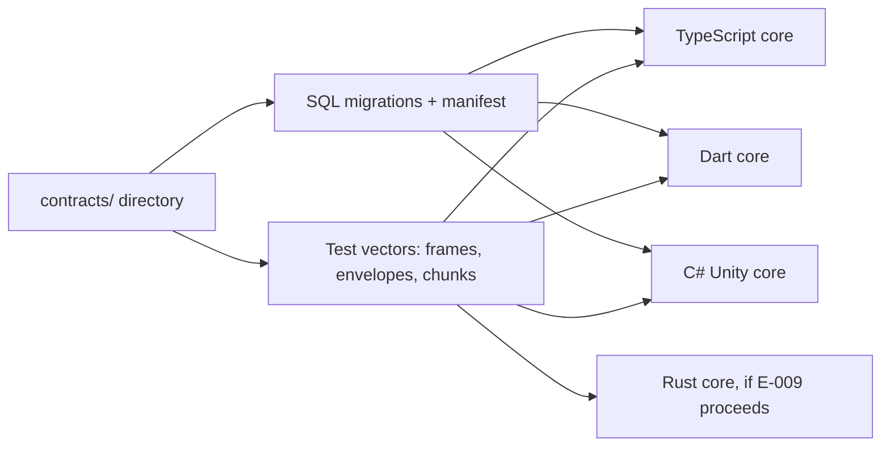
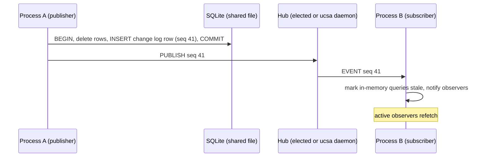
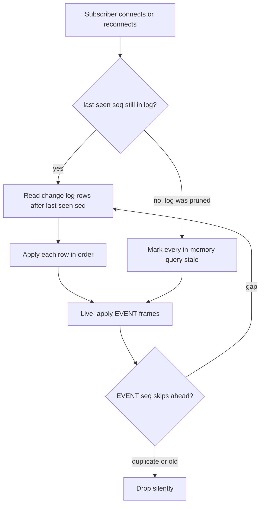
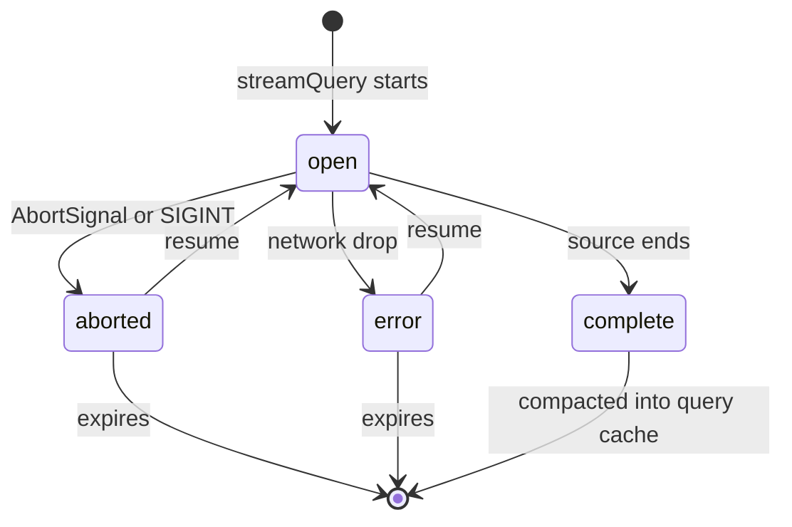
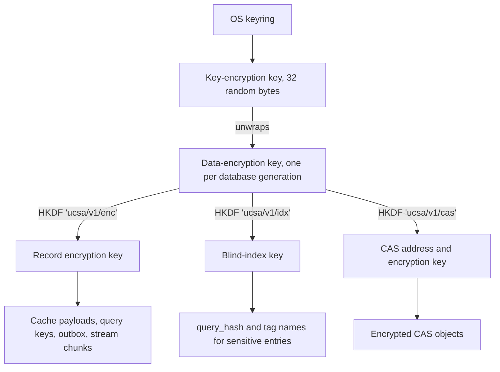
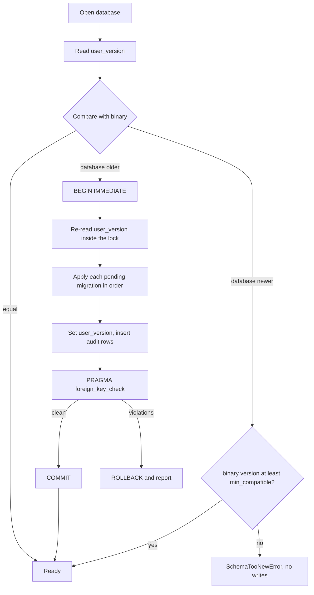
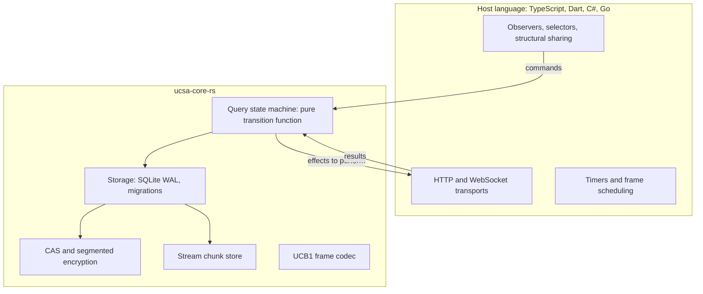
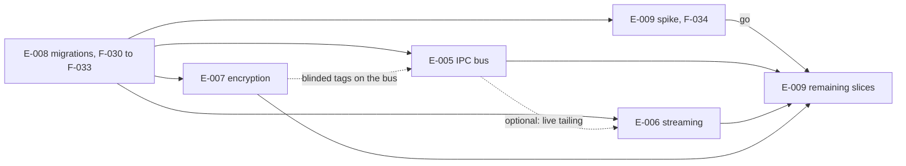

# UCSA Future Roadmap — Research, Architecture and Epic Breakdown

## Orientation <span class="topic-chip">read this first</span>

**Where we are.** UCSA release 1.4 is promoted and nothing is in progress. This document is research and design only. It proposes five epics (large outcomes that each take several features to deliver), numbered E-005 to E-009, and splits each into slices (single shippable features, numbered F-015 to F-039).

**What it recommends, in plain words.**

1. **Do schema migration first, even though it is numbered fourth.** Every other feature adds tables or columns, and today the database has no version number at all.
2. **Cross-process reactivity is a durable log plus a socket that only says "wake up".** The log lives in SQLite and is the source of truth. The socket is a hint. Losing a socket message never loses an invalidation.
3. **Streaming keeps in-progress output in its own append-only tables** and folds it into the normal cache when the stream completes. HTTP Range resume is offered, but most LLM APIs cannot honour it, so resume is a pluggable strategy.
4. **Encryption is field-level envelope encryption with keys in the OS keyring.** The document is explicit about what still leaks (timestamps, sizes, row counts) and what JavaScript cannot scrub from memory.
5. **The Rust core starts with a go/no-go spike, not a rewrite.** It reverses a decision recorded on 2026-10-05, and it will not make SQLite faster on Node. Its real value is one implementation of the correctness-critical parts instead of three.

**Assumptions made without asking** are listed in [section 2](#assumptions-and-evidence-legend). The biggest open decision is in [section 11](#the-one-decision-that-needs-you).

<div class="metric-grid">
<div class="metric-tile"><strong>5</strong><br>epics (E-005 to E-009)</div>
<div class="metric-tile"><strong>25</strong><br>slices (F-015 to F-039, provisional)</div>
<div class="metric-tile"><strong>5</strong><br>schema migrations planned</div>
<div class="metric-tile alarm"><strong>0</strong><br>of the five features exist in code today</div>
</div>

---

## 1. Verified current state <span class="topic-chip">grounding</span>

These facts were read from the repository on 2026-10-08 by a read-only exploration subagent (file reads and greps; no commands were executed). They correct or sharpen the task brief in several places.

| Area | What the code actually does | Consequence for the roadmap |
|---|---|---|
| SQLite driver (TypeScript) | `better-sqlite3 ^11.8.1`, synchronous native addon. `packages/core/src/storage/sqlite-adapter.ts` | Storage calls already block the Node event loop today. Any "async" story is new. |
| PRAGMAs | `foreign_keys=ON`, `busy_timeout=5000`, `journal_mode=WAL`, `synchronous=NORMAL`; exit checkpoint is `wal_checkpoint(TRUNCATE)` | Multi-process WAL access already works at the SQLite level. |
| Schema versioning | **None.** No `user_version`, no migration code in TS, Dart or C#. Schema is `CREATE TABLE IF NOT EXISTS` only. `user_version` appears only as an aspiration in the 2026-10-05 design spec (line 263). | E-008 is a prerequisite, not a nice-to-have. |
| Tables | `ucsa_query_cache`, `ucsa_cache_tags`, `ucsa_mutation_outbox`, `ucsa_cas_objects` | All new tables below follow the `ucsa_` prefix. |
| Payload storage | `query_key` and `data_payload` are `JSON.stringify` text in `TEXT NOT NULL` columns | Encryption and streaming both have to cross this boundary. |
| Tag invalidation | `invalidateByTag` **deletes** cache rows (tag rows follow by `ON DELETE CASCADE`) and returns the deleted hashes | Another process holding the same query in memory is never told. This is the exact gap E-005 closes. |
| Storage interface | **None.** `SqliteAdapter` is a concrete class imported directly by `QueryEngine` and `MutationOutbox` | E-007 (ephemeral entries) and E-009 (Rust backend) both need a seam that does not exist yet. |
| Query API | `fetchQuery(key, queryFn, options)` returns one `Promise<T>` | No incremental path exists; E-006 adds a new entry point rather than bending this one. |
| CAS (content-addressable store) | Files at `<baseDir>/objects/<hash[0..2]>/<hash>`, SHA-256 hex, temp file then atomic rename, LRU pruning by `last_accessed_at` | Plaintext SHA-256 as the file name reveals content identity. E-007 changes the address for encrypted objects. |
| Outbox | Status is `pending`, `in_flight` or `failed`. `headers` and `payload` are plaintext text | Request headers very likely include authorization tokens. This is the most sensitive plaintext on disk today. |
| Cross-language parity | Dart uses `package:sqlite3`; Unity uses `Microsoft.Data.Sqlite`. **Schemas have already drifted**: Dart adds `idx_ucsa_tags_tag` and an outbox `conflict_policy` column and drops the status `CHECK`. There is no shared `contracts/` directory. | Parity is by convention. Each new feature multiplies the drift unless a shared contract is introduced. |
| CLI | All commands are one-shot except `tutorial`/`docs`, which spawns the docs dev server. No daemon mode. | `ucsa daemon` is a new long-running mode. |
| Rust | None in the repo. The 2026-10-05 architecture spec (lines 13, 38, 318, 322) **explicitly rejects a monolithic Rust FFI** after a decision round. | E-009 reverses a recorded decision and needs a decision record before any code. |

<div class="callout warn">
<strong>Five items in the brief do not match the repository.</strong> (1) "Deterministic schema migrations via <code>PRAGMA user_version</code>" is described as an extension of existing behaviour, but nothing uses <code>user_version</code> today. (2) There is no storage adapter interface to plug a Rust or encrypted backend into. (3) The Rust core contradicts the recorded decision above. (4) "UniFFI ... for TypeScript (napi-rs)" conflates two unrelated tools; see section 8. (5) The 345-test, 45-suite figure comes from the README (line 1689) and was not re-run in this session.
</div>

## 2. Assumptions and evidence legend

Every external claim in this document carries one of three marks.

- **[V]** verified in this repository on 2026-10-08 (by the exploration subagent's file reads).
- **[K]** general engineering knowledge, **not verified in this session**. Each one that affects a design choice is repeated in [section 12](#verify-before-build-list).
- **[A]** an assumption I chose in place of asking.

Assumptions:

1. **[A] Slice ids are provisional.** In this repository ids are minted by the release tooling (an idea, I-NNN, is created first and becomes F-NNN when refined). F-015 is the next free feature id and E-005 to E-009 are free **[V]**, so the numbers below are the ones the tooling would mint if slices are created in this order.
2. **[A] TypeScript is the reference implementation.** Dart and C# follow only where sharing a database file format requires it (E-008). See the decision in section 11.
3. **[A] Desktop and CLI are the targets for cross-process work.** Mobile sandboxes and Unity players rarely run two processes against one database.
4. **[A] Threat model for encryption is offline disk access** (stolen device, leaked backup, another local user, a synced folder). It is not malware running as the same user.
5. **[A] No new runtime dependency is added to `packages/core` without a slice that names it.** Each proposed dependency is called out.

## 3. Cross-cutting design principles

Three ideas recur in all five designs.

**The database is the truth; everything else is a hint.** Sockets drop, processes crash, terminals get interrupted. Each design writes the durable fact to SQLite in a transaction first, then sends a best-effort notification. A consumer that misses the notification recovers by reading the database.

**Contract before implementation.** A new top-level `contracts/` directory holds SQL migration files, binary format descriptions and language-neutral test vectors (JSON files with hex inputs and expected outputs). Every implementation, in any language, must pass the same vectors. This is what stops the drift already visible between the TypeScript and Dart schemas.

**The outbox is user data; the cache is not.** Cached query results can always be refetched, so on any incompatibility they may be evicted. Queued mutations are unsent user intent and must never be silently dropped. Every failure path below treats the two differently.



### Planned schema migrations

| Version | Introduced by | Content | Oldest binary that may still open the file |
|---|---|---|---|
| 1 | E-008 | Baseline: adopt existing tables, reconcile TS/Dart/C# drift, add `ucsa_meta` and `ucsa_migrations` | 1 |
| 2 | E-008 | `payload_version` columns on cache and outbox | 1 |
| 3 | E-005 | `ucsa_change_log`, `ucsa_bus_hub`, outbox lease columns | 1 |
| 4 | E-006 | `ucsa_streams`, `ucsa_stream_chunks`, `ucsa_stream_tags` | 1 |
| 5 | E-007 | `ucsa_keys`, `enc_key_id` columns, encrypted payloads stored as BLOB | **5** (older binaries cannot read ciphertext) |

---

## 4. E-005 — Inter-process event bus and live daemon <span class="topic-chip">IPC</span>

### 4.1 Problem

Two processes share one database file, for example the `ucsa` command line and a desktop app. Process A invalidates the tag `user:42`. SQLite rows are deleted, but process B still holds the old result in memory and has no way to learn it is stale short of polling.

### 4.2 Options considered

| Option | How it works | Strengths | Weaknesses |
|---|---|---|---|
| **A. Poll SQLite** (`PRAGMA data_version` or a counter row) | Each process re-checks on a timer | No sockets, works everywhere | It is polling, which the brief rules out; latency equals the interval; wakes idle processes |
| **B. Watch the WAL file** | File-system notifications on `<db>-wal` | No sockets | Notification delivery differs per OS and is lossy **[K]**; says "something changed", not what |
| **C. Peer-to-peer sockets** | Every process listens on its own socket in a shared directory and connects to all others | No single point of failure | N² connections; discovery races; stale socket files from every crashed peer; one-shot CLI runs churn the mesh |
| **D. Standalone daemon only** | `ucsa daemon` must be running | Simple topology | Reactivity silently stops when the daemon is not running; an extra thing for users to manage |
| **E. Durable change log plus elected hub (recommended)** | Invalidations are journaled in SQLite. A hub fans out wake-up events over one socket. The hub is whichever long-lived process binds first; `ucsa daemon` is the same hub code run standalone | No polling; no lost events; no mandatory daemon; one-shot CLI runs stay cheap | Most moving parts; election logic must be tested with real process kills |

<div class="callout success">
<strong>Recommendation: option E.</strong> It answers the brief's "hub-and-spoke versus peer-to-peer" question with hub-and-spoke for the topology, but makes the hub an elected role rather than a required service. The durable log is what makes hub crashes harmless.
</div>

### 4.3 Architecture

Two decoupled flows. The fast path only carries wake-ups. The durable path is what guarantees correctness.





**Roles.** A connecting process declares one of three roles.

- `publisher`: a one-shot command. It writes to the change log, sends one frame if a hub exists, and exits. It never becomes the hub.
- `subscriber`: receives events, never hosts.
- `hub-eligible`: a long-lived process (an app, or `ucsa daemon`). It tries to connect; if nobody is listening, it runs the election and becomes the hub in-process.

**Endpoint.** One hub per database file. `db_id` is a random identifier stored in `ucsa_meta`.

- POSIX: `$XDG_RUNTIME_DIR/ucsa/<db_id>.sock`, falling back to `<os tmpdir>/ucsa-<uid>/<db_id>.sock`. The directory is mode `0700` and the socket `0600`. Unix socket paths are limited to roughly 104 bytes on macOS and 108 on Linux **[K]**, which is why the path uses a short id rather than the database path.
- Windows: `\\.\pipe\ucsa-<db_id>`.

**Election, without lock files or heartbeats.** The database itself is the lock.

```sql
CREATE TABLE ucsa_bus_hub (
  id        INTEGER PRIMARY KEY CHECK (id = 1),
  epoch     INTEGER NOT NULL,
  pid       INTEGER NOT NULL,
  endpoint  TEXT    NOT NULL,
  token     TEXT    NOT NULL,   -- random per epoch; clients present it in HELLO
  claimed_at INTEGER NOT NULL
);
```

1. Read the row. Try to connect to `endpoint`.
2. If the connection succeeds, you are a client.
3. If it fails, run `BEGIN IMMEDIATE` and re-read the row. If `epoch` changed, someone else won; go to step 1.
4. Otherwise remove the stale socket file, bind, write `epoch + 1` with a fresh `token`, and commit.

Liveness is proven by a successful connection, so the hub never writes heartbeats into the database.

**Authentication.** File permissions protect the POSIX socket. Node's `net` module does not expose peer credentials **[K]**, and Windows named pipes created by Node may be reachable by other local users **[K, must verify]**. So every client must present the `token` from `ucsa_bus_hub` in its first frame. Anyone who can read the database file can read the token, which is exactly the set of processes that could already read the data.

### 4.4 Durable change log

```sql
CREATE TABLE ucsa_change_log (
  seq          INTEGER PRIMARY KEY AUTOINCREMENT,
  origin       TEXT    NOT NULL,          -- client_id of the writer
  kind         TEXT    NOT NULL CHECK (kind IN ('invalidate','mutation','stream','reset')),
  tags         TEXT,                      -- JSON array, may be null
  query_hashes TEXT,                      -- JSON array, may be null
  detail       TEXT,                      -- JSON object, kind-specific
  created_at   INTEGER NOT NULL
);
CREATE INDEX idx_ucsa_change_log_created ON ucsa_change_log(created_at);
```

- The row is inserted **in the same transaction** as the deletion it describes. Either both happen or neither does.
- Retention: the newest 10,000 rows or 24 hours, whichever keeps more. Pruning runs opportunistically on write.
- A subscriber whose last seen `seq` is older than the oldest remaining row cannot catch up precisely. It marks every in-memory query stale. This is always safe because stale only means "refetch".

### 4.5 Wire protocol `UCB1`

Every frame has a fixed 12-byte header followed by a UTF-8 JSON payload. JSON is chosen over a binary encoding because Dart and C# need to implement the protocol too, and frames are small and infrequent.

```
offset  size  field
0       4     magic            ASCII "UCB1"
4       1     type             see table
5       1     flags            must be 0 in protocol 1
6       2     reserved         must be 0
8       4     payload_length   unsigned, big-endian, maximum 1,048,576
12      n     payload          UTF-8 JSON object
```

| Type | Name | Direction | Payload fields |
|---|---|---|---|
| `0x01` | HELLO | client to hub | `proto`, `client_id`, `pid`, `role`, `token`, `last_seq`, `lang` |
| `0x02` | WELCOME | hub to client | `proto`, `hub_epoch`, `hub_pid`, `head_seq`, `ping_ms` |
| `0x03` | SUBSCRIBE | client to hub | `kinds` (array), optional `tag_prefixes` |
| `0x04` | UNSUBSCRIBE | client to hub | same shape as SUBSCRIBE |
| `0x05` | PUBLISH | client to hub | one change log row: `seq`, `origin`, `kind`, `tags`, `query_hashes`, `detail`, `ts` |
| `0x06` | EVENT | hub to client | identical to PUBLISH |
| `0x08` | PING | either | `nonce` |
| `0x09` | PONG | either | `nonce` |
| `0x0A` | RESYNC | hub to client | `head_seq`; "I dropped frames for you, read the log" |
| `0x0B` | BYE | either | `reason` |
| `0x0F` | ERROR | hub to client | `code`, `message` |

Rules:

- **Ordering.** Two publishers can commit `seq` 5 and 6 and have their frames arrive as 6 then 5. A subscriber that sees a `seq` higher than `last_seq + 1` reads the log for the gap. A `seq` at or below `last_seq` is dropped. Applying an event twice is harmless.
- **Echo suppression.** A client drops events whose `origin` is its own `client_id`.
- **Slow consumers.** The hub keeps a bounded send queue per client (1,000 frames or 4 MiB). On overflow it discards that client's queue and sends one RESYNC. A slow client can never block the hub or other clients.
- **Bad input.** Wrong magic, non-zero reserved bytes, an oversize length or invalid JSON gets one ERROR frame and a closed connection.
- **Version negotiation.** `proto` is an integer. The hub answers with the lower of the two; a client that cannot speak it sends BYE and falls back to log-only catch-up on its own writes and on window focus.

### 4.6 SQLite WAL coordination and crash recovery

| Failure | What happens | Why it is safe |
|---|---|---|
| Hub process is killed | Clients see the socket close, back off with jitter (50 ms to 2 s), and an eligible one wins the election with `epoch + 1` | Events published during the gap are in the change log; every client catches up on reconnect |
| Publisher crashes after commit, before PUBLISH | No frame is sent | The next event's `seq` reveals the gap; subscribers also catch up on reconnect and on focus |
| Publisher crashes before commit | SQLite rolls back | No row deleted, no log entry, nothing to announce |
| Stale socket file after a crash | Connection is refused; the election removes it | The epoch check prevents two processes both removing and binding |
| Checkpoint contention | Today the CLI runs `wal_checkpoint(TRUNCATE)` on exit **[V]**, which can fail as busy when other readers exist **[K]** | Change: try `TRUNCATE`, fall back to `PASSIVE`, never treat busy as an error. When a hub exists it is the designated checkpointer |
| Outbox row stuck `in_flight` after a crash | Today nothing reclaims it | Add `lease_owner` and `lease_until` columns. Replay claims rows with one atomic `UPDATE ... WHERE status='pending' OR (status='in_flight' AND lease_until < now)`. Two processes can no longer send the same mutation |
| Database on a network file system | WAL mode is not supported there **[K]** | Document as unsupported; `ucsa status` warns when it can detect it |

### 4.7 Platform scope

| Platform | E-005 support | Reason |
|---|---|---|
| Node on macOS, Linux, Windows | Full | Primary use case |
| Dart on desktop | Client and hub, later slice or via E-009 | Unix sockets are available in `dart:io` **[K]** |
| Flutter mobile, Unity players | Change log only, no socket | Single process per sandbox in practice |
| Web, Unity WebGL | Out of scope | No sockets, no shared SQLite file |

### 4.8 Epic E-005 definition

**Outcome.** Two processes that share a UCSA database see each other's invalidations and mutation status changes within 100 ms without polling, and lose none of them across a crash of any participant.

| Slice | Title | Depends on |
|---|---|---|
| F-015 | Durable change log and catch-up reader | E-008 F-030 |
| F-016 | `UCB1` frame codec and conformance vectors | none |
| F-017 | Hub: endpoint resolution, election, Unix socket and named pipe transports | F-015, F-016 |
| F-018 | Bus client wired into `QueryEngine` and `MutationOutbox` | F-017 |
| F-019 | `ucsa daemon`, designated checkpointer, outbox leases | F-018 |

**Acceptance criteria.**

*F-015 — change log*

- [ ] `invalidateByTag` and `invalidateQueries` insert exactly one `ucsa_change_log` row in the same transaction as the deletion; a forced failure after the delete leaves neither change.
- [ ] `readChangesSince(seq)` returns rows in ascending `seq` and reports `truncated: true` when `seq` is older than the oldest row.
- [ ] Pruning never removes a row newer than 24 hours while fewer than 10,000 rows exist.
- [ ] With no bus configured, behaviour and the existing test suite are unchanged.

*F-016 — frame codec*

- [ ] Encode then decode round-trips every frame type; output bytes equal `contracts/ipc/vectors.json` exactly.
- [ ] The decoder reassembles frames split at every possible byte boundary and handles several frames in one read.
- [ ] Wrong magic, non-zero reserved bytes, a length above 1,048,576 and invalid UTF-8 or JSON each produce a typed error and never throw an untyped exception.

*F-017 — hub*

- [ ] Ten processes started simultaneously against one database produce exactly one hub and nine clients, and `ucsa_bus_hub.epoch` increases by exactly one.
- [ ] After the hub receives `SIGKILL`, a new hub is serving within 3 seconds and the stale socket file is gone.
- [ ] A HELLO with a wrong `token` receives ERROR and is disconnected before any EVENT is sent.
- [ ] A client that stops reading receives RESYNC once its queue overflows, and other clients' delivery latency is unaffected.
- [ ] The same suite passes on Windows using a named pipe.

*F-018 — engine integration*

- [ ] Process A calls `invalidateByTag('t')`; an observer in process B is notified and refetches in under 100 ms at the 95th percentile on a developer laptop, with zero timers polling.
- [ ] Events published while B is disconnected are applied, in order, when B reconnects.
- [ ] An event whose `origin` is B's own `client_id` causes no refetch in B.
- [ ] Outbox status transitions (`pending`, `in_flight`, `failed`, removed) are observable from another process.

*F-019 — daemon and leases*

- [ ] `ucsa daemon --db <path>` runs in the foreground, exits cleanly on `SIGINT` and `SIGTERM`, and prints its endpoint; `ucsa status` reports hub pid, epoch, client count and head `seq`.
- [ ] A one-shot `ucsa query` run never becomes the hub.
- [ ] Two processes running `outbox replay` concurrently against 100 pending mutations send each mutation exactly once.
- [ ] A row left `in_flight` by a killed process is retried after its lease expires.
- [ ] Exit checkpoint under concurrent readers never returns a non-zero exit code.

**TDD testing matrix.** Each named test is written first and seen to fail.

| Slice | Unit | Integration (real SQLite file) | Cross-process | Fault injection |
|---|---|---|---|---|
| F-015 | `change-log.test.ts`: ordering, truncation flag, prune bounds | Atomicity: throw between delete and insert, assert both rolled back | none | Process exit mid-transaction |
| F-016 | `frame-codec.test.ts`: vectors, split reads, fuzz with random bytes | none | Vectors consumed by a Dart and a C# decoder test | Oversize and malformed frames |
| F-017 | Election state machine with a fake connector | Stale socket cleanup | `hub-election.e2e.test.ts` spawns 10 child processes | `SIGKILL` the hub in a loop, 50 iterations |
| F-018 | Gap and duplicate handling in the client | Catch-up from log | `cross-process-invalidation.e2e.test.ts` with two real processes | Drop the socket mid-burst |
| F-019 | Lease claim SQL | Checkpoint fallback | `outbox-exactly-once.e2e.test.ts` | Kill a replaying process |

**Gate additions.** Gate 2 (`scripts/integration.sh`, the integration check that runs before a release is promoted) gains a cross-process phase. The full-chain runner (`scripts/e2e-full-chain.sh`) gains a daemon step in its CLI phase.

---

## 5. E-006 — Generative AI and LLM token streaming engine <span class="topic-chip">streaming</span>

### 5.1 Problem

`fetchQuery` resolves once with a whole value **[V]**. A model response arrives as hundreds of small pieces over many seconds. Today a consumer would have to hold it all outside UCSA, losing persistence, deduplication, cancellation and cross-process visibility, and losing everything if the terminal is interrupted at 90 percent.

### 5.2 Options considered

| Option | How it works | Verdict |
|---|---|---|
| **A. Rewrite the cache row on every piece** | `UPDATE data_payload = whole text so far` | Rejected. Writing n pieces costs O(n²) bytes, and every observer receives the full string each time |
| **B. Append-only chunk table, compacted on completion (recommended)** | In-progress output lives in its own tables; on completion it becomes an ordinary cache entry | Linear cost, crash-safe partial output, and stale-while-revalidate keeps working because the previous complete answer stays in `ucsa_query_cache` until the new stream finishes |
| **C. Append to a CAS temp file** | Bytes go to a file, indexed by offset | Good for very large binary streams, but adds a second durability domain and no tag support. Used only as the destination for completed large or binary streams |

### 5.3 Chunk store protocol

```sql
CREATE TABLE ucsa_streams (
  query_hash   TEXT PRIMARY KEY,
  query_key    TEXT    NOT NULL,
  status       TEXT    NOT NULL CHECK (status IN ('open','complete','aborted','error')),
  encoding     TEXT    NOT NULL CHECK (encoding IN ('utf8','bytes')),
  next_seq     INTEGER NOT NULL DEFAULT 0,
  byte_length  INTEGER NOT NULL DEFAULT 0,
  resume_kind  TEXT,                 -- 'range' | 'last-event-id' | 'continuation' | null
  resume_token TEXT,                 -- last SSE event id, or opaque application token
  etag         TEXT,                 -- validator for Range resume
  writer_id    TEXT,                 -- client_id holding the write lease
  writer_lease_until INTEGER,
  payload_version INTEGER NOT NULL DEFAULT 0,
  error        TEXT,
  created_at   INTEGER NOT NULL,
  updated_at   INTEGER NOT NULL,
  expires_at   INTEGER NOT NULL
);
CREATE TABLE ucsa_stream_chunks (
  query_hash  TEXT    NOT NULL,
  seq         INTEGER NOT NULL,
  byte_offset INTEGER NOT NULL,
  data        BLOB    NOT NULL,
  PRIMARY KEY (query_hash, seq),
  FOREIGN KEY (query_hash) REFERENCES ucsa_streams(query_hash) ON DELETE CASCADE
);
CREATE TABLE ucsa_stream_tags (
  tag        TEXT NOT NULL,
  query_hash TEXT NOT NULL,
  PRIMARY KEY (tag, query_hash),
  FOREIGN KEY (query_hash) REFERENCES ucsa_streams(query_hash) ON DELETE CASCADE
);
```

`ucsa_stream_chunks` is an ordinary rowid table on purpose. SQLite's guidance is that `WITHOUT ROWID` suits small rows, not multi-kilobyte blobs **[K]**.

**Invariants** (each is a test):

1. `seq` values for a stream are contiguous from 0.
2. `byte_offset` of chunk n equals the sum of the lengths of chunks 0 to n-1.
3. `ucsa_streams.byte_length` and `next_seq` are updated in the same transaction as the chunk insert.
4. Offsets are always **bytes of the stored representation**. UCSA does not tokenise. "Token offset" in the brief maps to `seq`, the index of a stored chunk.

**Write batching.** A stored chunk is a coalesced batch, not one source piece. The appender flushes when 4 KiB is buffered, or 50 ms after the first unflushed byte, or on complete, abort or process signal. With `synchronous=NORMAL` in WAL mode a commit does not force a disk sync **[K]**, so this costs about 20 small transactions per second at most. The durability window is therefore at most 50 ms or 4 KiB of output.

**Text boundaries.** A multi-byte UTF-8 character can be split across source pieces. Bytes are stored exactly as received. The string view uses a streaming decoder that holds back an incomplete trailing sequence, so an observer never receives a broken character.

**Completion (compaction).** In one transaction: concatenate the chunks, write the `ucsa_query_cache` row, move tags from `ucsa_stream_tags` to `ucsa_cache_tags`, delete the `ucsa_streams` row (chunks cascade). Text up to 1 MiB is stored as a JSON string in `data_payload`. Larger or binary output is first written to the CAS (which is idempotent), and `data_payload` holds a reference `{"$ucsa_cas":"<hash>","bytes":<n>}`.

**Single writer.** Only the process holding the write lease appends. A second process asking for the same stream tails it: it reads chunks from SQLite and, when the E-005 bus is present, receives `kind: 'stream'` events carrying `{query_hash, seq}` as wake-ups. Without the bus it sees the result when the stream completes.

### 5.4 Resumable streaming



<div class="callout warn">
<strong>HTTP Range resume does not work for most model APIs.</strong> Range requests address bytes of a stored resource. A generated response is not a stored resource, and a second request generally produces a different sample. Range is the right tool for downloads and for gateways that buffer generations. It cannot be the only strategy.
</div>

Resume is therefore a small interface with four built-in strategies.

| Strategy | Request on resume | Accept when | Otherwise |
|---|---|---|---|
| `range` | `Range: bytes=<byte_length>-`, `If-Range: <etag>`, `Accept-Encoding: identity` | Status 206 and `Content-Range` starts at `byte_length` | Status 200: the server ignored the range, so reset and restart. Status 416: treat as already complete if lengths match, else reset |
| `last-event-id` | `Last-Event-ID: <resume_token>` (server-sent events) | Server continues after that event | Server restarts from the beginning: reset |
| `continuation` | Application callback receives the committed text and builds a new request (for example, sending the partial answer back as a prefix) | Always appends | Marked `nondeterministic: true` on the stream; UCSA makes no claim the continuation matches what the dropped stream would have produced |
| `restart` | Original request | Always | n/a; partial output is discarded |

`Accept-Encoding: identity` matters: a Range applies to the encoded bytes, so a compressed response would make stored offsets meaningless **[K]**.

**Reset is explicit.** When a resume cannot continue, observers receive a slice with `reset: true` before new content. A consumer that ignores it would display duplicated text, so the built-in sinks handle it and the type forces custom consumers to see it.

### 5.5 API

```ts
streamQuery(
  queryKey: QueryKey,
  streamFn: (ctx: { signal: AbortSignal; resume?: ResumeState }) =>
    AsyncIterable<string | Uint8Array> | ReadableStream<Uint8Array>,
  options?: {
    tags?: string[]; staleTime?: number;
    resume?: 'range' | 'last-event-id' | 'restart' | ContinuationStrategy;
    flushBytes?: number;   // default 4096
    flushMs?: number;      // default 50
    version?: number;      // payload version, see E-008
  },
): StreamHandle;

interface StreamHandle extends AsyncIterable<StreamSlice> {
  done: Promise<string | Uint8Array>;
  cancel(): void;
}

interface StreamSlice {
  delta: string | Uint8Array;   // only the newly appended part
  offset: number;               // byte offset of delta
  seq: number;
  status: 'open' | 'complete' | 'aborted' | 'error';
  reset?: true;                 // consumer must clear what it has shown
}

subscribeStream(
  queryKey: QueryKey,
  listener: (slice: StreamSlice) => void,
  options?: { scheduler?: FrameScheduler; fromOffset?: number },
): () => void;
```

`fetchQuery` on a key that is mid-stream waits for `done`. `getQueryData` returns the last complete value, which preserves stale-while-revalidate.

### 5.6 Observer slices without layout thrashing

Layout thrashing here means re-rendering the entire growing answer for every token. Three rules prevent it.

1. **Deliver deltas, not snapshots.** A DOM consumer calls `textNode.appendData(delta)`, which touches one text node. A terminal consumer writes only the delta.
2. **Coalesce per frame.** A `FrameScheduler` batches everything that arrived since the last frame into one slice. Defaults: `requestAnimationFrame` in a browser, a 16 ms timer in a terminal. Flutter and Unity adapters supply their own frame callbacks.
3. **Make full snapshots lazy.** Frameworks that need a whole value (React's `useSyncExternalStore`) get `getSnapshot()`, which joins chunks once per version and caches the result. It is never built unless asked for.

Back-pressure: the source is pulled, not pushed. The appender's buffer is bounded; when the database or the terminal cannot keep up, reads from the source pause. Because the data is append-only, slices are merged under pressure and never dropped. The terminal sink awaits `drain` when `stdout.write` returns false.

### 5.7 Epic E-006 definition

**Outcome.** A streamed response is cached as it arrives, survives an interrupted process with at most 50 ms of loss, resumes where the server allows it, and renders with one text-node append per frame.

| Slice | Title | Depends on |
|---|---|---|
| F-020 | Stream chunk store: tables, batched appender, compaction | E-008 F-030 |
| F-021 | `streamQuery` lifecycle, cancellation, stale-while-revalidate | F-020 |
| F-022 | Resume strategies | F-021 |
| F-023 | Frame-coalesced observer, DOM and terminal sinks, React hook | F-021 |
| F-024 | `ucsa stream` command, interrupt-safe flush, studio simulator | F-022, F-023 |

**Acceptance criteria.**

*F-020 — chunk store*

- [ ] The three invariants in 5.3 hold after 10,000 random-sized appends (property test).
- [ ] 1,000 source pieces of 8 bytes at 1 ms intervals produce at most 25 chunk rows.
- [ ] Compaction leaves zero rows in `ucsa_stream_chunks` for the stream and one row in `ucsa_query_cache` whose content is byte-identical to the source.
- [ ] Output above 1 MiB, or with `encoding = 'bytes'`, compacts to a CAS reference whose hash verifies.
- [ ] A multi-byte character split across two pieces is delivered to string observers whole.

*F-021 — lifecycle*

- [ ] Both `AsyncIterable<string>` and `ReadableStream<Uint8Array>` sources are accepted.
- [ ] Aborting sets status `aborted`, cancels the source, and keeps committed chunks.
- [ ] Two concurrent `streamQuery` calls for one key invoke `streamFn` once.
- [ ] While a key with a previous complete value is re-streaming, `getQueryData` returns the previous value until completion.
- [ ] `invalidateByTag` on an open stream aborts it and removes its rows.

*F-022 — resume*

- [ ] `range`: against a test server, a connection cut at a random offset resumes with the correct `Range` and `If-Range` headers and the final content hash equals the uninterrupted hash.
- [ ] `range`: a 200 response to a ranged request produces a `reset: true` slice and correct final content with no duplicated bytes.
- [ ] `last-event-id`: the header carries the last committed event id.
- [ ] `continuation`: the callback receives exactly the committed text, and the stream is flagged non-deterministic.
- [ ] A resumed stream in a **new process** continues from the offset stored in SQLite.

*F-023 — observer*

- [ ] With 500 source pieces inside one frame, the listener is called once and receives the concatenation.
- [ ] In a DOM test, streaming 5,000 pieces performs zero `textContent` assignments and a number of `appendData` calls no greater than the number of frames.
- [ ] `getSnapshot()` returns the identical string reference when called twice without new data.
- [ ] The terminal sink waits for `drain` under back-pressure and never writes the same byte twice.

*F-024 — CLI and studio*

- [ ] `ucsa stream <url> --key k` prints tokens as they arrive; after `SIGINT`, at most 50 ms of printed output is missing from the database.
- [ ] Re-running with `--resume` prints the cached prefix immediately and continues.
- [ ] The docs studio gains a sixth live simulator demonstrating drop and resume.

**TDD testing matrix.**

| Slice | Unit | Integration (real SQLite file) | Cross-process | Fault injection |
|---|---|---|---|---|
| F-020 | Offset arithmetic, UTF-8 hold-back, batch triggers with fake timers | Compaction transaction, cascade delete | none | Throw mid-compaction, assert chunks intact |
| F-021 | Status machine | Dedup, abort, re-stream with previous value | Tail from a second process (bus optional) | Source throws after n pieces |
| F-022 | Header construction, response classification table | Local HTTP test server: 206, 200, 416, changed ETag | Resume in a fresh child process | Socket destroyed at random offsets, 100 iterations |
| F-023 | Scheduler coalescing with a manual clock | none | none | Slow consumer; assert no drops, bounded memory |
| F-024 | Argument parsing | `cli-stream.test.ts` against the test server | `SIGINT` a child process then resume | Kill with `SIGKILL`; assert database opens cleanly |

---

## 6. E-007 — Transparent secret encryption at rest <span class="topic-chip">security</span>

### 6.1 Threat model

**Defended.** Someone obtains the files without the running user session: a stolen or decommissioned disk, a backup, a folder synchronised to a cloud drive, another account on the same machine.

**Not defended.** Code running as the same user while the store is unlocked. It can ask the keyring for the key or read process memory. On macOS the Keychain's per-application access control is attached to the calling binary, so for a script runtime the "application" is `node` itself **[K]**; any Node script the user runs could request the same item.

Stating this boundary plainly is part of the deliverable. An encryption feature that implies more than it delivers is worse than none.

### 6.2 Options considered

| Option | Coverage | Per-tag policy | Driver impact | Verdict |
|---|---|---|---|---|
| **A. Whole-database cipher** (SQLCipher or an equivalent build) | Everything in the database file and WAL, including indexes and metadata | No; all or nothing | A different SQLite build in all three stacks **[K]**; CAS files still need separate work | Strongest guarantee, heaviest packaging. Offered later as an optional adapter |
| **B. Field-level envelope encryption (recommended)** | Chosen columns, the outbox, and CAS objects | Yes | None; uses each platform's standard AES-GCM | Meets the tag-level requirement on the existing drivers. Metadata leakage must be designed out explicitly (6.5) |
| **C. Rely on OS full-disk encryption** | Whole disk while powered off | No | None | Does nothing against backups, sync folders or other local users. Not sufficient alone |

### 6.3 Key hierarchy



- The **key-encryption key** never touches the database. It lives in the keyring under service `dev.ucsa.kek`, account `<db_id>`.
- The **data-encryption key** is stored wrapped in `ucsa_keys`. Rotating the keyring key only re-wraps this one row.
- Sub-keys are derived with HKDF-SHA-256 so that the encryption key is never also used as a MAC key.

```sql
CREATE TABLE ucsa_keys (
  key_id      INTEGER PRIMARY KEY,
  wrapped_dek BLOB    NOT NULL,     -- a UCE1 envelope, see 6.4
  kek_ref     TEXT    NOT NULL,     -- provider + account, never the key
  state       TEXT    NOT NULL CHECK (state IN ('active','decrypt_only','destroyed')),
  enc_reserved INTEGER NOT NULL DEFAULT 0,
  created_at  INTEGER NOT NULL
);
ALTER TABLE ucsa_query_cache     ADD COLUMN enc_key_id INTEGER;  -- null means plaintext
ALTER TABLE ucsa_mutation_outbox ADD COLUMN enc_key_id INTEGER;
ALTER TABLE ucsa_streams         ADD COLUMN enc_key_id INTEGER;
ALTER TABLE ucsa_cas_objects     ADD COLUMN enc_key_id INTEGER;
```

**Key providers.** A `KeyProvider` interface with `get`, `set` and `delete`.

| Provider | Backing store | Notes |
|---|---|---|
| `keyring` | macOS Keychain, Linux Secret Service, Windows Credential Manager | Needs a native dependency on Node; the candidate is a maintained Rust-backed binding **[K, must verify]**. The long-standing `keytar` package is archived **[K]**. Shelling out to OS tools is rejected because the secret would appear in process arguments |
| `passphrase` | Key derived with scrypt from `UCSA_PASSPHRASE` or an interactive prompt | For headless Linux and CI, where no Secret Service is running |
| `memory` | Process memory | Tests only |
| Dart, Unity | Platform secure-storage plugins | Chosen per platform in the parity slice or delivered by E-009 |

**Fail closed.** If an entry's policy requires encryption and no provider is unlocked, the write throws `EncryptionUnavailableError`. There is no fallback to a key file and no fallback to plaintext.

### 6.4 Encryption envelope `UCE1`

```
offset  size  field
0       4     magic       ASCII "UCE1"
4       1     alg         0x01 = AES-256-GCM
5       1     flags       bit 0 = segmented (large objects)
6       2     reserved    must be 0
8       4     key_id      unsigned, big-endian
12      12    nonce       random
24      n     ciphertext
24+n    16    tag         GCM authentication tag
```

**Associated data** (authenticated, not stored) binds every ciphertext to its location:

```
ucsa|v1|<db_id>|<table>|<column>|<row_id>|<key_id>
```

Copying a ciphertext into a different row, column or database makes authentication fail. This blocks an attacker with write access from swapping one user's cached record for another's.

**Nonce budget.** With random 96-bit nonces, one key must not encrypt more than 2³² messages **[K: NIST SP 800-38D]**. The implementation rotates the data key at 2³¹. The counter is reserved in blocks of 1,024 and persisted before use, so a crash can waste nonces but never reuse them.

**Segmented form for large objects.** CAS objects and long streams are encrypted in 64 KiB segments, each with its own tag. The segment nonce is a 7-byte random prefix, a 4-byte counter and a 1-byte last-segment flag. Truncating, reordering or dropping a segment fails authentication, and memory use stays bounded.

**Storage.** The envelope is stored as a BLOB in the existing `data_payload` column. SQLite does not convert BLOB values stored in a TEXT-affinity column **[K]**, so no column rebuild is needed. A binary that predates migration 5 would fail to parse such a row, which is why migration 5 raises the minimum compatible version.

### 6.5 Closing the metadata leaks

Encrypting only `data_payload` leaves most of the interesting information readable. Each leak and its treatment:

| Leak | Why it matters | Treatment for sensitive entries |
|---|---|---|
| `query_key` in plaintext | Keys routinely contain user ids, search text or prompt text | Stored as a `UCE1` envelope |
| `query_hash` is a plain hash of the key | Guessable keys can be confirmed by hashing candidates | Replaced by HMAC-SHA-256 under the blind-index key. Lookups still work; guessing does not |
| Tag names | `user:42:medical` is itself sensitive | Tag stored as HMAC of the name. Exact-match invalidation still works; prefix matching on such tags does not |
| Outbox `headers`, `payload`, `endpoint` | Authorization tokens and unsent user data | **Always encrypted when encryption is enabled**, regardless of tags |
| CAS file name is SHA-256 of content | Anyone can confirm "this known file is present" | Address becomes HMAC-SHA-256 under the CAS key. Deduplication within one database is preserved |
| WAL and shared-memory files | Hold copies of recently written pages | Contain only what was written, which is ciphertext |
| Freed pages after delete | Old plaintext from before encryption was enabled | `PRAGMA secure_delete = ON`; the enable command rewrites existing rows then runs `VACUUM` |
| SQLite temp files | Sorting may spill to disk | `PRAGMA temp_store = MEMORY` |
| CAS `tmp/` staging | Plaintext staged before rename | Encrypt while writing to the staging file |
| E-005 bus frames and change log | Carry tags and hashes | Carry only the blinded values |

**What still leaks, by design:** row counts, payload sizes, timestamps, how many entries share a tag, and which rows are encrypted. Hiding these requires option A.

### 6.6 Policies

Two reserved tags, plus a rule table for teams that prefer configuration.

```ts
engine.fetchQuery(['session'], fetchSession, { tags: ['@ephemeral'] });
engine.fetchQuery(['profile', id], fetchProfile, { tags: ['@sensitive', `user:${id}`] });

new QueryEngine({
  sqliteAdapter,
  security: {
    keyProvider,
    policies: [
      { match: 'auth:*', policy: 'ephemeral' },
      { match: 'pii:*',  policy: 'sensitive' },
    ],
  },
});
```

| Policy | Memory | SQLite | CAS | Outbox | Bus |
|---|---|---|---|---|---|
| default | yes | plaintext | plaintext | encrypted if encryption is enabled | yes |
| `@sensitive` | yes | encrypted, blinded key and tags | encrypted | encrypted | blinded values only |
| `@ephemeral` | yes | **never written** | never written | rejected with an error | hash only |

When several rules match, the strictest wins: ephemeral, then sensitive, then default.

### 6.7 In-memory key scrubbing: what is and is not possible

| Item | Node | Guarantee |
|---|---|---|
| Key-encryption key and data key | Held as native `KeyObject` or `Buffer`; `Buffer.fill(0)` on lock and close | Zeroed deterministically |
| Derived sub-keys | Same | Zeroed deterministically |
| Decrypted payload as a `Buffer` | Zeroed after parsing | Zeroed deterministically |
| Decrypted payload as JavaScript strings and objects | Immutable; copied by the garbage collector at will | **Cannot be scrubbed.** Best effort is dropping references |
| Swap and crash dumps | Outside the process's control | Not addressed |

`engine.lock()` zeroes keys and evicts sensitive entries from memory. A Rust core (E-009) can do better for key material, with zero-on-drop types and locked memory pages, but once plaintext crosses into a managed language the same limit applies.

### 6.8 Rotation, loss and shredding

- **Rotate the keyring key:** re-wrap one row. Instant.
- **Rotate the data key:** a new `key_id` becomes `active`, the old one `decrypt_only`. Rows are re-encrypted lazily on write and by a bounded background sweep. When no rows reference the old key it becomes `destroyed`.
- **Keyring entry lost:** cached rows encrypted under it are evicted (the selective eviction of E-008). **Outbox rows are not deleted**; they move to `failed` with error `key_unavailable` so the user can be told that unsent changes exist.
- **Crypto-shredding:** deleting a data key makes everything under it unrecoverable at once, which is a fast, complete "sign out and forget".

### 6.9 Epic E-007 definition

**Outcome.** With encryption enabled, a byte-level scan of every file UCSA writes finds no plaintext of any sensitive payload, query key, tag name or outbox header, and the store refuses to write rather than degrade.

| Slice | Title | Depends on |
|---|---|---|
| F-025 | `UCE1` envelope, key derivation, `KeyProvider` interface, memory and passphrase providers, vectors | none |
| F-026 | OS keyring providers (macOS, Linux, Windows) | F-025 |
| F-027 | Policy engine, encrypted cache rows, blind index for keys and tags | F-025, E-008 F-030 |
| F-028 | Encrypted outbox and segmented encrypted CAS | F-027 |
| F-029 | Rotation, shredding, `ucsa secrets` command, disk leak audit | F-026, F-028 |

**Acceptance criteria.**

*F-025 — envelope*

- [ ] Encrypt and decrypt match `contracts/crypto/vectors.json` for fixed key, nonce and associated data.
- [ ] Flipping any single bit of the header, ciphertext or tag fails authentication.
- [ ] A ciphertext decrypted with associated data for a different row id, column or `db_id` fails.
- [ ] The nonce counter reserved value on disk is always greater than or equal to the number of encryptions performed, including after a simulated crash.
- [ ] After `lock()`, the buffers that held key material read as all zero.

*F-026 — keyring*

- [ ] Set, get and delete round-trip on each of the three operating systems in CI, or the test is reported as skipped with the reason, never as passed.
- [ ] With no keyring service available and no passphrase, enabling encryption fails with `EncryptionUnavailableError`.
- [ ] The key never appears in process arguments, environment dumps or log output.

*F-027 — policy and cache*

- [ ] A `@sensitive` entry's row has a BLOB payload beginning with `UCE1`, an encrypted `query_key`, and a `query_hash` that differs from the plain hash of the key.
- [ ] `invalidateByTag('pii:x')` removes a sensitive entry even though the stored tag is blinded.
- [ ] An `@ephemeral` entry produces zero rows in every table and zero CAS files.
- [ ] Strictest-policy-wins is covered for all three pairings.
- [ ] Plaintext entries and existing tests behave identically when encryption is not configured.

*F-028 — outbox and CAS*

- [ ] With encryption enabled, every outbox row has encrypted `headers`, `payload` and `endpoint`, and replay sends the original request byte for byte.
- [ ] A 50 MiB CAS object is encrypted and decrypted with peak additional memory under 1 MiB.
- [ ] Truncating an encrypted CAS file by one segment, or swapping two segments, fails on read.
- [ ] Two puts of identical content yield one object.

*F-029 — rotation and audit*

- [ ] After data key rotation and a completed sweep, no row references the old `key_id` and its state is `destroyed`.
- [ ] After the keyring entry is deleted, cached encrypted rows are evicted, outbox rows remain with status `failed` and error `key_unavailable`, and unencrypted rows are untouched.
- [ ] **Leak audit:** write 1,000 entries containing a unique marker string in payload, key, tag and outbox header; checkpoint; then scan every byte of the database, WAL, shared-memory file and CAS directory. The marker occurs zero times.
- [ ] `ucsa secrets status|enable|rotate|shred` exists; `enable` on an existing database leaves zero plaintext occurrences of pre-existing sensitive data after its `VACUUM`.

**TDD testing matrix.**

| Slice | Unit | Integration (real SQLite file) | Cross-language | Fault injection |
|---|---|---|---|---|
| F-025 | Vectors, bit-flip property test, associated-data mismatch | Counter persistence | Vectors decrypted by Dart and C# test stubs | Crash between reserve and use |
| F-026 | Provider contract test against the memory provider | Real keyring per OS in CI | none | Keyring locked or absent |
| F-027 | Policy resolution table | Row inspection with raw SQL | none | Provider removed mid-session: writes fail closed |
| F-028 | Segment nonce construction | Replay through a recording executor | none | Truncation, reordering, wrong key |
| F-029 | Sweep scheduling | Rotation end to end | none | Process killed mid-sweep, then resumed |

Every code slice in this epic also goes through the `security-reviewer` agent in its quality gate.

---

## 7. E-008 — Schema migration and payload versioning pipeline <span class="topic-chip">do this first</span>

### 7.1 Problem

Two different things change over time, and they need different machinery.

1. **The database schema**: tables and columns. Today there is no version marker, and three languages create slightly different tables **[V]**.
2. **The shape of cached JSON**: an app update changes what `['user', 42]` returns. A cache written by the old app is then read by the new one.

Wiping the database on any mismatch would destroy queued mutations, which are user data.

### 7.2 Schema migrations

**Single source.** Migrations are plain SQL files, shared by all languages.

```
contracts/schema/
  manifest.json            [{ "version": 1, "file": "0001_baseline.sql",
                              "sha256": "...", "min_compatible": 1 }, ...]
  0001_baseline.sql
  0002_payload_version.sql
```

Each language embeds these files at build time and verifies the checksums. Nobody hand-writes schema in language code again.

```sql
CREATE TABLE ucsa_meta (
  key   TEXT PRIMARY KEY,
  value TEXT NOT NULL
);  -- db_id, min_compatible_version, hash_algo_version, created_by
CREATE TABLE ucsa_migrations (
  version    INTEGER PRIMARY KEY,
  name       TEXT    NOT NULL,
  checksum   TEXT    NOT NULL,
  applied_at INTEGER NOT NULL,
  applied_by TEXT    NOT NULL       -- e.g. "ts/1.5.0"
);
```

`PRAGMA user_version` is the authority. `ucsa_migrations` is an audit trail.

**Runner algorithm.**



- **Atomic.** All pending migrations and the `user_version` update happen in one transaction. `user_version` is stored in the database header and participates in the transaction **[K, must verify with a test]**. A crash at any point leaves the previous version intact.
- **Concurrent openers.** `BEGIN IMMEDIATE` takes the write lock. A second process waits (the existing 5-second busy timeout applies), re-reads the version inside the lock, and finds nothing to do.
- **Table rebuilds.** Changes that `ALTER TABLE` cannot express use SQLite's documented create-copy-drop-rename procedure. `foreign_keys` cannot be toggled inside a transaction **[K]**, so the runner switches it off before `BEGIN` and back on after.
- **Forward compatibility.** Each migration declares `min_compatible`: the oldest binary that can still work with the resulting schema. Additive changes leave it alone. This lets an older command-line build keep working next to a newer app instead of refusing outright.

**Migration 1, the baseline.** Existing databases have `user_version = 0` with tables already present. The baseline is idempotent: create what is missing, then reconcile the known drift by inspecting `PRAGMA table_info` and adding absent columns (the outbox `conflict_policy` column, the `idx_ucsa_tags_tag` index). The status `CHECK` constraint differs between languages; the baseline standardises on having it, using a table rebuild where it is absent.

**The outbox safety net.** Before any migration that rebuilds `ucsa_mutation_outbox`, and on any migration failure, pending mutations are exported to `<db>.outbox-salvage-<timestamp>.json`. The cache may be rebuilt from nothing. Unsent mutations may not.

### 7.3 Payload versioning

```sql
ALTER TABLE ucsa_query_cache     ADD COLUMN payload_version INTEGER NOT NULL DEFAULT 0;
ALTER TABLE ucsa_mutation_outbox ADD COLUMN payload_version INTEGER NOT NULL DEFAULT 0;
```

```ts
engine.fetchQuery(['user', id], fetchUser, {
  version: 3,
  upcast: {
    1: (v1) => ({ ...v1, name: { full: v1.name } }),          // 1 -> 2
    2: (v2) => ({ ...v2, locale: v2.locale ?? 'en' }),        // 2 -> 3
  },
  validate: isUserV3,   // optional
});
```

Version 0 means "written before versioning existed". An app that adopts versioning supplies `upcast[0]` or accepts eviction of version-0 rows.

**Read path decision table.**

| Stored version | Situation | Action | Row afterwards |
|---|---|---|---|
| equals current | Normal | Return | Unchanged |
| lower, full chain present | Old data, upgradable | Run upcasters in order, validate, return | Rewritten at the current version in the same call |
| lower, a step is missing | Cannot upgrade | Treat as a miss and refetch | **That row only** is deleted; event `payload-evicted` with reason `no-upcaster` |
| lower, an upcaster throws or validation fails | Bad transform or corrupt data | Treat as a miss and refetch | That row only is deleted; reason `upcast-failed` |
| higher | A newer app wrote it | Treat as a miss and refetch | **Left in place** so the newer app keeps its cache until this app overwrites it |
| any, in the **outbox** | User data | Upcast if possible | On failure the row is kept with status `failed`, error `incompatible_payload`. Never deleted |

Upcasters must be pure and synchronous. Each one is covered by a golden fixture: a stored old payload and the expected new one.

**Interactions.**

- *Encryption:* decrypt, then upcast, then re-encrypt. The envelope's own format version (`UCE1`) is independent of the payload version.
- *Streams:* the version is recorded on the stream row and carried into the cache row at compaction.
- *CAS:* blobs are opaque. The version belongs to the cache entry that references them.
- *Key hashing:* if the algorithm that turns a query key into `query_hash` ever changes, every row is orphaned. `ucsa_meta.hash_algo_version` records it so that such a change becomes an explicit migration.

### 7.4 Epic E-008 definition

**Outcome.** Any UCSA database written by any earlier release or any of the three language cores opens under the current release with its outbox intact, and a payload shape change never forces more than the affected entries to be refetched.

| Slice | Title | Depends on |
|---|---|---|
| F-030 | `contracts/schema`, migration runner, baseline adoption (TypeScript) | none |
| F-031 | Dart and C# runners on the same SQL files; drift reconciled | F-030 |
| F-032 | Payload version columns and on-read upcaster pipeline | F-030 |
| F-033 | Incompatibility handling, outbox salvage, `ucsa migrate` command | F-032 |

**Acceptance criteria.**

*F-030 — runner*

- [ ] A database fixture created by release 1.4 (committed under `contracts/schema/fixtures/`) migrates to the head version with every cache and outbox row preserved.
- [ ] A fresh database and a migrated 1.4 database have identical schemas, compared through `sqlite_master`.
- [ ] A migration that fails on its last statement leaves `user_version` and all tables exactly as before.
- [ ] Eight processes opening an unmigrated database simultaneously result in each migration being applied exactly once.
- [ ] A database whose `min_compatible_version` exceeds the binary's version raises `SchemaTooNewError` and performs zero writes.
- [ ] A changed migration file fails the checksum test in CI.

*F-031 — cross-language*

- [ ] Fixtures created by the current Dart and C# cores migrate to a schema identical to the TypeScript result.
- [ ] A database migrated by any one language opens without further migration in the other two.
- [ ] No `CREATE TABLE` statement for a `ucsa_` table remains in Dart or C# source outside the embedded migration files.

*F-032 — payload versioning*

- [ ] A version-1 row read with `version: 3` returns the version-3 shape and the row is rewritten with `payload_version = 3`.
- [ ] Every row in the decision table has a test with that row's exact outcome.
- [ ] Existing callers that pass no `version` see no behaviour change.

*F-033 — incompatibility handling*

- [ ] With 1,000 entries of which 10 are un-upgradable, exactly 10 are deleted, 10 `payload-evicted` events fire, and 990 are served from cache.
- [ ] An outbox mutation with an un-upgradable payload remains present with status `failed`.
- [ ] A forced failure during an outbox table rebuild produces a salvage file containing every pending mutation.
- [ ] `ucsa migrate status` prints current, target and minimum-compatible versions; `ucsa migrate --dry-run` lists pending migrations and changes nothing.

**TDD testing matrix.**

| Slice | Unit | Integration (real SQLite file) | Cross-language | Fault injection |
|---|---|---|---|---|
| F-030 | Version comparison, manifest and checksum parsing | 1.4 fixture upgrade; schema equality | none | Failing statement; `SIGKILL` mid-migration; 8 concurrent openers |
| F-031 | none | Dart and C# fixture upgrades | Round-robin: migrate in one language, open in the other two | Same failing-statement test per language |
| F-032 | Chain selection, purity check (same input twice gives equal output) | Write-back, downgrade read | Shared golden fixtures | Throwing upcaster |
| F-033 | Eviction accounting | Mixed-version database | none | Failure during outbox rebuild; corrupt JSON payload |

---

## 8. E-009 — Native systems core in Rust <span class="topic-chip">highest risk</span>

### 8.1 This reverses a recorded decision

The architecture spec of 2026-10-05 rejected a monolithic Rust core behind a foreign-function interface **[V]**. Three things have changed since, and one has not.

- **Changed:** three language cores now exist and their schemas have drifted.
- **Changed:** this roadmap adds an IPC protocol, a streaming chunk store, an encryption envelope and a migration runner. Each would otherwise be written three times.
- **Changed:** `contracts/` with shared vectors (introduced by E-008) makes an alternative implementation testable.
- **Not changed:** every cost that motivated the rejection (binary distribution, debugging across a language boundary, platform gaps) is still there.

The first slice of this epic is therefore a decision record and a measured spike, with a stated way to stop.

### 8.2 What Rust will and will not buy

| Claim | Assessment |
|---|---|
| "Faster SQLite on Node" | **No.** `better-sqlite3` is already native C. Time is spent inside SQLite either way, and crossing into Rust adds string conversion between UTF-16 and UTF-8 |
| "Faster structural sharing" | **No.** `replaceEqualDeep` compares host-language objects. It has to stay in the host language |
| "Faster hashing and encryption of large objects" | **Yes, somewhat**, mostly by moving work off the main thread. Node's own crypto is also native |
| "One implementation of migrations, CAS, envelope, chunk store and frame codec" | **Yes.** This is the real argument: correctness-critical code written and audited once |
| "Better key hygiene" | **Yes.** Zero-on-drop types and locked memory for key material |
| "Go and future languages for free" | **Partly.** Each new language still needs a binding and a packaging story |
| "Works everywhere the current cores do" | **No.** Web and Unity WebGL cannot load native libraries the normal way; the managed implementations must remain for those targets |

<div class="callout danger">
<strong>The last row is the crux.</strong> If the Dart and C# implementations must be kept for web targets, a Rust core adds a fourth implementation rather than replacing three, unless web targets are explicitly cut or served by a WebAssembly build. That choice has to be made in the decision record, not discovered later.
</div>

### 8.3 Architecture: a core that performs no network I/O and owns no threads



- **The state machine is a pure function.** `transition(state, event, now)` returns the next state plus a list of effects such as "start fetch", "notify observers" or "schedule a timer at T". The host performs them and feeds results back as events. The clock is passed in, so tests are deterministic.
- **Networking stays in the host.** Each platform keeps its own HTTP stack, proxy settings and certificate store.
- **Rust owns bytes on disk:** SQLite, migrations, CAS, the encryption envelope, stream chunks, the frame codec.
- **No callbacks carrying data cross the boundary.** Events queue inside the core. The host registers one argument-free `wake` function and then drains events with a normal call. This sidesteps the hardest binding problems: Unity's requirement that callbacks be static methods under its ahead-of-time compiler **[K]**, and Dart's rules about which thread may call into an isolate **[K]**.

### 8.4 Binding strategy

The brief names UniFFI together with napi-rs, dart:ffi, P/Invoke and cgo. These are different layers, and they need to be separated.

| Layer | What it is | Fit for UCSA |
|---|---|---|
| **UniFFI** | Generates bindings from an interface definition. First-party generators cover Kotlin, Swift, Python and Ruby. C#, Go and Dart generators are third-party **[K, must verify]** | Poor for the primary targets: it pins the core to whatever version the third-party generators support, and its buffers are always copied |
| **Hand-written C ABI** | A small `ucsa.h`, generated from Rust with `cbindgen`, with opaque handles and byte buffers | Works with every target named in the brief and gives full control over memory |
| **napi-rs** | A Rust framework for Node native addons. It is not part of UniFFI | Best for Node: direct buffers and thread-safe wake-ups |

<div class="callout success">
<strong>Recommendation.</strong> A narrow, hand-designed C ABI as the single contract, consumed by Dart (<code>dart:ffi</code>), C# (P/Invoke) and Go (cgo). Node uses a napi-rs crate that calls the same Rust API directly. UniFFI is kept as a possible later convenience for Swift and Kotlin only.
</div>

### 8.5 C ABI contract (sketch)

```c
typedef struct UcsaCore UcsaCore;                 /* opaque */
typedef struct { uint8_t *ptr; size_t len; size_t cap; } UcsaBuf;   /* owned by Rust */
typedef struct { const uint8_t *ptr; size_t len; } UcsaSlice;       /* borrowed from host */
typedef void (*UcsaWakeFn)(void *user_data);      /* no payload, callable from any thread */

int32_t ucsa_abi_version(void);
int32_t ucsa_open(UcsaSlice config_json, UcsaCore **out);
int32_t ucsa_close(UcsaCore *core);
int32_t ucsa_set_wake(UcsaCore *core, UcsaWakeFn fn, void *user_data);

int32_t ucsa_query_get(UcsaCore *core, UcsaSlice query_hash, UcsaBuf *out_entry);
int32_t ucsa_query_set(UcsaCore *core, UcsaSlice entry_header, UcsaSlice payload, UcsaSlice tags_json);
int32_t ucsa_invalidate_tag(UcsaCore *core, UcsaSlice tag, UcsaBuf *out_hashes_json);
int32_t ucsa_cas_put(UcsaCore *core, UcsaSlice bytes, UcsaBuf *out_hash);
int32_t ucsa_cas_path(UcsaCore *core, UcsaSlice hash, UcsaBuf *out_path);
int32_t ucsa_stream_append(UcsaCore *core, UcsaSlice query_hash, UcsaSlice bytes);
int32_t ucsa_fsm_dispatch(UcsaCore *core, UcsaSlice event, UcsaBuf *out_effects);
int32_t ucsa_poll_events(UcsaCore *core, UcsaBuf *out_events);

void    ucsa_buf_free(UcsaBuf buf);
int32_t ucsa_last_error(UcsaBuf *out_message);    /* thread-local */
```

**Memory rules.**

1. A `UcsaSlice` is valid only for the duration of the call. If Rust needs the bytes afterwards it copies them.
2. A `UcsaBuf` is owned by Rust and must be released with `ucsa_buf_free` exactly once. Host wrappers attach a finalizer and also expose explicit disposal.
3. Every exported function returns a status code and never unwinds across the boundary. Each wraps its body in `catch_unwind`; a caught panic poisons the handle and returns a dedicated code. Aborting on panic is not acceptable because it would take down the Unity editor.
4. Handles are checked for null and for use after close.

**Thread safety.** `UcsaCore` may be used from any thread. Internally there is one writer connection behind a mutex and a small pool of reader connections, which is what WAL mode allows. Calls block. The host decides where they run: Node on its worker pool for anything heavy, Dart on a helper isolate, Unity on a worker thread with results applied on the main thread.

**Zero-copy, stated precisely.** It means no additional copy at the language boundary. SQLite still copies out of its page cache.

| Direction | Mechanism | Caveat |
|---|---|---|
| Rust to Node | External `Buffer` over Rust memory | Not permitted in runtimes with the V8 memory sandbox, such as recent Electron **[K, must verify]**; fall back to a copy |
| Rust to Dart | `Pointer<Uint8>.asTypedList` with a native finalizer | The view must not outlive the finalizer |
| Rust to C# | `ReadOnlySpan<byte>` over the pointer; in Unity a `NativeArray<byte>` view | Lifetime is manual |
| Rust to Go | `unsafe.Slice` | cgo pointer-passing rules apply |
| Host to Rust | Borrowed `UcsaSlice` | Call duration only |
| Large CAS objects | Return a file path, not bytes | The host streams or memory-maps it |

For payloads under a few kilobytes a copy is cheaper than the pinning and finalizer bookkeeping. Zero-copy paths are reserved for CAS objects and stream chunks, and the spike measures where the crossover is.

### 8.6 Distribution cost

| Target | Artifact | Known difficulty |
|---|---|---|
| Node: macOS arm64 and x64, Linux x64 and arm64 (glibc and musl), Windows x64 and arm64 | Prebuilt `.node` files as optional npm packages | Eight builds per release |
| Flutter iOS and macOS | XCFramework | Static linking; symbol clashes if the app links another SQLite |
| Flutter and Unity Android | Shared library for four ABIs | 16 KB page alignment required on recent Android **[K]** |
| Unity iOS | Static library, `DllImport("__Internal")` | Ahead-of-time compilation constraints |
| Unity desktop | Per-platform plugin | Editor and player load paths differ |
| Go | Static library and header | cgo complicates cross-compilation |
| Web and Unity WebGL | WebAssembly build, or keep the managed core | No ordinary SQLite file access; a separate project |

SQLite is bundled and compiled with hidden symbols to avoid clashing with a host application's own copy.

### 8.7 Spike with explicit go and no-go criteria

Slice F-034 is a time-boxed experiment. It builds only `query_get`, `query_set`, `cas_put` and the migration runner, bound to Node and Dart, and measures against the current implementations.

| Criterion | Go | No-go |
|---|---|---|
| Conformance | Passes all E-008 schema fixtures and vectors | Any failure that needs a contract change |
| Node point read of a 1 KiB entry | Within 20 percent of `better-sqlite3` | More than 50 percent slower |
| CAS put of 50 MiB, main-thread blocked time | At least 5 times less than today | No improvement |
| Dart point read | Within 20 percent of `package:sqlite3` | More than 50 percent slower |
| Android release size increase per ABI | Under 2.5 MiB | Over 4 MiB |
| Web and WebGL plan | A written, costed decision | Unresolved |

If the result is no-go, the outcome is a decision record that confirms the 2026-10-05 rejection with numbers, and the `contracts/` vectors remain as the parity mechanism for hand-written ports.

### 8.8 Epic E-009 definition

**Outcome.** One Rust implementation of storage, CAS, encryption envelope, chunk store and query state machine passes the shared conformance suite and is consumed by TypeScript, Dart, C# and Go, with the previous implementations selectable at runtime during transition.

| Slice | Title | Depends on |
|---|---|---|
| F-034 | Decision record and benchmark spike | E-008 F-030 |
| F-035 | `ucsa-core-rs`: storage, migrations, CAS, pure state machine; conformance suite green | F-034 go |
| F-036 | C ABI `ucsa.h`, memory and threading contract, sanitizer suite | F-035 |
| F-037 | `StorageBackend` interface in TypeScript and napi-rs binding behind it | F-036 |
| F-038 | Dart `dart:ffi` and C# P/Invoke bindings | F-036 |
| F-039 | Go cgo binding and prebuilt binary release matrix | F-036 |

**Acceptance criteria.**

*F-034 — spike*

- [ ] A decision record under `docs/superpowers/decisions/` states go or no-go with the measured value for every row of 8.7.
- [ ] Benchmarks are reproducible with one documented command.
- [ ] Spike code is on a branch labelled throwaway and is not merged.

*F-035 — core crate*

- [ ] `cargo test` passes all `contracts/` vectors and schema fixtures.
- [ ] The state machine has zero I/O or clock calls (enforced by a lint or module boundary), and a property test shows equal inputs give equal outputs.
- [ ] A database written by the TypeScript core is read correctly by the Rust core and the reverse.
- [ ] The state machine reproduces the transitions asserted by the existing TypeScript lifecycle tests, replayed from a shared fixture.

*F-036 — C ABI*

- [ ] `ucsa.h` is generated, committed, and a CI check fails if it is out of date.
- [ ] The C test harness passes under AddressSanitizer and under Miri where applicable, with zero leaks after 100,000 get-and-free cycles.
- [ ] A panic injected in each exported function returns the panic status code and the process survives.
- [ ] Sixteen threads issuing mixed reads and writes for 60 seconds produce no data race report under ThreadSanitizer and no `SQLITE_BUSY` surfaced to the caller.
- [ ] `ucsa_abi_version` mismatches are detected by every wrapper at load time.

*F-037 — Node binding*

- [ ] `QueryEngine` and `MutationOutbox` depend on a `StorageBackend` interface; `SqliteAdapter` implements it with no behaviour change (the existing suite passes untouched).
- [ ] The existing TypeScript suite passes with `UCSA_BACKEND=rust`.
- [ ] A 50 MiB CAS put blocks the event loop for under 5 ms.
- [ ] In a runtime that forbids external buffers the binding falls back to copying and the suite still passes.

*F-038 — Dart and C#*

- [ ] The Dart and C# suites pass against the Rust backend on desktop.
- [ ] An Android and an iOS sample app load the library and pass a smoke test.
- [ ] Unity tests pass in the editor and in an ahead-of-time compiled player build.
- [ ] Buffers are freed on disposal and by finalizer, verified by a leak counter exposed in debug builds.

*F-039 — Go and release*

- [ ] A Go test suite covers open, get, set, invalidate and CAS round-trip, and passes under the race detector.
- [ ] One tagged release produces all artifacts in 8.6 from CI, each with a checksum.
- [ ] Installing the npm package on a platform without a prebuilt binary fails with a clear message and falls back to `SqliteAdapter`.

**TDD testing matrix.**

| Slice | Unit | Conformance | Cross-language | Fault and safety |
|---|---|---|---|---|
| F-034 | none | Schema fixtures | Node and Dart benchmark harness | none |
| F-035 | `cargo test`, property tests on the state machine | All `contracts/` vectors | Database files exchanged with the TypeScript core | Kill mid-transaction |
| F-036 | C harness | Header freshness | none | AddressSanitizer, ThreadSanitizer, Miri, injected panics, use-after-close |
| F-037 | Backend contract test run against both backends | Existing suite on both | none | Missing binary fallback |
| F-038 | Wrapper lifetime tests | Existing Dart and C# suites on both backends | Mobile smoke tests | Finalizer leak counter |
| F-039 | Go tests | Vectors from Go | Release artifact install test per platform | Checksum mismatch |

---

## 9. Sequencing and dependencies <span class="topic-chip">plan</span>

Epic numbers follow the brief. Execution order does not.



| Step | Work | Why here |
|---|---|---|
| 1 | E-008 slices F-030 and F-031 | Establishes the version marker, `contracts/` and cross-language schema parity. Everything else adds migrations on top |
| 2 | E-008 F-032 and F-033, and E-009 F-034 (spike) in parallel | The spike result decides how steps 3 to 5 reach Dart and C# |
| 3 | E-005 | Smallest of the three feature epics and unlocks live tailing for streams |
| 4 | E-006 | Highest user-visible value |
| 5 | E-007 | Benefits from every table existing first, so the leak audit covers them all |
| 6 | E-009 F-035 onward, only on a go | Absorbs the contract-tested behaviour |

**Risk register.**

| Risk | Likelihood | Impact | Mitigation |
|---|---|---|---|
| Baseline migration mishandles a real 1.4 database | Medium | High: user data | Committed fixtures from all three languages; outbox salvage file; dry-run command |
| Hub election races on Windows named pipes | Medium | Medium | Election is decided in SQLite, not by the pipe; Windows runs the same end-to-end suite |
| Resume strategies are built but no real provider supports them | Medium | Low | Strategy interface is small; `restart` always works; documented honestly |
| Encryption gives a false sense of security | Medium | High | Threat model stated in the docs; leak audit test; fail-closed writes |
| Native keyring dependency is unmaintained or lacks a platform | Medium | Medium | Passphrase provider as a first-class alternative; provider interface isolates the choice |
| Rust core becomes a fourth implementation | High if web targets stay | High: maintenance cost | Decided in F-034 before any production code |
| Three-language parity triples the cost of E-005 to E-007 | High | High | Section 11 decision |

## 10. Off-goal findings <span class="topic-chip">filed, not chased</span>

Found while grounding this document. Each is one line for the backlog; none was investigated further. `docs/superpowers/ideas.md` does not exist yet, so they are recorded here.

- The README mentions `pnpm dev:docs` (line 1453) but the root `package.json` has no such script.
- The E-004 verification text cites `scripts/epic-check.sh`, which does not exist.
- `OutboxMutation.conflictPolicy` exists as a TypeScript field but the TypeScript outbox table has no `conflict_policy` column (the Dart table has one). E-008's baseline reconciles the schema; whether the TypeScript field is persisted correctly today was not checked.
- Gate 2 (`scripts/integration.sh`) declares `DATASTORE_ENV_VAR` but never enforces it.
- The root `package.json` `workspaces` field lists only `packages/*` while `pnpm-workspace.yaml` also lists `apps/*`.
- No `engines` field or Node version file pins the runtime.
- "Industry standard" also depends on things outside these five features: published packages, a stability policy, framework adapters and developer tools. Worth its own brainstorm.

## 11. The one decision that needs you

**Should Dart and C# receive E-005, E-006 and E-007 as hand-written ports, or wait for the Rust core?**

- **Default taken in this document: wait.** TypeScript is the reference implementation, with language-neutral vectors in `contracts/`. Dart and C# get E-008 only (they must, to keep database files compatible). The E-009 spike then decides whether they receive the rest through Rust or through ports.
- **Alternative: port now.** Keeps the multi-platform parity claim true at every release, at roughly three times the implementation cost for three epics, with a real chance that the ports are replaced by Rust bindings within the same roadmap.

Everything in sections 4 to 8 is written so that either answer works; only the slice count per epic changes.

## 12. Verify-before-build list

Claims marked **[K]** that a design choice depends on. Each should be confirmed by a test or a documentation check in the named slice before code relies on it.

| Claim | Affects | Check in |
|---|---|---|
| `PRAGMA user_version` changes roll back with the enclosing transaction | Atomic migration guarantee | F-030, as the first failing test |
| Node-created Windows named pipes are reachable by other local users | Whether the HELLO token is essential or defence in depth | F-017 |
| Unix socket path limits (about 104 and 108 bytes) | Endpoint naming | F-017 |
| `wal_checkpoint(TRUNCATE)` reports busy with concurrent readers | Checkpoint fallback | F-019 |
| WAL commits with `synchronous=NORMAL` do not sync on every commit | Stream batching cost | F-020 benchmark |
| BLOB values are stored unconverted in TEXT-affinity columns | Encrypted payload storage without a table rebuild | F-027 |
| A maintained keyring binding exists for Node on all three operating systems | Dependency choice | F-026 |
| macOS Keychain access control binds to the `node` binary | Threat-model wording | F-026 |
| NIST limit of 2³² random-nonce encryptions per AES-GCM key | Rotation threshold | F-025 |
| Third-party UniFFI generators for C#, Go and Dart, and their version lag | Binding strategy | F-034 |
| External buffers are forbidden under the V8 memory sandbox | Zero-copy fallback on Node | F-037 |
| Android 16 KB page alignment requirement | Android build flags | F-038 |

## 13. What this document is not

- Not an approved specification. Each epic still needs its own spec and plan through the release workflow, with slices minted as ideas first.
- Not accompanied by `.drawio` architecture diagrams. The diagrams here are Mermaid and are intentionally split into a fast path and a durable path per epic. Production-grade draw.io diagrams with the structural validation score belong to each epic's spec.
- Not verified by execution. No command was run in the session that produced it; repository facts come from file reads and external facts are marked.
