# Unified Client State Architecture (UCSA) — Specification

> **Status:** Draft (Audited & Refined)  
> **Date:** 2026-10-05  
> **Target Audience:** Cross-platform engineers, CLI architects, and client application teams (macOS, Web, iOS, Android, Windows).  
> **Goal (Verbatim):** "has multiple cli need to support ; want to unify statemanagement ( like tan-stack , redux ) Want simplicity + efficient + scale ; help do deep research ; synthesis usecases, epic , plan, spec for all platform Support BFF API , WS , WebRTC, GQL , hydrate , de-hydrate , persistence SQLite ,image cache , package cache, init load retry success fail; Platform; Mac , Web , iOS, Android , Windows"

---

## 1. Executive Summary & Orientation

<div class="callout info">
<strong>Orientation:</strong> We are establishing a standardized, cross-platform client state architecture (UCSA) across desktop, mobile, web, and CLI environments. Instead of reinventing the wheel with a single monolithic Rust FFI binary that fights native UI reactivity and GPU memory pools, UCSA defines a unified mental model (TanStack Query + SQLite persistence + Content-Addressable disk storage + Native GPU image decoding) implemented with idiomatic native primitives on each target platform.
</div>

### 1.1 The Problem
Client applications across macOS, iOS, Android, Web, Windows, and developer CLIs currently handle state, network retries, and persistence in ad-hoc, divergent ways:
- **Redundant State Logic:** Query caching, deduplication, and retry backoffs are re-invented per client stack.
- **Cache Inconsistency:** In-memory states desynchronize from background pushes, WebSockets, and offline mutations.
- **Blob & Artifact Bloat:** Image caching and package/binary caching are frequently conflated with relational state, causing database bloat or excessive memory usage.
- **Cold Boot Latency:** Clients lack deterministic hydration snapshots, resulting in visual flickers and slow startup times.
- **CLI Ephemeral Write Loss:** Fast-terminating CLI processes drop asynchronous background writes, and concurrent CLI runs hit SQLite database locks.

### 1.2 The UCSA Solution
UCSA unifies client state management around five decoupled layers:
1. **Server & Query State:** Asynchronous cache governed by TanStack Query semantics (Stale-While-Revalidate, hierarchical query keys, tag invalidations, and optimistic rollbacks).
2. **Persistent Structured Storage:** Local SQLite database with platform-tuned journaling (`WAL` on native platforms, `MEMORY`/`IDB` on Web), busy timeouts (`PRAGMA busy_timeout = 5000;`), and indexed tag mappings.
3. **Content-Addressable Storage (CAS):** File-based disk cache keyed by SHA-256 for developer CLI packages, WASM artifacts, and heavy binary payloads with access tracking.
4. **Hardware GPU Image Pipeline:** Delegated to native hardware-accelerated texture pools (`Kingfisher` on Apple, `Coil` on Android, `CacheStorage` on Web).
5. **Pluggable Transports:** Uniform transport adapter contracts bridging BFF REST, GraphQL, WebSocket push streams, and WebRTC DataChannels into the query engine.

---

## 2. Architectural Decisions (Batch-Grill Record)

```markdown
## Decisions (batch-grill, 2026-10-05)
- Architecture Strategy → Standardized Architecture Pattern (Idiomatic Native/TS Primitives over Shared Schema & Contracts). Rejects monolithic all-in-one Rust FFI to avoid UI reactivity impedance and GPU texture marshaling overhead.
- State Paradigm → TanStack Query Mental Model (QueryCache + MutationCache + Stale-While-Revalidate + Tag Invalidation + Optimistic Updates).
- Persistence & Blob Tier → Multi-Tier Hybrid: SQLite for structured metadata and offline outbox; Content-Addressable Storage (CAS) on disk for package cache; Native GPU libraries for image caching.
- Transport Boundary → Pluggable Transport Adapters (BFF REST, GraphQL, WebSockets, WebRTC DataChannel) exposing uniform event streams into the query cache.
- Resilience FSM → Strict 5-Stage Lifecycle: Init -> Load -> Retry (with exponential backoff and jitter) -> Success / Fail.
```

---

## 3. Production Architecture & Decoupled Flows

UCSA strictly decouples fast real-time transport pipelines from deep state and persistence loops.

<div class="schematic">
+-------------------------------------------------------------------------------------------------------------------------+
|                                        UNIFIED CLIENT STATE ARCHITECTURE (UCSA)                                         |
+-------------------------------------------------------------------------------------------------------------------------+
| [FLOW A: Real-Time & Network Ingress]    [FLOW B: Core State & Query Engine]       [FLOW C: Multi-Tier Storage]         |
|                                                                                                                         |
| +----------------------------------+     +----------------------------------+     +----------------------------------+  |
| | BFF REST (HTTP/2, ETag, Auth)    | --> | TanStack Query & Mutation Cache  | --> | SQLite (WAL/Memory)              |  |
| | GraphQL (AST, Subscriptions)     |     | (Query Keys, SWR, Invalidation)  |     | (Indexed Queries, Tags, Outbox)  |  |
| | WebSocket (Multiplex, Heartbeat) |     | 5-Stage Lifecycle & Backoff FSM  |     | Content-Addressable Storage      |  |
| | WebRTC DataChannel (Signaling)   |     | Hydrate / Dehydrate JSON Engine  |     | (Package Cache, SHA-256 Blobs)   |  |
| +----------------------------------+     +----------------------------------+     | Native GPU Texture Cache         |  |
|                                                          |                        | (Kingfisher, Coil, CacheStorage) |  |
|                                                          v                        +----------------------------------+  |
|                                          +----------------------------------+                                           |
|                                          | [FLOW D: Consuming Platforms]    |                                           |
|                                          | macOS (SwiftUI) | iOS (SwiftUI)  |                                           |
|                                          | Web (Svelte/TS) | Android (Compose)|                                         |
|                                          | Windows & Developer CLIs         |                                           |
|                                          +----------------------------------+                                           |
+-------------------------------------------------------------------------------------------------------------------------+
</div>

### 3.1 Structural Verification
- **Draw.io Source:** [`docs/superpowers/specs/diagrams/unified-state-architecture.drawio`](file:///Users/pasitnusso/workspace/repos/cli-state-handler/docs/superpowers/specs/diagrams/unified-state-architecture.drawio)
- **Inline SVG Preview:** [`docs/superpowers/specs/diagrams/unified-state-architecture.drawio.svg`](file:///Users/pasitnusso/workspace/repos/cli-state-handler/docs/superpowers/specs/diagrams/unified-state-architecture.drawio.svg)
- **Validation Score:** `score: 0` (0 through-vertex errors, 0 line crossings, 0 overlaps) verified via `drawio-skill/validate.py`.

---

## 4. Multi-Tier State System

### 4.1 Tier 1: UI / Ephemeral State
- **Scope:** Transient component state, navigation routes, form draft inputs, modal visibility, and audio/video playback positions.
- **Storage:** Pure in-memory reactive primitives. Never persisted to SQLite.
- **Implementations:**
  - Web: Svelte 5 Runes (`$state`), React Signals / `useSyncExternalStore`.
  - Apple: Swift `@Observable` / `@StateObject`.
  - Android: Jetpack Compose `mutableStateOf` / `StateFlow`.
  - CLI: Terminal component models / prompt state machines.

### 4.2 Tier 2: Server State (TanStack Query Semantics)
- **Scope:** Server entities, paginated collections, user permissions, and remote configurations.
- **Query Key Convention:** Structured hierarchical tuples:
  ```json
  ["users", "detail", "usr_123"]
  ["messages", "thread", "th_456", { "limit": 50, "before": "msg_789" }]
  ["cli", "packages", "pkg_state_handler", "versions"]
  ```
- **Stale-While-Revalidate (SWR):** Queries serve cached data synchronously from memory, triggering a silent background fetch if `Date.now() > stale_at`.
- **Cache Lifecycle Policies (`staleTime` vs `gcTime`):**
  - `staleTime`: Duration (ms) a cached query is considered fresh. Within this window, subsequent reads return immediately without background network refetches.
  - `gcTime`: Duration (ms) an inactive query (0 mounted observers) remains in memory before being garbage-collected from the active store.
- **Query Cancellation & AbortSignals:** Every query execution receives an `AbortSignal`. When a consumer unmounts or a query is superseded, the signal fires, aborting the in-flight network request at the transport layer to conserve bandwidth and prevent state races.
- **Infinite Queries & Pagination:** First-class support for paginated collections with cursor parameters (`pageParam`, `fetchNextPage()`, `hasNextPage`), accumulating page slices into a contiguous collection.
- **Fast Tag Invalidation:** Queries register domain tags (e.g., `["tag:user-profile", "tag:workspace-99"]`). Tags map to query hashes via an indexed join table, enabling $O(\log N)$ invalidations without scanning the entire cache table.
- **Optimistic Updates & Rollback:**
  1. `onMutate`: Cancel outgoing refetches, snapshot current cache into a rollback context, apply optimistic patch locally.
  2. `onError`: Revert cache to snapshot, surface error to UI.
  3. `onSettled`: Invalidate affected query keys to synchronize with authoritative server state.
- **Offline Outbox Conflict Resolution:**
  - Outbox mutations carry an `expected_etag` or timestamp token.
  - If a replayed mutation receives an HTTP 409 Conflict, resolution applies according to entity policy:
    - `server-wins` (default): Roll back optimistic update and refetch authoritative server entity.
    - `client-wins`: Re-issue mutation with forced overwrite header.
    - `merge`: Invoke registered domain merge function to reconcile conflicting fields.

### 4.3 Tier 3: Persistence & Offline Cache (SQLite Engine)
SQLite operates as the authoritative local persistence layer for structured data and offline mutation queuing.
- **Journal Mode:**
  - **Native (macOS, iOS, Android, Windows, CLI):** `PRAGMA journal_mode = WAL; PRAGMA synchronous = NORMAL;`
  - **Web (`wa-sqlite` / IndexedDB VFS):** `PRAGMA journal_mode = MEMORY;` (WAL is skipped on Web due to missing POSIX shared memory).
- **Concurrency & CLI Durability:**
  - `PRAGMA busy_timeout = 5000;` to avoid database lock errors across concurrent CLI executions.
  - Ephemeral CLI processes register an exit hook (`process.on('exit')` / `atexit`) to execute synchronous write-through flushes before process termination.
- **Schema (Explicit TEXT Types to Avoid Numeric Affinity Coercion):**
  ```sql
  CREATE TABLE IF NOT EXISTS ucsa_query_cache (
      query_hash TEXT PRIMARY KEY,
      query_key TEXT NOT NULL,
      data_payload TEXT NOT NULL,
      etag TEXT,
      created_at INTEGER NOT NULL,
      stale_at INTEGER NOT NULL,
      expires_at INTEGER NOT NULL
  );
  CREATE INDEX IF NOT EXISTS idx_ucsa_cache_expires ON ucsa_query_cache(expires_at);

  CREATE TABLE IF NOT EXISTS ucsa_cache_tags (
      tag TEXT NOT NULL,
      query_hash TEXT NOT NULL,
      PRIMARY KEY (tag, query_hash),
      FOREIGN KEY (query_hash) REFERENCES ucsa_query_cache(query_hash) ON DELETE CASCADE
  );
  CREATE INDEX IF NOT EXISTS idx_ucsa_tags_hash ON ucsa_cache_tags(query_hash);

  CREATE TABLE IF NOT EXISTS ucsa_mutation_outbox (
      mutation_id TEXT PRIMARY KEY,
      endpoint TEXT NOT NULL,
      method TEXT NOT NULL,
      headers TEXT,
      payload TEXT,
      status TEXT NOT NULL CHECK(status IN ('pending', 'in_flight', 'failed')),
      retry_count INTEGER NOT NULL DEFAULT 0,
      created_at INTEGER NOT NULL,
      last_attempt_at INTEGER
  );
  CREATE INDEX IF NOT EXISTS idx_ucsa_outbox_status ON ucsa_mutation_outbox(status, created_at);
  ```

### 4.4 Tier 4: Content-Addressable Storage (CAS) for Package & Binary Cache
For CLI packages, binary plugins, models, and heavy assets:
- **Location:**
  - macOS/Linux/CLI: `~/.cache/<app>/cas/`
  - Windows: `%LOCALAPPDATA%/<app>/cas/`
  - Mobile: App-sandboxed `Caches/cas/`
- **Keying:** `SHA-256` content hash.
- **Atomic File Writing:** Assets are downloaded into `<cas>/tmp/<uuid>.tmp`, verified against checksum, and atomically renamed to `<cas>/objects/<hash_prefix>/<full_hash>`.
- **LRU Budget & Pruning:** Because filesystem `atime` is disabled or throttled by modern OS mounts (`noatime`/`relatime`), UCSA tracks access times explicitly:
  - Cache hits touch file modification time (`mtime`) and update `last_accessed_at` in an SQLite index table `ucsa_cas_objects (hash TEXT PRIMARY KEY, size INTEGER, last_accessed_at INTEGER)`.
  - On reaching 90% capacity of the size budget (e.g., 2.0 GB), a background worker prunes objects with the oldest access timestamps down to 70%.

### 4.5 Tier 5: Hardware GPU Image Cache
Images are never stored in SQLite or manipulated as raw decoded byte arrays in JS:
- **Apple (macOS / iOS):** Delegated to `Kingfisher` (or `SDWebImage`). Leverages Metal/CoreGraphics zero-copy texture buffers and handles system memory-warning purges automatically.
- **Android:** Delegated to `Coil`. Leverages Kotlin Coroutines, Android Bitmap Pools, and hardware bitmap configurations (`Bitmap.Config.HARDWARE`).
- **Web:** Standard HTTP Caching headers + `CacheStorage` API for offline service-worker caching.
- **Developer CLIs:** Headless bypass. Downloads raw images directly to disk when needed without decoding graphics buffers.

---

## 5. Pluggable Transport Ingress Protocols

```mermaid
sequenceDiagram
    autonumber
    actor Client as Client App (UI / CLI)
    participant Engine as UCSA Query Engine
    participant Transport as Transport Adapter
    participant SQLite as SQLite Persistence
    participant Remote as Backend Services

    Client->>Engine: useQuery(["messages", "list"])
    Engine->>SQLite: Check cached record
    SQLite-->>Engine: Cached TEXT Payload (Stale)
    Engine-->>Client: Yield Cached Data (Immediate Render)
    
    rect rgb(30, 30, 46)
        Note over Engine,Remote: Background Revalidation
        Engine->>Transport: Fetch with If-None-Match: etag
        Transport->>Remote: BFF HTTP / GQL / WS
        Remote-->>Transport: 304 Not Modified OR 200 OK
        Transport-->>Engine: Ingest Response
        Engine->>SQLite: Upsert Query & Update TTL
        Engine-->>Client: Emit Fresh Data (Background SWR)
    end
```



### 5.1 BFF REST Client
- Injects authentication tokens (`Authorization: Bearer ...`).
- Tracks ETags for HTTP conditional revalidations (`If-None-Match`).
- Translates RFC 7807 Problem Details into standardized error structures.

### 5.2 GraphQL Client
- Automatic Document Hash / Persisted Query support.
- Subscriptions feed directly into the Query Invalidation Engine.

### 5.3 WebSocket Transport
- Single multiplexed connection with ping/pong keepalive (30s interval).
- Server push invalidations trigger local cache revalidations:
  ```json
  { "type": "INVALIDATE", "tags": ["tag:user-123", "tag:notifications"] }
  ```
- Exponential backoff reconnection FSM.

### 5.4 WebRTC DataChannel
- Low-latency P2P state synchronization (gaming, collaboration, HUD companions).
- Handles ICE candidate gathering and connection states (`connecting`, `connected`, `failed`).
- Ingress DataChannel packets deserialize into lightweight mutation events routed into the Query Cache.

---

## 6. State Lifecycle & Resilience Engine

All asynchronous operations follow a deterministic 5-stage state machine:

```
[INIT] ──> [LOAD] ──> [SUCCESS] (Fresh / Stale)
             │   ▲
             │   │ (Retry with Backoff)
             v   │
           [FAIL] ──> [RETRYING]
```

### 6.1 Resilience Rules
1. **Network Connectivity Manager (`onlineManager`):** Listens to platform-specific network monitor events (Browser `window.ononline`/`onoffline`, Apple `NWPathMonitor`, Android `ConnectivityManager`). Offline transitions pause active retries and mutation queues; reconnecting triggers an immediate non-blocking revalidation sweep.
2. **Window / App Foreground Manager (`focusManager`):** Monitors tab visibility (`document.visibilityState`), desktop window focus, and mobile app lifecycle (`didBecomeActive`). Refetches active stale queries upon foregrounding unless disabled per query.
3. **Backoff Formula:** Exponential backoff with full jitter:
   $$t_{\text{wait}} = \text{random}(0, \min(t_{\text{max}}, t_{\text{base}} \times 2^{\text{attempt}}))$$
   - Defaults: $t_{\text{base}} = 500\,\text{ms}$, $t_{\text{max}} = 30\,000\,\text{ms}$, $\text{max\_retries} = 4$.
4. **Error Categorization:**
   - **Retryable:** Network timeouts, DNS failures, HTTP 429, HTTP 502/503/504.
   - **Non-Retryable:** HTTP 400, 403, 404, 422 (fail immediately).
   - **Authentication Expired (HTTP 401):** Intercepted by auth middleware to refresh access token, then transparently replay request.

---

## 7. Hydration & Dehydration

To ensure zero-flicker startup across native apps, SSR web pages, and fast CLI commands:
- **Dehydrate:** Extracts all in-memory queries where `stale_at > Date.now()` into a serializable JSON payload.
- **Hydrate:** Restores the Query Cache on app launch synchronously from the SQLite snapshot before network listeners initialize.
- **Schema Migration:** SQLite tables carry `PRAGMA user_version`. Schema revisions automatically run non-destructive migrations or purge obsolete caches cleanly.

---

## 8. Cross-Platform Implementation Matrix

| Platform | Primary Language | UI Framework | Query & State Core | SQLite Engine | Image Cache Engine |
|---|---|---|---|---|---|
| **macOS** | Swift 6 | SwiftUI | `UCSA-Swift` (Actor Cache) | `GRDB.swift` (WAL) | `Kingfisher` |
| **iOS** | Swift 6 | SwiftUI | `UCSA-Swift` (Actor Cache) | `GRDB.swift` (WAL) | `Kingfisher` |
| **Web** | TypeScript | Svelte 5 / React | `@tanstack/query-core` | `wa-sqlite` (Memory VFS) | Native HTTP + CacheStorage |
| **Android** | Kotlin | Jetpack Compose | `UCSA-Kotlin` (Coroutines/Flow) | AndroidX `Room` | `Coil` |
| **Windows / CLI**| TypeScript / Rust | Win32 / Terminal | `@tanstack/query-core` | `better-sqlite3` / `rusqlite` (WAL) | Headless CAS bypass |

---

## 9. Synthesis of Use Cases & Scenarios

### Use Case 1: Multi-Platform Developer CLI (Fast Boot & Offline Mode)
- **Scenario:** Developer executes CLI commands repeatedly in the terminal.
- **Behavior:** Query cache loads from local SQLite in <5ms. Commands that fetch remote schemas or packages check the Content-Addressable Storage (CAS) on disk; if present and fresh, execution proceeds with zero network delay. If offline, mutations are recorded to `ucsa_mutation_outbox` for subsequent push. Synchronous write-through flush ensures no dropped state upon CLI exit.

### Use Case 2: Real-Time Companion App (macOS HUD & Mobile)
- **Scenario:** User interacts with real-time assistant and smart glasses (`joy-companion`).
- **Behavior:** WebRTC DataChannel and WebSocket push events stream delta updates. The UCSA query engine updates in-memory stores and triggers SWR revalidations without freezing 60fps HUD animations.

### Use Case 3: Web Dashboard (GraphQL & REST Hydration)
- **Scenario:** Enterprise portal loads user profile, data tables, and dynamic analytics.
- **Behavior:** Server renders page and injects dehydrated JSON cache. Browser hydrates query cache synchronously. Subsequent queries hit local cache while WebSocket push invalidates stale analytics tiles.

---

## 10. Epic & Plan Breakdown (ps-release-workflow)

This architecture maps directly to **Epic E-001** with 5 sequential implementation waves:

```
[Wave 1: Contracts & SQLite Core] ──> [Wave 2: Query Engine & SWR] ──> [Wave 3: CAS & Blob Cache] 
                                                                               │
[Wave 5: Multi-Platform Bindings] <── [Wave 4: Pluggable Transports] <─────────┘
```

- **Wave 1 (Contracts & SQLite Schema):** Define TypeScript and Swift/Kotlin interfaces for `QueryCache`, `QueryKey`, and implement SQLite schema with `TEXT` column types, tag join tables, and `PRAGMA busy_timeout = 5000;`.
- **Wave 2 (Query Engine & SWR Lifecycle):** Implement 5-state lifecycle machine, exponential jitter backoff, $O(\log N)$ tag-based invalidations, and optimistic update rollbacks.
- **Wave 3 (CAS & Blob Storage):** Implement Content-Addressable Storage (CAS) with SHA-256 hashing, atomic file writes, explicit access time tracking, and LRU disk quota eviction.
- **Wave 4 (Pluggable Transports):** Implement transport adapters for BFF REST (ETags/auth), GraphQL, WebSocket (multiplexed FSM), and WebRTC DataChannels.
- **Wave 5 (Multi-Platform Adapters & Verification):** Validate bindings across macOS (SwiftUI), Web (Svelte 5), Android (Compose), and developer CLIs with end-to-end integration tests.

---

## 11. Appendix

### 11.1 Spec Self-Review Checklist
- [x] **No Placeholders:** All parameters, schemas, and paths are concrete.
- [x] **Consistency:** Flow A (Transports), Flow B (Core), Flow C (Storage), and Flow D (Clients) match exactly across text, Mermaid, and Draw.io diagrams.
- [x] **Scope:** Fully scoped to standardized client state architecture without bloated monolithic Rust FFI reimplementations.
- [x] **Production-Grade Diagrams:** Draw.io diagram verified with `score: 0`, background badge pills on connector labels, and SVG format parity provided.

### 11.2 Audit Trail
- 2026-10-05: Initial specification authored based on user requirements for multi-platform client state handling. Batch-grill decision captured: adopted standardized architectural patterns over monolithic Rust FFI.
- 2026-10-05 self-grill-audit: verdict `safe-with-fixes`.
  - Corrected SQLite column types from `JSON` to `TEXT` to prevent NUMERIC affinity data corruption.
  - Added `ucsa_cache_tags` join table to prevent $O(N)$ full table scans during tag invalidations.
  - Added conditional SQLite journal mode (`WAL` on native, `MEMORY` on Web `wa-sqlite`).
  - Added `PRAGMA busy_timeout = 5000;` and synchronous write-through flush on CLI exit.
  - Added explicit `last_accessed_at` / `mtime` touch for CAS LRU pruning to circumvent `noatime` OS mount throttling.
  - Re-routed Draw.io semantic edges with label background pills, maintaining structural score 0.
